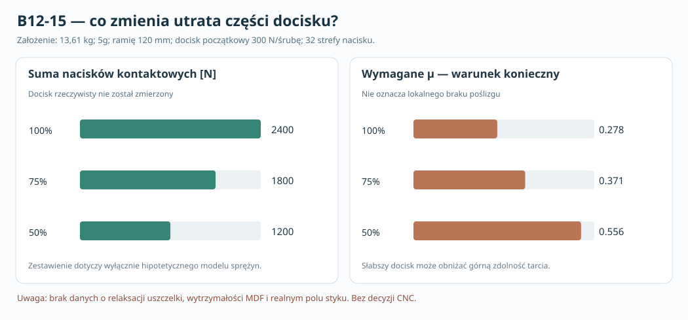

# B12-15 — rozkład nacisku i wrażliwość na utratę docisku

**3 listopada 2026 · wykonano 2916 obliczeń i 100 niezależnych sprawdzeń SciPy · brak pomiarów · NIE CNC.**

## Cel i relacja do podręcznika

Ten raport jest **szczegółowym aneksem badawczym**, a nie kolejnym obowiązkowym rozdziałem praktycznego README. Główny przewodnik prowadzi od wyboru przetwornika przez geometrię, litraż, mocowanie, DSP do prototypu. Poprzednie B12-14 badało osiem współpołożonych sprężyn śrub i nacisku. Tutaj **zwiększamy liczbę zastępczych obszarów kontaktu** i sprawdzamy wrażliwość na niejednorodność docisku, rozdzielczość oraz zadany spadek wstępnego zacisku.

**Źródła nominalne:** [producent Dayton RSS390HF-4](https://daytonaudio.com/product/126/rss390hf-4-15-reference-hf-subwoofer-4-ohm) i [rysunek wymiarowy](https://www.daytonaudio.com/images/resources/295-468-dayton-audio-rss390hf-4-specifications-46176.pdf): 30 lb (13,6078 kg), kołnierz Ø388,4 mm, wycięcie Ø355,8 mm, oś śrub Ø368 mm. **Nie znamy fizycznego pola kontaktu uszczelki.**

## Model i jego ograniczenia

Kołnierz jest sztywną płytą o trzech uogólnionych stopniach swobody (przemieszczenie osiowe i dwa przechyły). Osiem sprężyn śrubowych działa wyłącznie na rozciąganie; N=8,16,32 niezależnych sprężyn kontaktowych działa wyłącznie na ściskanie. Normalne siły B_i i C_j wynikają z:

\[
B_i=\max(0,P_{\rm eff}+k_b q_i u),\qquad
C_j=\max(0,C_{j0}-k_{cj} Q_j u).
\]

Tu q_i to punkty śrub R_b=184 mm, Q_j to środki sektorów kontaktu na referencyjnym promieniu 186,05 mm. P_eff=P_0·r jest przyjętą pozostałością docisku, a sum_j C_j0=8P_eff. Przyrosty stanu rozwiązano tłumionym Newtonem z kontrolą 3 równań równowagi.

Cały **hipotetyczny** pierścień pomiędzy R=177,9 a 194,2 mm daje pole zastępcze **19 054,48 mm²**. Dzielenie siły na sektor przez A/N daje **wskaźnik modelowego nacisku N/mm², NIE rzeczywisty nacisk MDF**, ponieważ faktyczna uszczelka, otwory i sztywność kosza mogą kontaktować tylko część pierścienia. Ponadto kontakt dzielimy na *niepołączone* elementy sprężyste — nie jest to ciągły model MES.

**Przyjęte, a nie zmierzone parametry:** k_b=200 N/mm na śrubę; referencyjne k_c=500 N/mm dla 1/8 pierścienia (dla N sektorów proporcjonalne do 8/N); mnożnik k_c=0,5/1/2; umowna koncentracja początkowego nacisku przy osiach śrub κ=0/3/12; docisk początkowy P_0=100/300/600 N na śrubę; zachowana jego część r=1/0,75/0,5; obciążenie 1/5/10g; ramię 80/120 mm; siła X/Z.

**Uwaga o czasie:** r=0,5 to zadane zmniejszenie docisku, a NIE obliczony czas relaksacji uszczelki, pełzania MDF czy starzenia gwintu. Nie wolno podawać czasu do utraty połowy docisku. Nie wolno wyznaczać z tych liczb momentu dokręcenia.

## Wyniki wykonanych 2916 analiz

Iloczyn: 3 rozdzielczości × 3 koncentracje × 3 podatności × 3 poziomy P_0 × 3 poziomy zachowanej siły × 3 przyspieszenia × 2 ramiona × 2 kierunki = **2916**. W każdym przypadku bilans sił normalnych i dwóch momentów miał residuum poniżej 10⁻⁶ N w przeskalowanym układzie. **468 przypadków** miało co najmniej jeden obszar kontaktu z naciskiem równym zeru. To wynik siatki, a nie częstość uszkodzeń lub prawdopodobieństwo.

Wybrany przykład: 13,6078 kg, umowne 5g, ramię 120 mm, P_0=300 N/śrubę, k_c=500 N/mm na ósmą część pierścienia, N=32 i koncentracja κ=0.

| Zachowana część docisku P_0 | Suma ściskania ΣC [N] | Otwarty kontakt | Wymagany µ w globalnym warunku tarcia | Maks. wskaźnik nacisku [N/mm²] |
|---|---:|---:|---:|---:|
| 100% | 2400 | 0/32 | 0,278 | 0,1584 |
| 75% | 1800 | 0/32 | 0,371 | 0,1269 |
| 50% | 1200 | 0/32 | 0,556 | 0,0954 |

Spadek wstępnego docisku o połowę podwaja **wymagane µ dla globalnej sumy tarcia**, choć w tym przykładzie żaden kontakt modelowy nie otwiera się. Jednocześnie względna koncentracja lokalnego nacisku (maksimum / średnia) rośnie z **1,258** do **1,516**. Nie jest to ocena fizycznej wytrzymałości MDF.

**Nierówny rozkład nacisku:** przy r=100%, N=32, κ=12, maksymalny wskaźnik wzrasta z 0,15842 do **0,17575 N/mm²** (około **10,9%**), choć ΣC=2400 N i globalne µ=0,278 się nie zmieniają. Pokazuje to ograniczenie sprawdzania tylko sumy tarcia, która nie dostrzega lokalnych koncentracji.

**Rozdzielczość przy słabszym docisku:** dla P_0=100 N, zachowaniu 50%, 5g i e=120 mm, κ=0: model N=8 daje **3/8** sektorów otwartych, N=16 **5/16**, a N=32 **11/32**. Brak monotonicznej zbieżności udziału otwartej powierzchni oznacza, że **nie wolno uznać nawet N=32 za zwalidowaną siatkę ciągłego styku**.

## Kontrole numeryczne

W pełnym kontakcie i równomiernym zacisku istnieje niezależne rozwiązanie analityczne dla maksymalnej siły w śrubie:

\[
B_{\max}=P_{\rm eff}+\frac{k_b F e/R_b}{4k_b+4k_c(R_c/R_b)^2}.
\]

Dla P_eff=300 N, 5g, 120 mm model daje **330,592664 N** dla N=8/16/32. Test jest w programie. Niezależny kod SciPy (solver wyznaczania pierwiastków układu równań), stosujący inną implementację residualu, sprawdził deterministyczną próbkę **100 scenariuszy** (ziarno 20261103): maksymalna różnica uogólnionego przemieszczenia **1,12·10⁻¹³ mm**. To wyłącznie kontrola numeryczna.

[Program odtwarzający 2916 przypadków](../skrypty/b12_15_nacisk_rozproszony.py) · [manifest i wyniki referencyjne](../wyniki/b12_15_podsumowanie.json) · [wykres](../wyniki/b12_15_relaksacja_nacisku_NIE_CNC.svg) · [regresja automatyczna](../.github/workflows/b12-15-regression.yml). Program generuje pełny JSON scenariuszy i manifest SHA-256; duży JSON nie jest pomiarem i nie musi być przechowywany na stałe w git.

## Co naprawdę przybliża pierwszą budowę?

**Nie rekomenduję automatycznego uruchamiania B12-16 jako kolejnej serii abstrakcyjnych sprężyn.** B12-09–15 już pokazują, jak niepewność geometrii, sztywności i docisku wpływa na model, ale **bez fizycznych danych nie sposób zweryfikować wyboru nośnika mocowania**.

Następna realnie rozstrzygająca praca: uzyskać autentyczny kształt kosza z zaciskami i wymiary wymaganych prześwitów; rozpisać **dwie konkretne ścieżki sił** (osiem lokalnych punktów albo rama A) oraz kolejność montażu i serwisu; przetestować próbki rzeczywistego MDF, kleju, wkładek i docisku. Dopiero po takich testach kwalifikować do CNC. Równolegle domknąć konstrukcję obudowy 100/120/150 l, szczelność, limit kompletnej głębokości **500 mm**, elektroniki klasy D i DSP.

**Bramka CNC: HOLD. Nie wykonano próbek ani nie zbudowano prototypu. Nie ma podstaw do nadania wartości bezpiecznego docisku, momentu śruby, siły niszczącej lub do wyboru ramy wyłącznie z tych obliczeń.**
