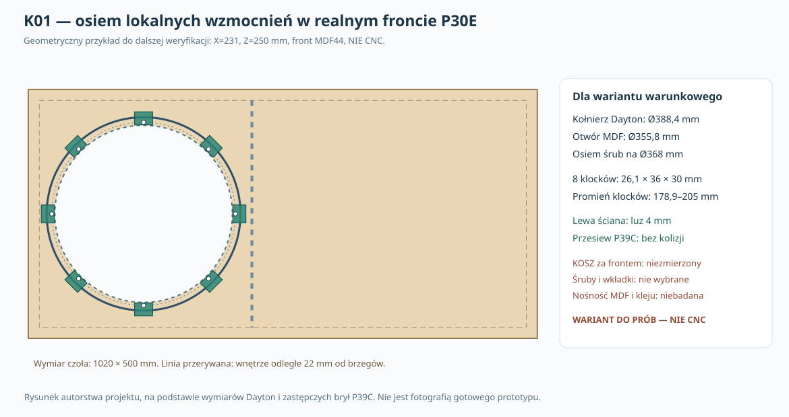

# K01 — konstrukcyjny punkt kontrolny: osiem lokalnych mocowań, litraż i pełna głębokość

**3 listopada 2026. Badanie numeryczne prowadzące do pierwszej konstrukcji, nie dodatkowa seria abstrakcyjnych modeli. Status: WYBRANO GEOMETRYCZNY KANDYDAT DO PRÓB; NIE CAD KOSZA, NIE NOŚNOŚĆ, NIE CNC.**

## Pytanie i zakres dowodów

Czy w dotychczasowej obudowie **1020 × 425 × 500 mm**, ze stałym frontem MDF **44 mm**, głośnikiem **Dayton RSS390HF-4** na osi **X=231/Z=250 mm** i pierwszą wręgą od X=448 mm, można rozmieścić **osiem lokalnych wzmocnień** bez automatycznego przejścia na obszerną stalową ramę? Oraz jaki jest rzeczywisty wpływ *tego jednego rozwiązania* na objętość i budżet maksymalnej głębokości urządzenia?

Źródła: [P30E — obudowa, mata 50 mm, 20 modułów i litraże](078_P30E_mata50_montaz_robustnosc.md), [P31C — bramki konstrukcji](../dokumentacja/P31C_koncepcja_konstrukcyjna_i_bramki.md), [P39C — zastępczy korpus 3D](../dokumentacja/P39C_front_korpus_pierscien_REFERENCYJNY_NIE_CNC.scad), [wymiary RSS390HF-4 producenta](https://www.daytonaudio.com/images/resources/295-468-dayton-audio-rss390hf-4-specifications-46176.pdf). Producent podaje Ø388,4 kołnierza, Ø355,8 wycięcia, osiem Ø6,5 otworów na PCD Ø368 i głębokość 178 mm. **Nie podaje pełnego przestrzennego obrysu żeber, zacisków, śrub ani danych nośności połączenia MDF.** Rysunek nie jest kompletną bryłą CAD.

## 1. Konstrukcyjny kandydat — nie zatwierdzenie mocowania

**Pozostawiono X=231 mm**, aby nie zmieniać uzgodnionego położenia głośnika, bilansu objętości, wręg i planu badań akustycznych. Wariant do sprawdzenia ma następującą **hipotetyczną geometrię**:

| Element | Wariant K01 |
|---|---|
| Liczba lokalnych wzmocnień | 8, rozmieszczonych co 45° na osiach śrub |
| Materiał / konstrukcja | jedynie zastępcza bryła „klocek” — rzeczywisty MDF/sklejka/spoina nie wybrane |
| Promień wewnętrzny / zewnętrzny klocka | 178,9 / 205 mm |
| Długość promieniowa / szerokość styczna | **26,1 / 36 mm** |
| Głębokość bloku za płaszczyzną Y=44 | **30 mm** (Y=44–74) |
| Prześwit geometryczny do lewej ściany X=22 | **4 mm** |
| Modelowy wymagany luz do zastępczych ścian i wręg | **2 mm** |
| Prześwit rzutu klocka do krawędzi otworu Ø355,8 | **1 mm** |
| Objętość wszystkich ośmiu brył wewnątrz skrzyni | **0,225504 l** |

To jest **wskazanie kandydata do dalszej walidacji i makiety**, nie docelowy wymiar klocka do wycinania. Osiągnięcie 2 mm umownego luzu nie gwarantuje, że zrealizujemy połączenie klejone, wkładkę, jej wkręcenie i dostęp narzędzia. Przy wymogu **6 mm zapasu** kandydat o X231/R205 **odpada** ze względu na 4 mm do lewej ściany. Nie należy tego ograniczenia ukrywać. Wariant X235 (przesunięcie głośnika) miał w siatce korzystniejsze prześwity, ale jest **niesprawdzoną zmianą układu całej obudowy**, więc nie wprowadzono jej jako decyzji.

**Rzeczywisty kosz:** promień wycięcia r=177,9 mm nie oznacza promienia żeber przy Y=44–74. Potrzebna jest trójwymiarowa obwiednia kosza, terminali i przewodów. Cztery śruby na osi żeber wymagają osobnej kontroli od czterech między nimi. Nie ma zweryfikowanego prześwitu do kosza ani rzeczywistej ścieżki pracy wkrętaka.

### Pas drewna przy wkładce — najpoważniejsza niewiadoma konstrukcyjna

Dla modelowego promienia wewnętrznego klocka R_i=178,9 mm i osi śruby R_b=184 mm pas od hipotetycznej **zewnętrznej** tulei/wkładki do wewnętrznej krawędzi klocka wynosi:

\[
w=184-R_i-d_{\rm zewn.\ wkładki}/2.
\]

| Hipotetyczna zewnętrzna średnica wkładki | Pozostający pas drewna | Czy przechodzi *umowny* próg 2 mm? |
|---|---:|---|
| Ø6 mm | **2,1 mm** | tak |
| Ø8 mm | **1,1 mm** | nie |
| Ø10 mm | **0,1 mm** | nie |

**Ten próg nie jest normą nośności drewna.** Nie wykazano, że nawet Ø6 mm jest wystarczającą, realnie produkowaną wkładką dla wybranego gwintu, montażu i obciążeń. Otwory Ø6,5 mm w kołnierzu **nie wyznaczają** średnicy wiercenia w MDF ani średnicy wkładki. Nie dobierać śrub na podstawie tabeli.

## 2. Wykonane testy geometryczne, a nie kolejna analiza sprężyn

Niezależnie przeliczono **480** kombinacji: X głośnika 231/235 mm, R_i 178,9/180 mm, R_o 200/203/205/207/211 mm, szerokość 24/36/48 mm, głębokość 20/30 mm oraz wymagany luz do przeszkód 0/2/4/6 mm. Osiem klocków miało przekroje wielokątne, testowane metodą **twierdzenia o osiach rozdzielających (SAT)** wobec zastępczych paneli/wręg P39C. Kolizja wymagała również wspólnego zakresu głębokości Y.

| Założony minimalny luz do uproszczonych przeszkód | Układy z ośmioma klockami bez kolizji |
|---|---:|
| 0 mm | **108/120** |
| 2 mm | **108/120** |
| 4 mm | **84/120** |
| 6 mm | **72/120** |

**Liczności scenariuszy nie są prawdopodobieństwami powodzenia**. Dla luzu 2 mm wariant X231 przeszedł 48/60 porównań, zaś X235 — 60/60; wynik zależy od arbitralnego zbioru brył. Dla R_o=205 i X231 uzyskano prześwit do lewej ściany 4 mm, a przy R_o=211 pojawiają się kolizje z tym panelem.

**Kontrola niezależna:** wszystkie 480 konfiguracji, w tym osiem obróconych wielokątów i aktywne przeszkody, porównano osobno z obliczeniami przecięć Shapely 2.1.2; **480/480** zgadza się z implementacją SAT dla dodatniego pola przecięcia. To test poprawności obliczeń tych uproszczonych brył, nie walidacja rzeczywistego kosza.

Dodatkowo każdy klocek zaczyna się od R_i>177,9 mm, więc nie zasłania w **rzucie 2D** kołowego otworu przeznaczonego do wprowadzenia głośnika i modułów. Nie znaczy to, że manipulator, wkład, ręka czy narzędzie przejdą fizycznie **w całym przebiegu ruchu 3D**.

## 3. Bilans objętości netto — zachować rzeczywiste 100/120/150 l

W P30E wybrano nominalne stany **100,12 / 119,92 / 150,16 l**, zależne od 20 modułów regulujących i wyporności przyjętych w tamtym modelu. Dla ośmiu klocków z powyższej geometrii otrzymano **0,225504 l** zajętej objętości.

| Wariant P30E | Jeśli klocków nie uwzględniono wcześniej: nowe modelowe netto |
|---|---:|
| 100,12 l | **99,8945 l** |
| 119,92 l | **119,6945 l** |
| 150,16 l | **149,9345 l** |

**Warunek krytyczny:** to delta tylko w przypadku, gdy te wzmocnienia **nie są już ujęte** w źródłowym bilansie. P39C zawierał również *alternatywny, zastępczy pierścień* OD400/ID356/grubość4 mm o objętości ok. **0,104502 l**. Jeśli realnie **zastępujemy** ten pierścień ośmioma klockami, dodatkowa wyporność netto wynosi ok. **0,121002 l**, nie sumę obu elementów. P30E i P39C nie stanowią jeszcze jednej uzgodnionej listy materiałów. **Nie dodawać jednocześnie obu wariantów do BOM.**

Zmiana około 0,12–0,23 l jest niewielka wobec dotychczasowego stresu objętości P30E (kilka litrów), lecz trzeba ją ująć w końcowym jednoznacznym zestawieniu części, by nie powielać błędów. Nie udowadnia też samodzielnie poprawnego działania wszystkich 20 wkładów regulacyjnych.

## 4. Bilans pełnej głębokości, nie tylko skrzyni

Korpus ma D=425 mm; limit **500 mm dotyczy całego urządzenia**, razem z osłoną, tylnymi złączami, przewodem i tolerancjami. Zbadano **48 scenariuszy** wystawania osłony z przodu 25/36/45/55 mm, tylnego osprzętu 10/20/30/40 mm oraz nieprzydzielonej rezerwy 0/5/10 mm.

| Umowna osłona przód + terminal tył + rezerwa | Łączny obrys | Zapas do 500 mm |
|---|---:|---:|
| 36 + 20 + 0 mm, odniesienie P30E | **481 mm** | **19 mm** |
| 36 + 20 + 10 mm | 491 mm | 9 mm |
| 45 + 30 + 5 mm | **505 mm** | **−5 mm: odrzucony** |
| 55 + 40 + 10 mm | **530 mm** | **−30 mm: odrzucony** |

**26/48** scenariuszy zachowało *dodatni* zapas; zero nie zostało zaliczone do zapasu. Wszystkie wymiary osłony, terminala, tolerancji i prowadzenia przewodu są **hipotetyczne**; bez realnych komponentów nie mamy zatwierdzonej całkowitej głębokości. Gdy od głośnika i ewentualnej osłony fizycznie odstają części, muszą być wliczone do obrysu. Rozwiązanie lokalnych klocków nie zwalnia z tego warunku.

## 5. Droga montażu i serwisowania pierwszej sztuki — plan do fizycznej walidacji

Proponowana kolejność weryfikacji **przed produkcją**, z wariantami lokalnymi i ramowym porównanymi uczciwie:
1. Zweryfikować na konkretnym RSS390HF-4 *geometrię* wszystkich ośmiu osi, żeber, zacisków i zewnętrznego kołnierza; kontrolować różne fazy orientacji **całego** głośnika względem obudowy, nie mylić z niezmienną fazą żeber względem śrub.
2. Wykonać pełnowymiarowy kartonowy/szablonowy test obrysu frontu i klocków **bez wiercenia docelowego MDF i bez zatwierdzenia CNC**; porównać skręcenie od przodu, tor narzędzia, wprowadzenie głośnika i wentylację.
3. Zbudować i przetestować próbki rzeczywistego połączenia (MDF44 + klej + klocek + wkładka/śruba) oraz **alternatywną ramę** z całym łańcuchem rzeczywistych złączy. Testować wyrywanie, ścinanie, odrywanie, obrót wkładki, pełzanie i cykle demontażu. Liczby dopuszczalne wprowadzić dopiero z pomiarów.
4. Przed zamknięciem korpusu przetestować suchy montaż i odzyskiwanie mocowań, zwłaszcza obracającej się wkładki, oraz pozycje i dojazd dwóch wręg. Dopiero wtedy ustalić sposób złożenia stałego frontu.
5. Powtórzyć **próby wprowadzenia 20 modułów** regulacji P30E przez faktyczny otwór i pomiędzy *nowymi rzeczywistymi* wzmocnieniami wraz z uchwytami i narzędziami; wynik „20/20 przy 6 mm” z P30E **nie obejmuje nowych brył i nie jest automatycznie zachowany**.
6. Po ustaleniu kompletnej listy brył ponownie wykonać bilans objętości, sprawdzić głębokość ≤500 mm z dodatnią rezerwą i obie orientacje pion/poziom oraz drogę wentylacji, zasilanie i DSP.

**Nie kupowano materiałów, nie wybrano gwintu ani wartości dokręcenia, nie ma prototypu.**

## 6. Decyzja ograniczająca mnożenie badań

**Kierunek konstrukcyjny K01:** zachować obudowę P30E i dotychczasową oś X231; potraktować **osiem lokalnych klocków** jako **pierwszego kandydata do rzeczywistego sprawdzenia**, nie jako wybrany bezpieczny materiałowy projekt. Rama A jest wariantem rezerwowym, jeśli realne prześwity, mocowania, wygoda serwisu albo testy wytrzymałościowe wykażą problem. Wariant pozycjonowania X235 pozostaje odrębną zmianą, nie zatwierdzoną wyłącznie na podstawie ekranu geometrii.

**Nie uruchamiać następnych abstrakcyjnych badań kontaktowych bez nowej informacji materiałowej.** Najbliższy krok naprawdę rozstrzygający to **zweryfikowanie kosza, opracowanie jednego szczegółowego połączenia do prób i prototypowanie materiałowe złączy**, przy równoległym sprawdzeniu pełnej ścieżki montażu modułów. Do tego momentu **CNC HOLD, brak finalnego BOM i brak zgody na produkcję**.

## 7. Reprodukcja

[Python 3 — komplet siatki 480 przypadków, objętość i głębokość](../skrypty/k01_mocowanie_bilans.py) · [Podsumowanie danych](../wyniki/k01_podsumowanie.json) · [Autorski szkic konstrukcyjny](../wyniki/k01_osiem_klockow_front_NIE_CNC.svg) · [Regresja K01](../.github/workflows/k01-konstrukcja-regression.yml).

Uruchomienie: `python3 skrypty/k01_mocowanie_bilans.py`. Skrypt generuje pełen zestaw 480 + 48 scenariuszy i manifest kontrolny SHA-256; wartości bazowe, geometrie i liczniki mają asercje. Wariant K01 nie zastępuje wcześniejszych wyników B12 i P30; **nowa dokumentacja pozostaje w raporcie, a w głównej ścieżce README jedynie krótki wniosek konstrukcyjny**.
