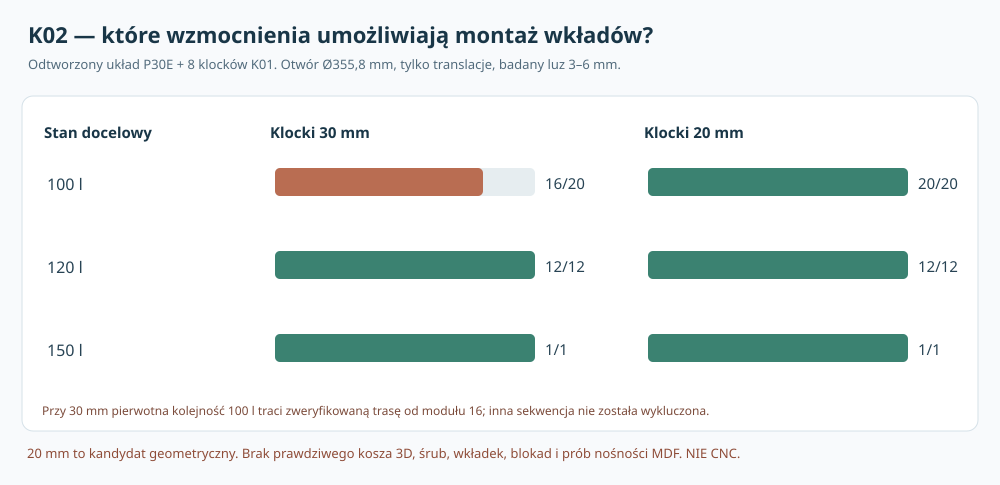

# K02 — czy 20 modułów objętości przejdzie obok ośmiu lokalnych wzmocnień?

**3 listopada 2026 · weryfikacja integracji P30E + K01 · wykonane trasowanie translacyjne z wejściem z ZEWNĄTRZ · bez fizycznego prototypu · NIE CNC.**

## 1. Problem konstrukcyjny

K01 zaproponował osiem prostych lokalnych klocków w strefie tylnej frontu **MDF 44 mm**, o przekroju radialnym 178,9–205 mm, szerokości stycznej 36 mm i **głębokości 30 mm**. Nie sprawdzono wtedy ich wpływu na **przemieszczanie wszystkich wkładów** objętościowych, a P30E wcześniej raportował 20/20 *bez ośmiu nowych klocków*. W K02 zintegrowano obie geometrie, aby nie wybierać montażu śrub kosztem utraty regulacji 100/120/150 l.

Zachowano **cały korpus P30E**: szerokość 1020 mm, głębokość 425 mm, wysokość 500 mm, front 44 mm, reszta ścian 22 mm, **oś głośnika X231/Z250 mm**, dwie uproszczone wręgi i tylną matę 50 mm. Nie przesuwamy głośnika ani wręg wyłącznie dlatego, że trasa bazowa P30E uległa kolizji.

## 2. Rzeczywiste dane producenta i model

[Dayton Audio RSS390HF-4 — oryginalna karta](https://www.daytonaudio.com/images/resources/295-468-dayton-audio-rss390hf-4-specifications-46176.pdf) potwierdza zewnętrzny kołnierz Ø388,4 mm, wycięcie montażowe Ø355,8 mm, osiem otworów Ø6,5 na Ø368 mm, nominalną głębokość 178 mm i cztery główne żebra w rzucie od tyłu. **Dokument NIE zwymiarowuje kosza jako pełnej funkcji 3D, położenia obwiedni terminali, ścieżek śrub ani potrzebnych prześwitów rzeczywistych narzędzi.** Nie odnaleziono potwierdzonego fabrycznego pliku STEP dla dokładnie tej rewizji RSS390HF-4. Ta obserwacja o dostępności nie dowodzi, że taki plik u producenta nie istnieje.

Wymiary 20 wkładów w modelu P30E, z repozytoryjnego [skryptu P30E](../skrypty/p30e_mat50_geometria_montaz.py):
- **16 dużych**, w tym osiem „tylnych” 210×120×100 mm i osiem „przednich” 210×150×100 mm;
- **cztery małe** 180×100×100 mm;
- orientacyjne konfiguracje: **100 l = 16 dużych + 4 małe**, **120 l = 12 dużych**, **150 l = jeden duży**.

To zamknięte bryły AABB bez zatrzasków, okuć, kleju, przewodów, rąk i narzędzi. Przeniesiono bez zmian ich pozycje i kolejność dodawania z P30E, nie tworzono arbitralnego nowego rozmieszczenia.

## 3. Jak zweryfikowano rzeczywiste wejście przez otwór?

P30E w swojej funkcji planowania rozpoczynał drogę **już we wnętrzu**: lokalny środek modułu (209,105,228) mm przy osi od lewej/frontu/dna *wewnętrznej* przestrzeni. Wcześniejszy test nie zawierał przejścia przez płytę frontową grubości 44 mm. **K02 dodaje ten brakujący odcinek**: środek modułu umieszcza najpierw całkowicie przed zewnętrzną powierzchnią frontu, prowadzi go osiowo przez kołowy otwór Ø355,8, aż do poprzedniego wewnętrznego punktu startowego, i kontroluje ciągłą obwiednię bryły modułu.

Dla największej przekrojem bryły 210×100 mm w płaszczyźnie frontu oraz umownego nadmiaru 6 mm na stronę, półprzekątna wynosi **√(111²+56²)=124,34 mm**. Przy promieniu wycięcia **177,9 mm** pozostaje **53,57 mm** zapasu do okręgu (dotyczy tylko *środka prowadzonego centralnie* i prostokątnego obrysu modułu, nie ręki czy uchwytu). Przy luzie 3 mm zapas wynosi **57,60 mm**. Dodatkowo sprawdzono kolizje odcinka wejściowego z już ustawionymi modułami, wręgami, matą i ośmioma nowymi klockami. **Głośnik musi być przy tym wymontowany.**

Wewnątrz obudowy wykorzystano rzeczywisty [algorytm P30A](../skrypty/p30a_robust_geometry.py) oraz ustawienia [P30E](../skrypty/p30e_mat50_geometria_montaz.py). Każdy odcinek oryginalnej trasy zweryfikowano jako objętość przemieszczającego się prostopadłościanu, przeciętą z ośmioma klockami w formie **obróconych w X/Z wielokątów** K01 z równoczesnym nakładaniem przedziałów Y. Gdy bazowa trasa była zablokowana, obliczono *nową* trasę omijającą konserwatywne prostokątne obwiednie klocków, po czym ponownie skontrolowano dokładniejsze wielokąty i pozostałe przeszkody.

**Weryfikacja ograniczona:** planer szuka wyłącznie tras translacyjnych o skokach prostopadłych, na skończonym zbiorze węzłów. Gdy nie potrafi znaleźć trasy, nie dowodzi to globalnej niemożliwości dla obrotów i innej kolejności; sukces dowodzi jedynie możliwości w przyjętym *zastępczym* modelu 3D.

## 4. Wynik konstrukcyjny: skrócenie klocka z 30 do 20 mm

Zamiast nieuzasadnionej rozbudowy ramy lub zmiany całej skrzyni zbadano **mniejszą głębokość ośmiu wzmocnień**. Pozostałe parametry K01: R_i=178,9, R_o=205, szerokość=36, środek głośnika X231/Z250 — **bez zmian**.

| Stan objętości | Moduły | Klocki 30 mm, oryginalna kolejność z ponownym szukaniem tras | Klocki 20 mm, ta sama kolejność |
|---|---:|---:|---:|
| 100 l | 20 | **16/20** — nie odnaleziono korytarza dla modułu 16 | **20/20** |
| 120 l | 12 | **12/12**, konieczne 4 objazdy | **12/12** |
| 150 l | 1 | **1/1** | **1/1** |

Wszystkie trzy stany skontrolowano dla **3 i 6 mm** luzu; 100 l również przy 5 mm. Razem **14 odrębnych przebiegów** z ośmioma klockami. Wariant 20 mm przeszedł **7/7 przebiegów**, a 30 mm **4/7**; dla 30 mm trzy nieprzejścia wystąpiły w stanie 100 l przy 3/5/6 mm. Łącznie skontrolowano pozycje i drogi **160 modułów** w udanych częściach kampanii; jest to suma etapów wielokrotnie odtwarzanych w różnych scenariuszach, a nie liczba osobnych modułów wyprodukowanych. Dla 100 l z klockami 20 mm wymagano tylko **jednego objazdu** w każdym z trzech sprawdzeń.

**NIE stwierdzono niemożliwości montażu klocków 30 mm w ogóle.** Nie przebadano wszystkich alternatywnych kolejności, obrotów, uchwytów ani układu zamków. Prawdziwe części mogą zostać zamontowane inaczej. **Znaleziono natomiast prostszy wariant 20 mm, który przechodzi w niezmienionej kolejności P30E**, i to jest konkretne uzasadnienie warunkowej rekomendacji geometrycznej.

## 5. Co skrócenie klocka zmienia — i czego nie poprawia?

| Cechy klocków K01 | Głębokość 30 mm | Głębokość 20 mm |
|---|---:|---:|
| Wspólny promień wewnętrzny/zewnętrzny | 178,9–205 mm | 178,9–205 mm |
| Szerokość w X/Z | 36 mm | 36 mm |
| Łączna zajęta objętość ośmiu brył | 0,225504 l | **0,150336 l** |
| Uwolniona objętość wobec 30 mm | — | **0,075168 l** |
| Prześwit do lewej ściany wewnętrznej P39C | 4 mm | **4 mm — bez poprawy** |
| Prześwit do realnych żeber/terminali | NIEZMIERZONY | **NIEZMIERZONY** |
| Możliwość zastosowania realnej wkładki i długości śruby | NIEPOTWIERDZONA | **NIEPOTWIERDZONA** |
| Nośność spoiny i MDF | NIEPOTWIERDZONA | **NIEPOTWIERDZONA** |

**Mniej gruby klocek to również mniejsza powierzchnia boczna i możliwy krótszy tor zakotwienia.** Nie wolno uznać 20 mm za bezpieczne mocowanie tylko dlatego, że moduły je omijają. Dodatkowo promień osi śruby 184 mm i promień wewnętrzny klocka 178,9 mm pozostawiają jedynie **1,1 mm do wewnętrznej krawędzi przy hipotetycznej wkładce o zewnętrznym Ø8 mm**. To parametr, którego modyfikacja głębokości nie naprawia; rzeczywisty zespół łącznika i wymagany pas drewna muszą zostać wybrane na podstawie prób.

Główna bramka objętości: P30E 100,12/119,92/150,16 l wymaga korekty **o 0,150336 l**, jeżeli wypełnienia nowych klocków jeszcze nie uwzględniono w bilansie. Jeżeli w projekcie istnieje zastępczy pierścień P39C, należy zdecydować, czy jest on *zastępowany*, a nie podwójnie odliczać oba elementy. **Bez spójnego BOM i potwierdzonej wyporności przetwornika nie ma gotowego litrażu CNC.**

## 6. Rysunek 3D i protokół próbek

- [Edytowalna makieta OpenSCAD K02](../dokumentacja/K02_p30e_moduly_8_klockow_REFERENCYJNE_NIE_CNC.scad): parametry **state_liters = 100/120/150** i **pad_depth = 20/30**. Zawiera pozycje 20 brył i klocków; *nie jest realnym CAD Daytona*, nie obejmuje zamków i przewodów. Wizualizacja jest źródłową konstrukcją referencyjną, nie pokazuje wykonanego prototypu.
- [Karta pomiarowa i prób konkretnych połączeń](../dokumentacja/K02_protokol_pomiarow_kosza_i_probek_zlacz.md) — porównanie dwóch głębokości na rzeczywistym MDF44, uzupełnienie R_b(y,θ), śrub, wkładek, dostępów, relaksacji docisku i cykli demontażu.

**Nie wykonano tych prób fizycznie.** Brak danych nośności, kleju, lokalnej sztywności, gwintów, prześwitów wkrętaka i rzeczywistych zespołów. Weryfikacja zewnętrznego obrysu **≤500 mm** także pozostaje z K01 otwarta dla rzeczywistej maskownicy i terminali.

## 7. Rozstrzygnięcie etapu K02

**Do dalszej konstrukcji przyjąć wyłącznie jako wariant badawczy** osiem lokalnych wzmocnień **26,1 × 36 × 20 mm**, bez przesuwania głośnika X231/Z250 mm, w obudowie P30E 1020×425×500. Ma to **udokumentowaną dodatnią przewagę w dostępie do 20 wkładów**, ale **żadnego udokumentowanego współczynnika bezpieczeństwa** i tylko 4 mm do lewej ściany.

Następne właściwe działanie: uzyskać realną geometrię kosza i terminali, dobrać jeden konkretny system połączeń w MDF i wykonać próbki wariantu 20 mm oraz kontrolnego 30 mm, by określić bezpieczeństwo, serwis i wymaganą głębokość zakotwienia. Jeśli 20 mm jest niewystarczające mechanicznie, **wrócić do rozmieszczenia lub kolejności modułów / innego złącza**, nie deklarować z góry konieczności masywnej ramy.

**CNC: HOLD. Produkcyjny CAD: NIE. Przetwornik fizycznie zmierzony: NIE. Nośność MDF/spoin/gwintów: NIE.**

## 8. Reprodukcja i ślad audytu

[Skrypt K02 odtwarzający geometrię P30E i K01](../skrypty/k02_dostep_modulow_i_klocki.py) · [GitHub Actions K02](../.github/workflows/k02-moduly-assembly.yml) · [schemat wyników](../wyniki/k02_trasy_20_vs_30_moduly_NIE_CNC.svg).

Wymagane zależności: NumPy i **oryginalne** repozytoryjne skrypty `p30a_robust_geometry.py`, `p30e_mat50_geometria_montaz.py`, `k01_mocowanie_bilans.py`. Uruchomienie `python3 skrypty/k02_dostep_modulow_i_klocki.py` generuje `wyniki/k02_moduly_przejscia_pelne.json` (pełne 14 przebiegów z adnotacjami o każdej ścieżce) i manifest SHA-256. Nie zmieniono pierwotnego P30E ani historycznych wyników K01; nowe trasy są **własnym uzupełnieniem**, a nie retroaktywnym poprawieniem starego modelu.
