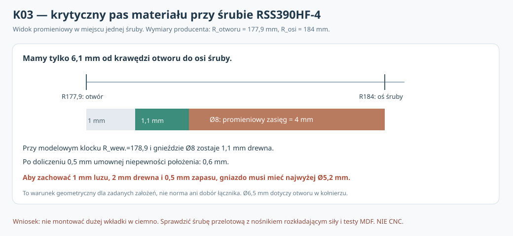

# K03 — decyzja o sposobie zakotwienia RSS390HF-4: wąski pas MDF i rzeczywisty tor siły

**3 listopada 2026 · badanie konstrukcyjne przygotowujące konkretny węzeł do prób · 162 warunkowe sprawdzenia wymiarów · NIE fizyczny pomiar, NIE kwalifikacja CNC.**

## Dlaczego K03, a nie kolejna symulacja sprężyn?

[K02](K02_przejscie_20_modulow_obok_8_mocowan.md) wykazał, że przy ośmiu lokalnych klockach o **głębokości 20 mm** zaplanowana sekwencja **20/20 modułów** regulacji 100 l przechodzi przez otwór Ø355,8 w uproszczonej geometrii P30E. To zmieniło decyzję o **gabarycie wzmocnień**, ale nie dało prawa wyboru łącznika. Teraz trzeba rozstrzygnąć, **jak siła z ośmiu otworów kołnierza przejdzie do MDF/wręg**, przy czym blisko krawędzi otworu nie ma miejsca na dowolnie dużą wkładkę.

## Źródła pierwotne i liczba, której nie można obejść

Producent [Dayton Audio RSS390HF-4, karta 295-468](https://www.daytonaudio.com/images/resources/295-468-dayton-audio-rss390hf-4-specifications-46176.pdf) podaje:
- kołnierz Ø388,4 mm;
- wycięcie montażowe **Ø355,8 mm**, promień R_cut=177,9 mm;
- **osiem otworów Ø6,5 mm** w kołnierzu na PCD **Ø368 mm**, promień osi R_bolt=184,0 mm;
- grubość kołnierza 10,5 mm.

Z tych samych wymiarów wynika **odległość promieniowa osi śruby od krawędzi wycięcia dokładnie 6,1 mm**. Nie jest to wymiar zapasu drewna po wierceniu. Nie należy utożsamiać Ø6,5 w metalowym koszu z wybranym otworem, wkrętem lub wkładką w MDF.

Dodatkowe zewnętrzne źródło: [European Panel Federation — Screwing MDF](https://mdf-info.eu/using-mdf/fixing/screwing). Jako **ogólną** wskazówkę dla wkrętów osadzanych w *powierzchni* MDF podaje odległość osi od krawędzi około **co najmniej 12 mm** i podkreśla znaczenie otworów prowadzących oraz rodzaju wkręta. Nasze **6,1 mm do kołowej krawędzi** są znacznie mniejsze. **Nie wolno traktować tego ogólnego zalecenia jako normowego zakazu dla specjalnie wzmocnionego połączenia przelotowego ani wyprowadzać z niego dopuszczalnej nośności.** Jest jednak silnym argumentem przeciw rutynowemu wkręceniu standardowej śruby bez prób w sam MDF44.

## K03: geometryczny warunek dla wkładki w ośmiu klockach

W K02 lokalny klocek ma promień wewnętrzny **R_i=178,9 mm**, a więc pozostawia 1,0 mm nominalnego luzu w *rzucie* względem wycięcia. Śruba ma oś R_bolt=184 mm. Dla gniazda (całkowicie wybranej bryły pod wkładkę, nie otworu w kołnierzu) o zewnętrznej średnicy d, promieniowy pas materiału do wewnętrznej krawędzi klocka wynosi:

\[
w=R_{\rm bolt}-R_i-\frac{d}{2}.
\]

Dla d=6/8/10 mm otrzymujemy **w=2,1/1,1/0,1 mm**. **To nie są kryteria wystarczającej wytrzymałości**. Nie znamy fizycznie dopuszczalnej szerokości pasa dla konkretnego materiału i jego ułożenia oraz rodzaju łącznika.

Dla sprawdzenia **warunkowej tolerancji** przyjmijmy:
- co najmniej g milimetrów między otworem a wewnętrzną krawędzią klocka;
- co najmniej w_min milimetrów pozostającego materiału od gniazda do tej krawędzi;
- dodatkowy budżet niepewności położenia osi/gniazda t (przesunięcie niekorzystne w stronę wycięcia).

Aby spełnić te *samodzielnie zadane* założenia, musi zachodzić:

\[
6,1\ \mathrm{mm} \ge g+\frac{d}{2}+t+w_{\min},
\quad d_{\max}=2(6,1-g-t-w_{\min}).
\]

Na przykład **g=1 mm, t=0,5 mm, w_min=2 mm** pozostawia na średnicę gniazda najwyżej **d_max=5,2 mm**. Dla Ø8 mm pas wynikowy to **0,6 mm**, a nie 2 mm — zatem **wariant gniazda Ø8 NIE SPEŁNIA tych hipotetycznych wymogów geometrycznych**. Nie pomaga wydłużenie klocka wzdłuż osi Y z 20 do 30 mm: brakujące drewno jest przy wewnętrznej krawędzi **w płaszczyźnie XZ**.

Przeliczono **162 kombinacje**: g=0,5/1/2 mm, w_min=1/2/3 mm, t=0/0,5/1 mm oraz d=5/5,5/6/6,5/8/10 mm.

| Średnica gniazda / wybranej bryły d | Spełnia testowane założenia w ... /27 konfiguracjach |
|---:|---:|
| 5 mm | 14/27 |
| 5,5 mm | 10/27 |
| 6 mm | 10/27 |
| 6,5 mm | 6/27 |
| 8 mm | 3/27 |
| 10 mm | 0/27 |

To **miara tego, jak restrykcyjny jest wybrany zakres założeń**, a nie prawdopodobieństwo bezpieczeństwa czy dowód, że Ø10 mm z definicji nigdy nie działa. Niektóre rozwiązania rozkładają obciążenie poza cienkim pasem MDF, a rzut kosza i geometria wkładki mogą się różnić.

**Istotne rozróżnienie:** otwór *przelotowy w froncie MDF44* i otwór *pod wkładkę od tyłu w klocku* nie są tym samym. W samym froncie przy Ø5,5 mm geometryczny pas od krawędzi otworu wyniósłby 6,1−2,75 = **3,35 mm**, przy Ø6,5 mm — **2,85 mm**, przed tolerancjami. Żaden z tych wyników nie dowodzi, że MDF wytrzyma obciążenie na wyrywanie i ścinanie. Sama średnica otworu w kołnierzu nie wybiera przekroju śruby ani jej klasy.

## Konkretne warianty toru siły do fizycznego porównania

| Wariant do próby | Idea rzeczywistego obciążenia | Otwarta bramka |
|---|---|---|
| **N: śruba przelotowa + mechanicznie zabezpieczona tylna nakrętka/nośnik rozkładający siły** | łeb/podkładka na kołnierzu → śruba przez front → tylny mechaniczny element dociskowy → MDF/wzmocnienie | Czy da się zamontować, zablokować i serwisować nakrętkę przy kołowym otworze; czy nie naciska bezpośrednio na cienką krawędź; czy nie blokuje wkładów K02 |
| **S: specjalny wkręt w MDF + lokalne klejone wzmocnienie** | kołnierz → wkręt i ściskanie frontu → rzeczywiste połączenie MDF44/wzmocnienie | Zbyt mała odległość od krawędzi wobec ogólnej wskazówki EPF; rzeczywista siła wyrywania, uszkodzenia przy demontażu, klej |
| **R: wąski metalowy mostek/nośnik lub rzeczywista rama** | osiem śrub → metalowy element rozkładający siły na dalej położone pola MDF/wręgi | Połączenie z prawdziwymi wręgami, dostęp do 20 modułów, gabaryt, kosz i wentylacja |

**Rekomendowana kolejność prób:** najpierw **N** jako sposób uniknięcia problemu polegania wyłącznie na cienkim pasie gwintowanego drewna; równolegle **S** jako prosty wariant kontrolny na próbkach, a **R** jako rezerwa. To **wybór kolejności walidacji**, nie zatwierdzenie nośności i nie zakup konkretnego metalowego łącznika. Wariant N wciąż może być nieprzydatny przez brak dostępu do nakrętki po wklejeniu frontu albo przekazywanie obciążeń na zbyt wąski fragment MDF.

**Osie połączeń muszą pozostać na fabrycznym PCD Ø368 mm.** Nie „naprawiać” braku materiału przesuwaniem otworów, bo nie będą pasowały do kosza. Obejrzeć fazę żeber i terminali; cztery otwory na osiach żeber są szczególnie istotne przy prowadzeniu łączników. Obroty całego kosza nie zmienią położenia żeber wobec otworów.

## Długość osiowa nie jest wyborem gotowej śruby

Przy rzeczywistych wymiarach bazowego frontu **MDF44**, kołnierza **10,5 mm** i klocka K02 **20 mm**, suma nominalnych odcinków wynosi **74,5 mm**. To **nie jest długość śruby do zamówienia**. Nie obejmuje położenia łba, uszczelki, podkładek, gniazda na nakrętkę, skoku gwintu, rzeczywistej długości zazębienia, wymaganych odstępów i tolerancji. Dla wariantu N zakończenie poza tylną płaszczyzną klocka może dodatkowo kolidować z trasami P30E. Nie dobierać śrub „75 mm” wyłącznie z tej sumy.

## Protokół konstrukcyjny K03 — do wykonania przed CNC, bez pozorowania pomiarów

1. **Prawdziwy kosz:** dla wszystkich ośmiu osi zmierzyć R_basket(Y,θ) i zaciski przy Y=44–64 mm; udokumentować 3D strefy pracy narzędzia, montaż uszczelki i dostęp do tyłu każdego mocowania. Źródło: [karta K02](../dokumentacja/K02_protokol_pomiarow_kosza_i_probek_zlacz.md).
2. **Dwa kompletne szczegóły próbne** N i S: narysować i podpisać całą drogę siły (z dokładną średnicą otworu w MDF, średnicą niebezpiecznej bryły gniazda, blokadą obrotu, uszczelką, podkładką i widokiem po sklejeniu frontu). Nie wolno oprzeć się jedynie na rozmiarze „M5/M6” bez wskazania całego łącznika.
3. **Próbki MDF44 + klocek20**: według określonego wariantu połączeń; zmierzyć wyrywanie, ścinanie, lokalne pęknięcie przy otworze, obrót wkładki/nakrętki, cykle ponownego dokręcania i relaksację docisku. Dołączyć zdjęcia przełomów i przypadków uszkodzenia, a nie tylko siłę maksymalną. Minimum 3 próbki pilotażowe/warunek nie stanowi normowej oceny niezawodności.
4. **Dostęp i regulacja:** odtworzyć pełny tor montażu/demontażu **20 wkładów K02** z prawdziwą tylną nakrętką, narzędziem i przewodem. Potwierdzenie 20/20 w czystym modelu prostopadłościanów nie wystarcza.
5. **Po kontroli** ponownie zbilansować trzy rzeczywiste objętości netto, sprawdzić całe urządzenie **≤500 mm** z maskownicą i złączem, obie orientacje oraz nieblokowanie wentylacji przetwornika.
6. Po pomiarach porównać N/S/R według **nośności, odkształcenia, rozrzutu, szczelności, serwisowalności, wykonalności** i zakończyć wyborem *jednego* rzeczywistego układu mocowania do pierwszej konstrukcji.

## Wynik K03 i ograniczenia

**Nowy, sprawdzalny wniosek konstrukcyjny:** w geometrii K02 duże gniazdo metalowej wkładki bardzo szybko wyczerpuje promieniowy pas MDF. Przy jawnie umiarkowanych, *umownych* marginesach g=1, t=0,5, w_min=2 mm nie wolno uznać gniazda Ø8 mm za wykonalne: potrzebna średnica zewnętrzna ≤5,2 mm. To nie jest warunek normowy ani zakaz innego połączenia; uzasadnia wybór **innej trasy siły** jako pierwszego testu.

**Nie rozwiązano mechanicznie:** nośności MDF/spoin, rzeczywistego prześwitu do kosza, zabezpieczenia tylnej nakrętki, pracy pełnej ramy, montażu z narzędziami i tolerancji. **NIE CNC, NIE zakup, NIE ustalony typ śruby ani moment dokręcania.**

[Skrypt i 162 sprawdzenia](../skrypty/k03_budzet_lacznika_i_sciezka_sily.py) · [Zatwierdzone dane odniesienia](../wyniki/k03_podsumowanie.json) · [Autorski szkic](../wyniki/k03_pas_materialu_i_lacznik_NIE_CNC.svg) · [Regresja K03](../.github/workflows/k03-fastener-gate.yml). Oryginalne raporty B12, K01 i K02 zachowano; README otrzymuje wyłącznie **jedno praktyczne ostrzeżenie i wybór kolejności prób**, szczegóły pozostają w aneksie końcowym.
