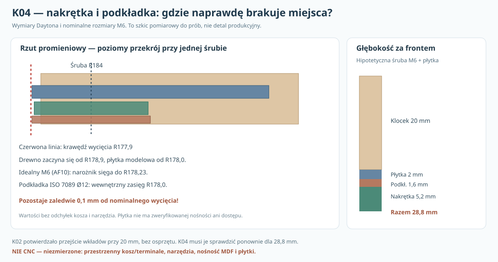

# K04 — węzeł mocowania, kompletna nakrętka/podkładka i ponowny dostęp do 20 modułów

**3 listopada 2026 · dalszy rozwój pierwszej obudowy P30E, po K02/K03 · NIE projekt CNC, NIE wykonane próby MDF, brak rzeczywistego kosza 3D.**

## 1. Co K04 rozstrzyga, zamiast mnożyć analizy kontaktu?

B12-09–15 wyjaśniły istotne ograniczenia pierścienia i wzmocnień. K01–K02 dały geometryczny kandydat **osiem klocków 26,1 × 36 × 20 mm za frontem MDF44**, z możliwością przeprowadzenia 20 modułów przy z góry znanych uproszczeniach. K03 ujawnił tylko 6,1 mm promieniowego odstępu między krawędzią wycięcia kołnierza a osią śruby. **K04 sprawdza pominięty dotychczas zespół: fizyczny gabaryt nakrętki i podkładki, orientację nakrętki oraz dodatkową głębokość za frontem.**

To **węzeł do fizycznej weryfikacji**, nie certyfikowana konstrukcja. „M5” i „M6” w raporcie oznaczają porównanie nominalnych rodzin wymiarowych, a **nie zatwierdzony typ ani klasę śruby**.

## 2. Udokumentowane wymiary i pochodzenie

- [Dayton RSS390HF-4, karta producenta](https://www.daytonaudio.com/images/resources/295-468-dayton-audio-rss390hf-4-specifications-46176.pdf): wycięcie Ø355,8 (R177,9 mm), osie 8 otworów Ø6,5 na PCD Ø368 (R184,0 mm), kołnierz Ø388,4, grubość 10,5 mm; cztery główne żebra są na oficjalnym widoku od tyłu. **Pełnego przebiegu żeber R(y,θ) nie da się odzyskać z rysunku w potrzebnej dokładności.**
- [European Panel Federation — Screwing MDF](https://mdf-info.eu/using-mdf/fixing/screwing): ogólna zasada rozmieszczania wkrętów w MDF z odsunięciem od krawędzi; przy zaledwie 6,1 mm na osi otworu konieczne są próby konkretnego wzmocnionego złącza. Reguła EPF nie jest automatyczną normą dla śruby przelotowej z niezależnym nośnikiem.
- [Tabela wymiarowa nakrętek wg ISO 4032](https://www.wermac.org/bolts/dimensions_hex-nuts_across-flats-and-heights_din-iso.html): typowe nominalne *szerokości pod klucz* M5 **8 mm**, M6 **10 mm**, wysokości M5 **4,7 mm** i M6 **5,2 mm** w wybranym źródle.
- [Würth, podkładki normalne ISO 7089](https://marketplacemedia.witglobal.net/source/marketplace/stmedia/wuerth/documents/documents/std.lang.all/29208645.pdf): M5 podkładka OD10 mm / grubość 1 mm, M6 OD12 mm / grubość 1,6 mm. Rzeczywiste elementy mają zakresy tolerancji i mogą być innych klas.

**Uwaga o nakrętkach:** „11,05 mm przez naroża” w tabelach to często **minimum**, a nie maksymalny gabaryt. Zbudowano zatem świadomie *idealny regularny sześciokąt* z nominalnej odległości między płaszczyznami AF: promień narożnika AF/√3. To narzędzie porównawcze; nie jest konserwatywnym obrysem wszystkich produktów ISO.

## 3. Rzeczywisty problem: 5,1 mm na całą nakrętkę i podkładkę

Modelowy klocek K02 zaczyna się przy promieniu R=178,9, zatem od osi śruby R184 do jego *wewnętrznej* krawędzi pozostaje **5,1 mm**. Od osi do otworu kołowego jest **6,1 mm**, czyli o 1 mm więcej. Nie mieszajmy tych dwóch granic.

Dla regularnego sześciokąta odległość narożnika od środka wynosi AF/√3; dla narożnika skierowanego do wycięcia maksymalna projekcja do wnętrza wynosi AF/√3. Po obróceniu *płaskiej ścianki* ku otworowi jest to tylko AF/2. Odpowiednie wartości:

| Nominalny element | Projekcja ku wycięciu [mm] | Pozostały pas K02 [mm] | Nominalny odstęp od wycięcia [mm] |
|---|---:|---:|---:|
| M5 nakrętka, płaską ścianką do otworu | 4,000 | 1,100 | 2,100 |
| M5, narożnikiem do otworu | 4,619 | 0,481 | 1,481 |
| M6, płaską ścianką do otworu | 5,000 | **0,100** | 1,100 |
| M6, narożnikiem do otworu | 5,774 | **−0,674** | 0,326 |
| ISO7089 podkładka M5 Ø10 | 5,000 | **0,100** | 1,100 |
| ISO7089 podkładka M6 Ø12 | 6,000 | **−0,900** | **0,100** |

Powyższe ujemne wartości **nie dowodzą niemożliwości śruby przelotowej**; pokazują, że nominalnie nakrętka lub podkładka wystaje poza *wewnętrzny brzeg drewnianego klocka*. Jeśli metalowy nośnik jest odpowiednio podparty i nie styka się z koszem, może przenieść obciążenie poza ten pas. **Bez modelu ugięcia/wytrzymałości płytki i wyrywania MDF nie jest to jednak dopuszczony mechanizm nośny.**

W regularnej nakrętce **obrót zmienia wynik o 0,774 mm** dla M6. Nakrętka AF10 ustawiona płaską ścianką dokładnie do środka otworu może *nominalnie* zmieścić się w pasie 5,1 mm, ale jej margines wynosi tylko **0,1 mm**, bez realnych odchyłek, śladów kleju, rozrzutu położeń i wymaganego dostępu. Dlatego nie można jej dopuścić wyłącznie na podstawie korzystnej orientacji.

### Hipotetyczna płytka rozkładająca nacisk — tylko geometria, nie rozwiązanie

Wariant **N1** w modelu: metalowa płytka z wewnętrznym promieniem R=178,0 mm, zewnętrznym R=202 mm, szerokością styczną 24 mm i *założoną* grubością 2 mm. Zaczyna się **0,9 mm bardziej do wewnątrz niż drewno K02**, a **tylko 0,1 mm na zewnątrz nominalnego kołowego wycięcia**. Przy *umownym* otworze Ø6,6 mm promieniowa odległość od krawędzi otworu płytki do jej brzegu to **2,7 mm**. Ani ta szerokość, ani grubość 2 mm nie mają zweryfikowanej nośności na zginanie ani lokalne naciski. Jeśli rzeczywiste przesunięcie montażowe będzie nawet 0,5 mm ku otworowi, płytka może przekroczyć nominalne wycięcie. **To punkt porównawczy do mierzenia kolizji, nie wymiar do frezowania.**

Dla standardowej podkładki M6 o promieniu 6 mm nominalne pole zaczyna się przy R=178,0 — zaledwie **0,1 mm przed wejściem w otwór**. Przy zadanej niepewności osi 0,5 mm część obwiedni może zajść około 0,4 mm na obszar otworu. Rzeczywisty kosz na głębokości tylnej płytki nie jest znany.

## 4. Najbardziej praktyczny problem: nakrętka ponownie wydłuża wzmocnienie

Dlaczego K02 dał wynik 20/20 dla drewnianego klocka o głębokości 20 mm? Ponieważ **w modelu nie było tylnej nakrętki, podkładki i mechanicznego zabezpieczenia**. Nawet jeśli metal jest cieńszy od drewna, zajmuje dodatkową przestrzeń za nim.

**Przybliżone maksymalne obrysy za tylną powierzchnią MDF44:**

| Model osiowy do przesiewu | Odległość od tylnej powierzchni frontu [mm] |
|---|---:|
| Sam klocek K02 | 20 |
| Klocek + płytka modelowa 2 mm | 22 |
| Klocek + płytka 2 + nakrętka M6 5,2 bez osobnej podkładki | **27,2** |
| Klocek + płytka 2 + podkładka M5 1 + nakrętka M5 4,7 | **27,7** |
| Klocek + płytka 2 + podkładka M6 1,6 + nakrętka M6 5,2 | **28,8** |
| Klocek + płytka 4 + podkładka M6 1,6 + nakrętka M6 5,2 | **30,8** |
| Klocek K01 30 mm bez osprzętu | 30 |

To **górna obwiednia uproszczona**; rzeczywisty detal mógłby schować nakrętkę w kontrolowanej wnęce albo mieć zewnętrzny kształt mniejszy niż klocek. Jednak wówczas trzeba policzyć **ubytek przekroju i nośność** oraz dostęp do serwisu. Nie wolno przenosić sukcesu z 20 mm na kompletny zestaw 28,8 mm.

### Wykonane sprawdzenie korytarzy P30E/K02

[Skrypt K04](../skrypty/k04_nakretki_i_przejscie_modulow.py) importuje **bez modyfikacji oryginalny planer K02** i ponawia przesiew dla konfiguracji z szerszą obwiednią zespołu. Dla bezpieczeństwa matematycznego wypełnia *całą* powierzchnię lokalnego klocka od Y44 do najbardziej wystającej części osprzętu; w przypadku stalowej płytki przyjmuje także promień wewnętrzny R=178,0, zamiast R178,9 dla samego MDF. Oznacza to **celowo zbyt duży wirtualny obiekt**.

Skrypt definiuje **22 konfiguracyjne testy tras** (uruchomienie w GitHub Actions wymaga potwierdzenia zakończenia): po siedem wariantów dla krytycznego stanu **100 l / 20 modułów** przy 3 i 6 mm luzu, a także stan 120/150 l dla kontrolnego K02 i z nakrętką M6 przy dwóch marginesach. Każda próba ponownie rozpoczyna przejście modułu przed czołem obudowy z wymontowanym głośnikiem, a następnie wyszukuje translacyjną trasę z 20-modułowego planu P30E. **Wynik dodatni** dotyczy dokładnie tego zastępczego modelu, **wynik ujemny** nie dowodzi niewykonalności rzeczywistego złącza, które może mieć znacznie mniejszy obrys, być częściowo zagłębione albo wymagać innej kolejności montażu.

Pełne wyniki poszczególnych korytarzy będą dostępne po pomyślnym uruchomieniu skryptu jako generowany JSON. Odsyłacz do [kodu generatora](../skrypty/k04_nakretki_i_przejscie_modulow.py) przez regresję K04 i archiwizowane jako artefakt GitHub Actions. Wartości konkretnych sekwencji należy sprawdzić w automatycznej regeneracji, nie przyjmować „20/20” dla rzeczywistego osprzętu bez walidacji.

## 5. Czy wykonanie złącza jest bezpieczne? Nie można tego jeszcze stwierdzić

W pełnym złączu N1 droga siły musi zostać opisana i przetestowana:
- kołnierz odlewanego kosza → łeb śruby i podkładka → śruba pracująca na rozciąganie;
- śruba → *zabezpieczona przed obrotem i wypadnięciem nakrętka* → stalowa płytka (lokalne zginanie/ściskanie);
- płytka → rzeczywisty MDF44 i klocek przyklejony do jego tylnej strony → spoina i reszta skrzyni;
- tarcie na styku kołnierz/uszczelka/MDF, utrata docisku przy wilgotności i po serwisie.

Należy zapewnić możliwość wykręcenia głośnika **od przodu**, gdy front jest stały i obudowa została sklejona. Jeśli nakrętka z tyłu obraca się swobodnie, bez jej odzyskania złącze jest serwisowo nieakceptowalne. Nie wiadomo także, czy zespół nie zderzy się z czterema żebrami kosza lub zaciskami i nie zasłoni wentylacji. W **wariancie S — wkręt w MDF** osobno trzeba zbadać rozwarstwianie/wyrywanie blisko krawędzi i wytrzymałość po wielokrotnym montażu. Wariant ramowy R nadal jest rezerwą, nie domyślnym zwycięzcą.

**Próby wymagane do zamknięcia węzła:** rzeczywisty kosz/terminale ze zdjęciami i ośmioma pomiarami 3D; karta fizycznego łącznika z wymiarami i tolerancjami; próbki MDF44+klocek20, trzy lub więcej próbek porównawczych na warunek, ścinanie, odrywanie spoiny, wyrywanie, relaksacja, ślady zgniotu oraz cykle serwisu; ponowny fizyczny montaż 20 wkładów z pełnymi uchwytami, kluczem i przewodem.

## 6. Dlaczego nie ma tu wymiarów do zakupu?

Zsumowanie katalogowych/granicznych długości **kołnierz 10,5 + MDF44 + klocek20 + płytka2 + podkładka1,6 + nakrętka5,2 = 83,3 mm** pokazuje jedynie referencyjny stos wymiarów, bez uszczelki, podkładki pod łbem, sposobu wykończenia otworu, minimalnej długości gwintu i wkręcenia, tolerancji, miejsca na przewód. Nie jest to długość śruby 85 mm do zamówienia. Również otwór Ø6,5 w odlewanym kołnierzu nie dowodzi, że każda śruba i podkładka M6 będzie pasować.

**Działania konstrukcyjne następnym krokiem**: wybrać szczegółowy system *do próby*, nie do produkcji, **z kontrolą tylnego osprzętu w drodze modułów i dostępem serwisowym**. Dopiero pomierzyć rzeczywiste części i próby mechaniczne — nie doklejać kolejnych hipotetycznych sprężyn.

**Bramki:** prawdziwy kosz/terminale NIEPOTWIERDZONE; materiał MDF/spoina NIEPRZEBADANE; łącznik NIEKWALIFIKOWANY; ochrona DSP i akustyka końcowa OTWARTE; **CNC HOLD**.

[Projektowe źródła](../dokumentacja/K02_protokol_pomiarow_kosza_i_probek_zlacz.md) · [kod odtwarzający](../skrypty/k04_nakretki_i_przejscie_modulow.py) · [oryginalny wykres](../wyniki/k04_nakretka_podkladka_osie_20_vs_28_8_NIE_CNC.svg) · [regresja](../.github/workflows/k04-fastener-path-regression.yml).
