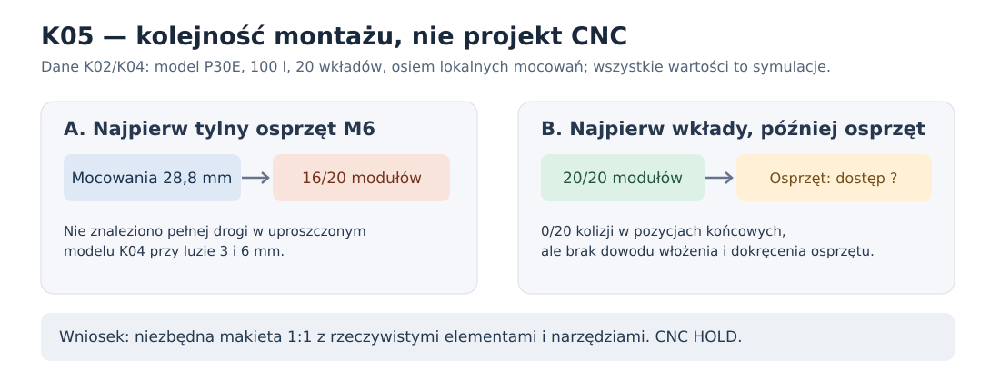

# K05 — kolejność montażu 20 modułów i osprzętu za frontem: czy da się ominąć wąskie gardło K04?

**3 listopada 2026 · analiza etapowania oparta na zweryfikowanych wynikach K02 i K04, nie nowe fizyczne pomiary · NIE CNC.**

## 1. Decyzja, której dotyczy to badanie

Dla zamkniętej skrzyni P30E **1020 × 425 × 500 mm**, frontu **MDF 44 mm**, osiem lokalnych wzmocnień głębokich na **20 mm** i montażu **20 wkładów** regulacji stanu około 100 l, K04 potwierdza, że **przeszkodą może być kolejność wprowadzenia całego osprzętu**, a nie końcowe położenia wkładów. W K04 przy modelowych płytce, podkładce i nakrętce M6 rosnących do **28,8 mm za frontem**, planer przeprowadza **16/20** wkładów. Bez tylnego osprzętu i przy samych klockach 20 mm osiąga **20/20**. Badania przeprowadzono dla **3 i 6 mm** nominalnego luzu.

Nowa hipoteza montażowa **H-K05**: najpierw wprowadzić i zabezpieczyć komplet 20 wkładów, a **dopiero później** wprowadzić tylny osprzęt mocowania kosza przez otwór po wymontowanym głośniku, albo zaprojektować od przodu mocowane, kompaktowe złącze bez wystającego osprzętu. **Samo „moduły pierwsze” nie jest dowodem wykonalności**, bo nie sprawdzono przejścia i montażu nakrętek/klucza w stanie z zainstalowanymi wkładami.

## 2. Co można obiektywnie powiedzieć na podstawie źródeł

| Sprawdzenie | Cały tylny zestaw M6 montowany przed wkładami | Wkłady montowane przed tylnym zestawem |
|---|---|---|
| Trasy wkładów w P30E/K02 z umownym luzem 3 mm | **16/20** (K04) | **20/20** z samymi klockami (K02/K04) |
| Trasy wkładów w P30E/K02 z umownym luzem 6 mm | **16/20** (K04) | **20/20** z samymi klockami (K02/K04) |
| Statyczne położenie 20 wkładów wobec obwiedni osprzętu 28,8 mm, luz 6 mm | **0 kolizji** | **0 kolizji** |
| Droga samej nakrętki/płytki za frontem i dostęp rzeczywistego narzędzia | NIEPOTWIERDZONE | **NIEPOTWIERDZONE** |
| Serwis tylko od przodu, wytrzymałość, zabezpieczenie nakrętki | NIEPOTWIERDZONE | **NIEPOTWIERDZONE** |

**Wniosek logiczny:** K02 i K04 dostarczają *dwóch oddzielnych warunków koniecznych* dla wariantu „wkłady pierwsze”: (i) trasy 20/20 bez tylnej wypustki; (ii) brak kolizji w położeniach końcowych po dodaniu modelowego osprzętu. **Nie udowodniono trzeciego warunku:** istnienia ciągłej trajektorii **wprowadzenia, ustawienia i zabezpieczenia** ośmiu prawdziwych elementów nośnych od frontu, z kluczem, palcami i przewodami. Bez niego nie można oznaczyć tego wariantu jako udanego montażu.

## 3. Krótkie nowe obliczenie: co musi zmienić położenie za otworem Ø355,8 mm?

Z oficjalnych wymiarów Daytona: promień wycięcia **177,9 mm**, promień osi śrub **184,0 mm**; oś każdej śruby znajduje się zatem **6,1 mm poza promieniem otworu**. Dla *swobodnej okrągłej części* o promieniu `r`, przechodzącej prostopadle przez kołowy otwór bez pochylania, środek przy przejściu musi znajdować się najwyżej na promieniu `177,9 − r`. Aby później dotrzeć środkiem do osi śruby na `184`, potrzeba **co najmniej `6,1 + r` mm przemieszczenia promieniowego za frontem**.

- Modelowa podkładka M5 Ø10: **11,1 mm** koniecznego przesunięcia.
- Modelowa podkładka M6 Ø12: **12,1 mm** koniecznego przesunięcia.
- Idealna nakrętka M6 AF10 zabezpieczona okręgiem opisanym (promień 10/√3): **11,87 mm** koniecznego przesunięcia.

To **jedynie dolne ograniczenie dla umówionego sposobu wejścia**, a nie dowód wolnego miejsca. Metalowy nośnik o innej sylwetce wymaga osobnej analizy, a położenia rzeczywistych żeber kosza, zacisków i narzędzia są nieznane. Dla każdej z ośmiu śrub ograniczenie promieniowe jest identyczne; rzeczywisty dostęp ze względu na ścianę, wręgi i kosz — nie.

## 4. Dwa wykonalne do przetestowania tory, bez fikcyjnych danych wytrzymałości

**Tor N-late (pierwsza próba logistyczna):** demonstrator MDF44 + osiem klocków 20 mm + 20 makiet wkładów w realnej kolejności; po wsunięciu wkładów wprowadzić *rzeczywisty* nośnik i zamocowaną przeciw obrotowi nakrętkę przez wycięcie głośnika. Sprawdzić wszystkie osiem pozycji **z narzędziem**; następnie dwukrotnie zamontować i zdjąć kosz **bez dostępu od tyłu**. Jeśli nie da się zabezpieczyć nośnika z zamkniętej skrzyni — ten tor odpada nawet przy 0 kolizji statycznych.

**Tor S-front (alternatywa):** złącze dostępne całkowicie od przodu, bez wystającego 28,8-mm tylnego stosu; sprawdzić rzeczywistą średnicę otworu/gniazda, odpowiednią liczbę włókien MDF między otworem a wycięciem oraz wyrywanie i wielokrotne skręcanie. **Samo „mieści się w 20 mm” nie potwierdza nośności, uszczelnienia ani przydatności wkładki**, a bardzo mały radialny pas przy osi śruby pozostaje krytyczny. Dopiero rzeczywiste próbki mogą wyłonić wariant. Rama R to rezerwa, jeśli N i S odpadną.

## 5. Warunki zakończenia etapu projektowego, bez produkcji

1. **Otwór i kosz:** zmierzyć rzeczywiste żebra/terminale w ośmiu pozycjach oraz zasięg narzędzi; zewnętrzny PDF nie podaje pełnego 3D.
2. **Droga elementów N-late:** udokumentować osiem trajektorii rzeczywistych nakrętek/nośników *po* zamontowaniu wkładów, najlepiej nagraniem, zdjęciami i wymiarami; osobno sprawdzić wyjęcie i ponowny montaż.
3. **Rzeczywiste złącza N/S:** porównywalne próbki z tego samego MDF44 i kleju; minimum trzy próbki pilotażowe na wariant i warunek (to nie jest statystyczna kwalifikacja seryjna); ścinanie, wyrywanie, rozwarstwienie, relaksacja, cykle serwisowe.
4. **Regulacja:** potwierdzić w realnym gabarycie 20/20, 12/12 i 1/1 z blokadami/uchwytami; po zamontowaniu kosza żadne elementy nie mogą grzechotać ani przesłaniać wentylacji.
5. **Końcowa skrzynia:** zamknąć wyporność netto i **≤500 mm całkowitej głębokości** razem z maskownicą i przyłączami. Bez wyników wyżej: **CNC HOLD**.

**Dane i odtwarzanie:** [skrypt K05](../skrypty/k05_kolejnosc_montazu_i_dostep.py) czyta *zweryfikowany* [manifest K04](../wyniki/k04_podsumowanie.json), sprawdza wartości 20/20, 16/20, 0 kolizji i przelicza ograniczenia wprowadzenia okrągłych elementów. Zapisuje [JSON K05](../wyniki/k05_podsumowanie.json). Nie jest to nowy solver tras elementów N-late, nie uruchamia pomiarów i nie naprawia brakujących danych poprzez modelowanie hipotetycznej sztywności.

**Stan końcowy: hipoteza montażowa wyznaczona do makiety, a nie przyjęty system mocowania. Dayton nadal jest warunkowym kandydatem; konstrukcja i CNC nie są zatwierdzone.**
