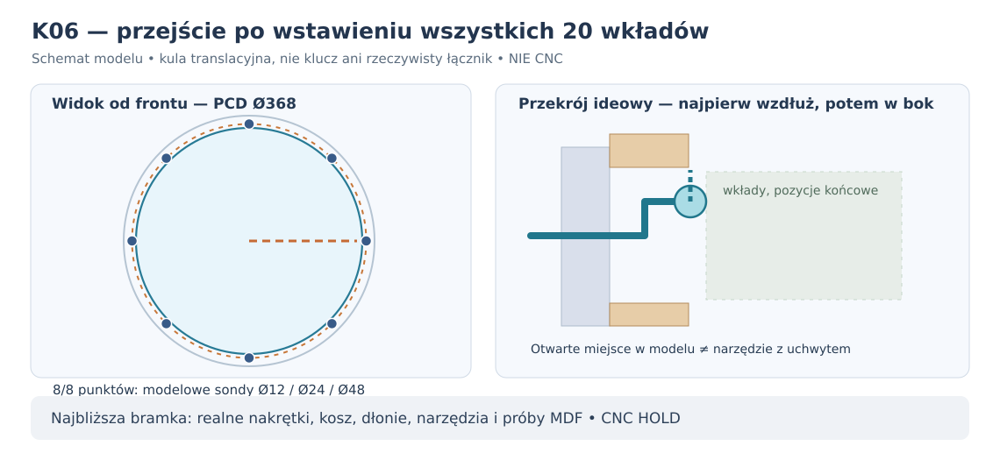

# K06 — droga przez otwór do wszystkich ośmiu mocowań po wstawieniu 20 wkładów

**3 listopada 2026 · niezależny model dojścia do węzłów, oparty na oryginalnej geometrii P30E/P30A. Wynik numeryczny, NIE pomiar, NIE zatwierdzenie montażu ani CNC.**

## Dlaczego badanie jest konieczne

W K05 zaproponowano wprowadzenie **20 wkładów stanu 100 l przed tylnym mocowaniem głośnika**. Warunek 20/20 tras modułów i zerowych kolizji w ich położeniach końcowych był spełniony, lecz **nie pokazano ani jednej ciągłej drogi dojścia do śruby już po umieszczeniu wkładów**. K06 wprowadza odrębny, ściśle zdefiniowany test takiej drogi, bez udawania pełnego montażu prawdziwej nakrętki.

## Źródła i konfiguracja

- **Rysunek producenta Daytona RSS390HF-4**: [oficjalny dokument producenta](https://www.daytonaudio.com/images/resources/295-468-dayton-audio-rss390hf-4-specifications-46176.pdf), 8 osi na PCD Ø368 mm (promień 184 mm), wycięcie Ø355,8 mm (promień 177,9 mm). PDF pokazuje cztery żebra, ale nie podaje ciągłej powierzchni ich rzeczywistych obrysów.
- **Obudowa P30E**: korpus 1020 × 425 × 500 mm; front 44 mm; MDF 22 mm, oś przetwornika X231/Z250 zewnętrznego obrysu, czyli **X209/Z228 względem wnętrza**; 20 modelowych zamkniętych brył modułów oraz modelowe wręgi, tylna mata 50 mm. Geometria odczytywana bezpośrednio przez `p30e_mat50_geometria_montaz.build(CANDIDATES[2])`, a nie przerysowana ze schematu.
- **Mocowanie K02**: osiem hipotetycznych wzmocnień z tyłu frontu o głębokości 20 mm; przy wejściu promień prowadnicy jest mniejszy od wycięcia o promień sondy i 1 mm. Po przekroczeniu frontu sonda przechodzi **za płaszczyznę tylnej ścianki wzmocnienia**, zanim przesunie się promieniowo na promień 184 mm.
- W K06 użyto **kulistych idealnych sond**, nie rzeczywistych nakrętek, podkładek, wkrętaków lub dłoni. Prześwietlenie modelu kosza w stanie **głośnik wymontowany**; przed założeniem kosza fizyczne żebra i zaciski pozostają niezmierzone.

## Metoda i wynik

Dla każdego kąta 0°, 45°, ..., 315° i trzech średnic sondy **Ø12, Ø24, Ø48 mm** zbadano ciągłą trajektorię z trzech prostoliniowych odcinków:
1. Wlot prostopadły od zewnątrz przez otwór, z promieniem środka `177,9 − r − 1` mm;
2. Skręt na głębokości Y=30/35/45/50/65/85 mm za frontem, potem radialne przesunięcie środka do promienia 184 mm;
3. Zbliżenie do tylnej powierzchni klocka 20 mm z osiowym luzem 0,5 mm od kuli.

Kolizje wyznaczono przez **minimalną odległość od całego prostoliniowego odcinka do każdej przeszkody AABB** (P30E: wręgi, 20 wkładów, mata), a nie tylko test punktów końcowych. Algorytm odległości sprawdzono oddzielnie na przypadkach analitycznych i 80 losowych prostych porównywanych z gęstym próbkowaniem. Klocki z K02 pomijane są w operacji segment/AABB wyłącznie dlatego, że dla obliczonych odcinków zachodzi **rozdzielenie wzdłuż Y** (`Yturn ≥ 20+r+0,5`) albo **rozdzielenie radialne na wejściu** (`Rentry+r ≤176,9 <178,9 mm`). Ten warunek jest jawnie weryfikowany.

| Średnica idealnej sondy | Osie z odnalezioną ciągłą drogą | Najwcześniejszy sprawdzony skręt za frontem | Najmniejszy modelowy luz do ściany na osi śruby |
|---|---:|---:|---:|
| **Ø12 mm** | **8/8** | 30 mm | 19 mm |
| **Ø24 mm** | **8/8** | 35 mm | 13 mm |
| **Ø48 mm** | **8/8** | 45 mm | **1 mm** |

**Praktyczne znaczenie:** istnieje wykazana, trzyodcinkowa droga dla **swobodnie przesuwanej kuli** nawet przy 20 wkładach pozostawionych na ich docelowych pozycjach w *badanym modelu*. To więcej niż K05, w którym potwierdzono tylko możliwość włożenia wkładów i brak kolizji statycznej. Nadal **nie istnieje dowód, że da się wnieść, utrzymać, zakotwiczyć i dokręcić prawdziwy tylny nośnik z nakrętką lub ręką i kluczem**.

### Ważna granica obrysu przy lewej ścianie

Najbardziej lewa oś śruby ma współrzędną **X=209−184=25 mm względem wewnętrznej lewej ściany**. Idealna kula ze środkiem dokładnie na tej osi nie może mieć promienia większego niż **25 mm**, nie przecinając płaszczyzny ściany. Sonda Ø48 ma tam tylko **1 mm** modelowego odstępu. To ograniczenie konkretnej *kulistej sondy*, nie ogólny limit wielkości klucza o kształcie innym niż kula.

**Nie wyprowadzamy z tych wyników** średnicy do zakupu, wytrzymałości, momentu dokręcania ani gabarytów serwisowego narzędzia. Dodatkowo kulę można przesunąć łamaną trasą bez wymagania miejsca na rękojeść czy sztywny prosty trzon. Z tego powodu przejście sondy nie oznacza przejścia wkrętaka ani gotowej płytki.

## Bramka fizyczna: najbliższe trzy decyzje

**1. Realny element:** uzyskać rozmiary konkretnego zestawu zabezpieczonej nakrętki, nośnika i klucza; sprawdzić, czy potrafi przejść drogę o odpowiadającym kształcie, bez obrotów niemożliwych w obudowie. Zmierzony rzeczywisty obrys nie może zostać zastąpiony kulą.

**2. Reprodukcja na makiecie:** przy **20 modelowych wkładach z okuciami i zamkami** wprowadzić kolejno 8 rzeczywistych nośników przez otwór Ø355,8, zamocować je na próbnym froncie MDF44, sprawdzić dostęp i powtórzyć demontaż od przodu. W tym stanie każda nakrętka musi być **mechanicznie zabezpieczona przed obrotem i wypadnięciem**. Zmierzyć kosz, zaciski, osłony i ich kolizje.

**3. Nośność:** porównać rzeczywisty zestaw przelotowy z dostępnym od przodu mocowaniem w MDF44 + lokalny klocek20, badając wyrywanie, rozwarstwienie przy wycięciu, ścinanie, relaksację docisku, połączenie klejone i serwis (minimum trzy porównywalne próbki pilotażowe na wariant/warunek). Bez pomiarów nie wybierać gwintu ani momentu.

**Wniosek konstrukcyjny:** K06 **podtrzymuje** możliwość montażu etapowego (wkłady → nośnik → głośnik), ale nie zatwierdza N-late. Jeśli rzeczywiste narzędzia nie przejdą lub nie da się zabezpieczyć nakrętki, kolejny tor jest **mocowanie w całości dostępne od frontu (S-front)**; ramę weryfikujemy dopiero w razie niepowodzenia prostszych rozwiązań. Pełny obrys, bilans netto i rzeczywista sztywność/nośność wciąż otwarte. **CNC HOLD.**

[Reprodukcja K06](../skrypty/k06_korytarz_kulisty_8_mocowan.py) · [Wersjonowany wynik](../wyniki/k06_podsumowanie.json) · [Regresja GitHub Actions](../.github/workflows/k06-fastener-gauge.yml) · [Poprzedni etap K05](K05_etapowanie_20_modulow_i_dostep_do_mocowan.md).
