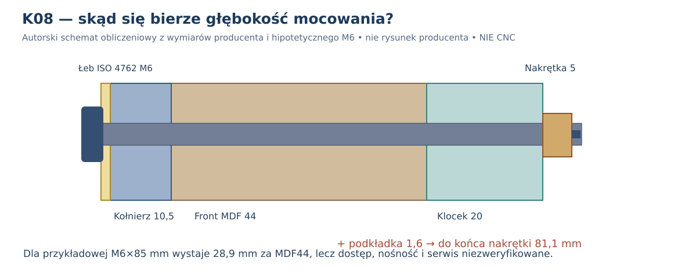

# K08 — nominalne mocowanie Daytona: główka, podkładka, długość śruby i osprzęt za frontem

**3 listopada 2026 · obliczenia geometryczne na podstawie karty Dayton RSS390HF-4, normowego łba ISO 4762 i jawnych hipotetycznych części M6. Nie jest to pomiar nośności ani dobór do wykonania. CNC HOLD.**

## 1. Najważniejszy wniosek — nie zgadujmy wymiarów głośnika

[Dayton Audio, rysunek wymiarowy RSS390HF-4, nr 295-468 (PDF producenta)](https://www.daytonaudio.com/images/resources/295-468-dayton-audio-rss390hf-4-specifications-46176.pdf) podaje: zewnętrzny kołnierz **Ø388,4 mm**, wycięcie **Ø355,8 mm**, osiem otworów w kołnierzu **Ø6,5 mm** na okręgu **PCD Ø368 mm**, grubość kołnierza **10,5 mm** oraz głębokość przetwornika **178 mm**. Cztery żebra są widoczne, ale ich pełna geometria przestrzenna oraz przestrzeń przy terminalach nie są zwymiarowane. **Producent nie wybiera rodzaju kotwienia w MDF 44 mm.**

*Źródło grafiki: Dayton Audio, RSS390HF-4, arkusz wymiarowy 295-468; obraz reprodukowany przez [Speaker&Co](https://www.speakerenco.nl/dayton-rss390hf-4). Oryginalny kompletny [PDF producenta](https://www.daytonaudio.com/images/resources/295-468-dayton-audio-rss390hf-4-specifications-46176.pdf) obejmuje także widok kosza od tyłu z rozmieszczeniem 8 otworów. Grafika jest osadzona **z zewnętrznego serwera**, a nie przedstawiona jako nasz prototyp ani skopiowana do plików binarnych repozytorium. Weryfikacja pełnej aktualności wymiarów u producenta jest konieczna przed wykonaniem.*

## 2. Krawędź otworu i kontakt łba

Oś śruby znajduje się `(368−355,8)/2 = 6,1 mm` poza otworem i `(388,4−368)/2 = 10,2 mm` od zewnętrznej krawędzi metalowego kołnierza. To **dwie różne odległości**: istotne dla drewna i główki, ale nie identyczne z wytrzymałością połączenia.

Normowo wymiarowany łeb cylindryczny z gniazdem sześciokątnym [ISO 4762 / DIN 912](https://tengtoolsusa.com/blogs/news/socket-capscrews-dimensions-chart): **M5 Ø8,5 / wys.5 mm / klucz 4 mm**, **M6 Ø10 / wys.6 mm / klucz 5 mm** (wymiary nominalne odniesienia, tolerancje i użyty model wymagają audytu). Podkładki Ø10 (M5) i Ø12 (M6) są **przykładowe**, nie zaleceniem producenta.

| Element wokół osi | Średnica obwiedni | Nominalny prześwit do krawędzi wycięcia |
|---|---:|---:|
| Łeb ISO 4762 M5 | 8,5 mm | **1,85 mm** |
| Łeb ISO 4762 M6 | 10 mm | **1,1 mm** |
| Przykładowa podkładka M5 | 10 mm | **1,1 mm** |
| Przykładowa podkładka M6 | 12 mm | **0,1 mm** |
| Przykładowa większa podkładka | 14 mm | **−0,9 mm** (nominalnie wystaje nad wycięcie) |

Wariant Ø12 ma nominalnie tylko **0,1 mm** od wewnętrznej krawędzi, więc *bez tolerancji* nie wolno go uznać za bezkolizyjny. Nie zakładamy, że koniecznie musi leżeć w tej samej płaszczyźnie lub że dostępny jest pełny kontakt łba z żebrowanym kołnierzem. K08 nie modeluje sprężystości kołnierza ani rozkładu docisku.

Dla przykładowego otworu MDF: Ø5/5,5/6/6,4/6,5/6,6 mm nominalny najkrótszy pas drewna od krawędzi otworu do wycięcia wynosi odpowiednio **3,6 / 3,35 / 3,1 / 2,9 / 2,85 / 2,8 mm**. **Otwór kołnierza Ø6,5 mm nie wymusza w drewnie takiego samego wiercenia**. Wybór śruby M5/M6, wkrętu do drewna lub wkładki gwintowanej musi uwzględniać rzeczywisty wymagany otwór oraz wyrywanie i rozwarstwienie krawędzi.

## 3. Ile wynosi śruba przez MDF44 i klocek20?

Zakładamy **tylko do porównania** wariant M6 z przykładową podkładką pod łbem **1,6 mm**, nakrętką o nominalnej grubości **5 mm** (dane referencyjne [DIN934](https://hudsonfasteners.blob.core.windows.net/specs/MetDin934.pdf)) i śrubą, której długość mierzymy **od spodu łba**, a nie łącznie z łbem. **Nie wybrano jeszcze typu nakrętki ani miejsca wbudowania gwintu.** W scenariuszu A nakrętka zaczyna się za samym frontem MDF44, w scenariuszu B **za klockiem o dodatkowych 20 mm**.

Minimalna długość dla hipotetycznego przejścia przez komplet części i **pełne 5 mm grubości nakrętki** wynosi:

- A — nakrętka od razu za MDF: `44 + 10,5 + 1,6 + 5 = 61,1 mm`; przykładowa śruba **65 mm** ma teoretyczny nadmiar 3,9 mm.
- B — nakrętka dopiero za klockiem MDF20: `44 + 20 + 10,5 + 1,6 + 5 = 81,1 mm`; przykładowa śruba **85 mm** ma teoretyczny nadmiar 3,9 mm.

Dla przypadku B **M6 × 85** (nominalnie): od tylnej powierzchni całego frontu wystaje koniec trzpienia **28,9 mm**, w tym 20 mm założonego klocka, 5 mm nakrętki i 3,9 mm nadmiaru. To interesująca zgodność ze stosowaną w K04 zastępczą bryłą **28,8 mm** — różnica 0,1 mm — ale NIE dowodzi, że K04 przedstawiał taki właśnie prawdziwy osprzęt ani że szerokości boczne są takie same. Elementy rzeczywiste mogą zajmować inną przestrzeń i zupełnie inaczej kolidować z wkładami.

**38,1 mm** śruby **1½″ z gotowego zestawu 1/4″-20 260-778**, wykorzystanego przez innego konstruktora [w galerii Parts Express](https://projectgallery.parts-express.com/speaker-projects/dayton-subwoofers/), nie przechodzi nawet przez sam front **44 mm** (a jeszcze pozostaje kołnierz 10,5 mm). Podobna rodzina łącznika jest inspiracją, ale ta **długość** nie pasuje do naszego wariantu. 1/4″-20 to nie M6; średnic i skoku gwintów nie należy zamieniać bez zmiany nakrętki.

## 4. Wybór pierwszego wariantu na podstawie JUŻ ZGROMADZONYCH przykładów

K08 nie powinno otwierać dyskusji o mocowaniu od nowa. **Badanie inspiracji B12-08, aneks A1 README i dokumentacja źródeł** opisały trzy konkretne realizacje z **tym samym RSS390HF-4**. Potwierdzenie z [oryginalnego wątku Parts Express TechTalk (wpis #15, Francis, 7.11.2016)](https://techtalk.parts-express.com/forum/tech-talk-forum/1305709-threaded-inserts-for-subs-in-mdf-from-behind-or): wkładki wkręcone w niewielkie klocki drewniane, które autor następnie przykleił za frontem. Francis powtórzył tę metodę w [drugiej dyskusji w 2018 r. (wpis #7)](https://techtalk.parts-express.com/forum/tech-talk-forum/1381453-threaded-inserts). Są to **relacje autorów, nie pomiary nośności**.

| Rozwiązanie z istniejących źródeł | Korzyść dla naszego MDF44 i 20 wkładów | Otwarty problem | Decyzja |
|---|---|---|---|
| **A. Osiem wkładek gwintowanych w ośmiu doklejonych klockach** (Francis) | Połączenie gwintowane obsługiwane przez otwór kołnierza od przodu; może się zmieścić w zastępczej obwiedni 20 mm, przy której K02/K07 daje 20/20 wkładów | Wymiary konkretnych wkładek, otwory, pozostałe drewno, kierunek osadzenia, blokada obrotu, nośność i spoina; wynik 20/20 **dotyczy pustych klocków**, nie osprzętu | **PIERWSZY WARIANT DO ZAPROJEKTOWANIA I PRÓB** |
| **B. T-nut od tyłu frontu** („hoppaz”, AVForums) | Metoda stosowana przy RSS390HF-4; po poprawnym zakotwieniu śruba może być obsługiwana z przodu | Pazurki, kołnierz nakrętki, możliwe jej wysunięcie lub obrót bez dostępu od tyłu, kolizje z wkładami; dokumentacji nośności brak | Wariant porównawczy |
| **C. Hurricane nut od tyłu** (Warren Hagan, Parts Express) | Opisany montaż ściskiem, stopniowe ręczne zakręcanie, naprzemienny docisk ośmiu śrub | Tam była inna obudowa (bass-reflex) i zestaw gwintów 1/4″-20, nie M6; ryzyko serwisu po zamknięciu | Wariant porównawczy |
| **D. Przelotowa M6×85 i wolna nakrętka za klockiem** (hipoteza K08) | Obliczone 81,1 mm stosu dla przykładowego gwintu M6; łatwa analiza osiowa | Występ 28,9 mm za MDF, bliski utrudniającej ścieżki obwiedni K04/K07 28,8 mm; brak zabezpieczenia i dostępu do nakrętki | **Nie prowadzić jako wariantu bazowego** |

**Ważne ograniczenie opinii forumowych:** użytkownicy w wątku TechTalk różnią się co do tego, czy wkładkę wkręcać od frontu, czy od tyłu, i opisują ryzyko jej obracania się. Nie można więc zapisać „wkładka w klocku” jako automatycznie bezawaryjnej. Rysunki i linki do cudzych zdjęć są już zarchiwizowane opisowo w [dokumencie źródeł](../dokumentacja/inspiracje_zewnetrznych_konstruktorow_mocowanie_RSS390HF4.md); bez licencji nie kopiujemy fotografii.

**Najbliższe, naprawdę nowe działanie — nie kolejne rozpoznawanie metod:** (1) wybrać jeden rzeczywisty typ wkładki M5 i jeden porównawczy M6, z kartą wymiarową i sposobem osadzania, (2) wprowadzić ich bryły do modelu **klocka 20 mm**, uwzględniając narzędzie do osadzania i średnicę otworu w MDF, (3) sprawdzić dostęp przy 0° (wkład ID16) i 180° (25 mm od lewej ściany), (4) wykonać reprezentatywne próbki MDF44 + klocek20 + klej, (5) przed decyzją o CNC potwierdzić 100/120/150 l, wielokrotny serwis i wymagany docisk. **CNC HOLD.**

[Skrypt źródłowy K08](../skrypty/k08_nominalne_mocowania_dayton.py) · [Dane obliczeń i warianty długości](../wyniki/k08_nominalne_mocowania_dayton.json) · [Regresja CI](../.github/workflows/k08-fastener-geometry.yml) · [K07](K07_serwis_wkladow_i_audyt_mocowan.md).
