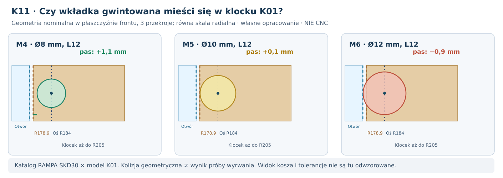

# K11 — materiał, geometria i nośność części nośnych: rzeczywiste wkładki kontra klocek K01

**3 listopada 2026 · Kontynuacja K10 po audycie P19/P30/P36/P37 i K01–K09. Obliczenia wykonane na wymiarach nominalnych producentów i jawnych przypadkach obciążenia. Wyniki nie są kwalifikacją do produkcji. CNC HOLD.**

## Po co ten etap

K10 przypisało kandydatów materiałowych do 35 części, ale samo przypisanie **klejonki bukowej 20 mm** do ośmiu klocków oraz MDF do frontu i ścian nie dowodzi nośności. K11 odpowiada na trzy konkretne pytania: **czy rzeczywiste wkładki gwintowane mają miejsce w geometrii K01, co daje zwiększanie powierzchni klejenia, i ile kosztuje pojemności oraz masy zmiana pięciu ścian bez zmiany frontu**. Osiem osi wiercenia, PCD Ø368 mm i wycięcie Ø355,8 mm pochodzą z [rysunku Daytona](https://www.daytonaudio.com/images/resources/295-468-dayton-audio-rss390hf-4-specifications-46176.pdf), a nie z własnego pomiaru.

## 1. Najważniejszy wynik: osadzenie typowych wkładek w klockach K01 jest krytyczne

Model K01 przewiduje klocek o promieniu wewnętrznym **178,9 mm**, promieniu zewnętrznym **205 mm**, szerokości stycznej **36 mm**, głębokości **20 mm**. Na każdej z ośmiu pozycji śruba znajduje się w promieniu **184 mm**. Odległość osi do *wewnętrznej krawędzi samego klocka* to **5,1 mm**, natomiast do wycięcia kołowego we froncie **6,1 mm**. Tych odległości nie wolno utożsamiać.

*Rysunek wykonany na podstawie wymiarów producentów; nie jest fotografią zmontowanego głośnika, wizualizacją rzeczywistego gwintu ani dokumentacją frezarską.*

Odczytałem wymiary z **oryginalnej [karty wkładek RAMPA SKD30 do MDF](https://www.rampa.com/media/e2/ed/d4/1699524202/RAMPA_Produktdatenblatt_MDF-EN.pdf)** (str. 3, tabela z kodami produktów) oraz [katalogu Type D Fastenright](https://www.fastenright.com/general-fixings/insert-nuts-for-wood-type-d/ff13). To **rzeczywiste katalogowe rozmiary danych rodzin wkładek**, a nie gabaryty zamontowanego złącza w naszym klocku.

| Przykład wkładki osadzanej ZA frontem | Ø zewnętrzna / długość [mm] | Prześwit rzutu wkładki do wycięcia głośnika [mm] — **NIE otwór frontu** | Pas do wewnętrznej krawędzi klocka K01 [mm] |
|---|---:|---:|---:|
| RAMPA SKD30 M4, 439412001 | 8 / 12 | 2,10 | **1,10** |
| RAMPA SKD30 M5, 439512001 | 10 / 12 | 1,10 | **0,10** |
| RAMPA SKD30 M6, 439612001 | 12 / 12 | 0,10 | **−0,90** |
| RAMPA SKD30 M6, 439615001 | 12 / 15 | 0,10 | **−0,90** |
| Fastenright Type D M5 | 10,5 / 13 | 0,85 | **−0,15** |
| Fastenright Type D M6 | 12,5 / 16 | **−0,15** | **−1,15** |

**Korekta interpretacyjna:** trzecia kolumna jest **rzutem średnicy ZEWNĘTRZNEJ wkładki na promień wycięcia**, a nie szerokością rzeczywistego drewna we froncie po wierceniu. Wkładka jest osadzana **za** płytą MDF44, w osobnym klocku. Rzeczywisty otwór we froncie przeznaczony jest **na wybraną śrubę**, a nie na cały gwint zewnętrzny wkładki.

### Trzy niezależne otwory — w którym materiale i dlaczego?

| Warstwa | Dobierany wymiar | Przykład M5 do odtworzenia (bez kwalifikacji wykonawczej) |
|---|---|---|
| Fabryczny **kosz Daytona** | Producent: **8 × Ø6,5 mm na PCD Ø368 mm** | Fabryczny otwór musi przepuścić trzpień wybranej śruby; jego Ø nie jest wierceniem pod MDF |
| Front **MDF44** | Wiertło przelotowe dobrane do **śruby i pasowania**, nie do otworu kosza | Przykładowa śruba M5 (Ø trzpienia nominalnie 5) i umowny przelot **Ø5,5 mm**: pas drewna do wycięcia `6,1−5,5/2 = 3,35 mm` |
| **Tylny klocek** z wkładką RAMPA SKD30 | Otwór wstępny pod jej zewnętrzny gwint, z karty dla **odpowiedniego materiału** | SKD30 M5×12: w [karcie do MDF](https://www.rampa.com/media/e2/ed/d4/1699524202/RAMPA_Produktdatenblatt_MDF-EN.pdf) **Ø9 mm**, ale w [karcie do drewna twardego](https://www.rampa.com/media/7e/76/df/1699524009/RAMPA_Produktdatenblatt_Laubholz-Hardwood_EN.pdf) **Ø8 mm**; średnica zewnętrzna samej wkładki w obu przypadkach **Ø10 mm** |

Dodatkowo: w RAMPA SKD30 **M4×12** wskazano nominalne wiertło **Ø6,5 mm w MDF** i **Ø7 mm w drewnie twardym**; przy **M6×12** oba katalogi podają **Ø10 mm**. Są to wyłącznie dane producenta do orientacyjnego porównania różnych podłoży, a nie parametry zatwierdzone dla naszego klocka. Twarde drewno w tabeli RAMPA nie jest automatycznie identyczne z konkretną klejonką bukową20; w kartach referencyjne próbki mogą mieć też inną grubość.

**Mechanicznie znaczące rozróżnienie:** przy M5 z przelotem Ø5,5 mm w płycie pozostaje **3,35 mm MDF do wycięcia**, natomiast w K01 za frontem wkładka o zewnętrznym Ø10 mm pozostawia **0,1 mm nominalnie przy granicy klocka**. To **dwa oddzielne pasy dwóch różnych części** i nie wolno ich dodawać, zastępować jednym ani porównywać bez geometrii złącza. Wybranie cieńszego wiertła pod gwint zewnętrzny wkładki nie zmienia jej maksymalnej średnicy Ø10.

Ostateczne średnice wierceń wymagają określenia tolerancji rzeczywistej śruby, położenia osi, średnicy łba/podkładki, kierunku wkręcania, grubości klejenia i prób wytrzymałościowych. **Nie są wymiarami CNC.**

Wartość ujemna oznacza **geometryczne przekroczenie nominalnego obrysu**; nie rozstrzyga, jak należy zaprojektować i wykonać **inny** nośnik. Dodatkowo w Type D podany rozmiar `D1` nie jest pełnym przestrzennym obrysem ewentualnego kołnierza i narzędzia.

Do przesiewu przyjąłem arbitralną, **niepochodzącą z normy** bramkę *co najmniej 2 mm ciągłego materiału do wewnętrznej krawędzi klocka*. Wówczas **maksymalna średnica zewnętrzna wkładki dla niezmienionego K01 wynosi tylko 6,2 mm**. Żaden z sześciu katalogowych przykładów jej nie spełnia. Ta bramka jest **warunkiem diagnostycznym**, nie gwarantowanym bezpiecznym minimum. Rzeczywista dopuszczalna odległość od krawędzi wymaga karty materiału, geometrii gniazda, wytrzymałości i niezależnych prób; samo 2 mm może być niewystarczające.

**Ważna uwaga o karcie RAMPA:** parametry, w tym pokazane na niej momenty **wkręcania wkładek**, dotyczą **osadzania w MDF określonej grubości** (np. M5 Ø10×12 — MDF16). Nie są momentem śruby kosza Daytona i **nie przenoszą się automatycznie na klejonkę bukową20**. W szczególności nie można przepisywać z PDF nośności wkładki bez zgodności materiału, grubości, odległości od krawędzi i sposobu montażu.

## 2. Czy powiększenie klocka albo twardsze drewno rozwiązuje problem?

Wykonano **5 oddzielnych przesiewów geometrii klocka**, bez utrzymywania fałszywego założenia, że powiększona bryła zmieści się nadal w P30E. Wariant `36→48 mm` szerokości stycznej zwiększa powierzchnię klejenia `939,6→1252,8 mm²`, a wysunięcie klocka **na zewnątrz** do promienia211 mm daje `1155,6 mm²`. **Żadne z nich nie zwiększa pasa przy wewnętrznej krawędzi dla wkładki M5 Ø10**: nadal pozostaje tylko **0,1 mm**.

Przesunięcie wewnętrznej granicy klocka z `r=178,9` na `178,0 mm` daje dla wkładki M5 Ø10 **1,0 mm** nominalnego pasa w klocku, ale pozostawia klockowi **tylko 0,1 mm do samego wycięcia głośnika**, bez tolerancji. To również **nie spełnia** umownej bramki 2 mm. Wydłużenie głębokości klocków do **30 mm** nie poprawia pasa promieniowego, a K02 wykazało problemy z trasami wkładów dla tej głębokości.

**Wniosek:** to **nie tylko problem „za słabego drewna”**. Podstawową przeszkodą jest geometria krawędzi i 8 sztywnych osi producenta. Sama zmiana klejonki na sklejkę albo zmiana klasy kleju może zwiększyć sztywność niektórych elementów, **lecz nie odtworzy brakującej geometrii**.

### Co można obliczyć ze znanego P40A, a czego nie?

W [P40A](101_P40A_reakcje_8_mocowan.md) w hipotetycznym przypadku masy 15 kg, 5g i środka masy120 mm największa siła na jedną śrubę wynosiła około **151 N**. K11 używa tej wartości **wyłącznie jako umownej wielkości F do przesiewu powierzchni**, bez twierdzenia, że jest to rzeczywista siła ścinająca klej:

- Nominalna powierzchnia klejenia K01: `(205−178,9)×36 = 939,6 mm²`. Iloraz `151/939,6 = 0,161 MPa` to **średnia umowna trakcja**, nie naprężenie graniczne.
- Dla czysto hipotetycznego momentu `M=151 N×20 mm = 3020 N·mm`, sztywnej płaszczyzny klejenia i liniowego rozkładu normalnego: ekstremum idealizowane wynosi około **0,739 MPa** przy momencie wzdłuż wymiaru radialnego26,1 mm albo **0,536 MPa** dla wymiaru stycznego36 mm. **Nie jest to obliczenie rzeczywistego rozkładu naprężeń od Daytona**, bo pomija lokalne odrywanie włókien, ciągłą ścieżkę przez MDF44, kontakt, zmienne obciążenie i pełzanie.
- **Nie wpisano do tych rachunków hipotetycznej „dopuszczalnej wytrzymałości MDF/kleju” ani współczynnika bezpieczeństwa.** P19A wykazało, że koncentracja sił w spoinie potrafi być istotna. Wyrwanie wkładki lub odspojenie klocka nie może być zweryfikowane przez samą średnią F/A.

## 3. Pięć ścian: MDF22, MDF25 lub sklejka brzozowa21 — wpływ na geometrię i masę

Zachowano **zewnętrzne wymiary 1020×425×500 mm** i **stały front MDF44**. Zmieniono **wyłącznie grubość i hipotetyczny materiał pięciu pozostałych ścian**. Oryginalne wręgi MDF22 i ich objętość 1,60908 l pozostawiono **bez zmian, aby nie mieszać efektów**. To porównanie **bilansu geometrycznego**, a nie gotowy projekt dopasowanych narożników i wkładów.

| Pięć ścian (front nadal MDF44) | Wolna geometr. objętość wnętrza [l] | Zmiana brutto wobec MDF22 [l] | Masa front + ściany + stare wręgi [kg] |
|---|---:|---:|---:|
| **MDF22** (baza P30E) | **159,775** | 0,000 | **39,573** |
| MDF25, ta sama gęstość modelowa 730 kg/m³ | 155,394 | **−4,381** | **42,771** |
| Sklejka brzozowa21, masa wg WISA 14,3 kg/m² | 161,253 | **+1,478** | **36,873** |

Dla MDF25 w stosunku do MDF22 wskaźnik sztywności zginania nieprzebitej płyty zwiększa się modelowo **1,467×** przy dodatkowych **3,20 kg** samej stałej struktury. Sklejka21 w tym przesiewie zmniejsza masę o **2,70 kg**, ale nie można z tego wywnioskować, że cała obudowa będzie mechanicznie lepsza: producent podaje kierunkowe moduły, materiał jest ortotropowy, a nasze wręgi i spoiny są nadal MDF22. [K10 — ograniczenia źródeł WISA](K10_paszport_materialowy_wszystkich_czesci.md).

**Różnica brutto nie jest różnicą rzeczywistych nastaw 100/120/150 l.** Przesunięcie wewnętrznej powierzchni ściany może spowodować kolizję z wręgą lub wkładami, zmienić sposoby klejenia i masę samych narożników, a nawet uniemożliwić montaż. Dla MDF25 nie twierdzimy, że faktycznie uda się odjąć dokładnie 4,381 l bez zmiany brył: to geometryczny wynik przy utrzymaniu obrysu i dotychczasowych założeń.

## 4. Decyzja dla każdej grupy materiałowej

| Pozycje K10 | Rekomendacja po K11 | Dlaczego nie jest jeszcze finałem |
|---|---|---|
| **E01 — MDF44 (2×22)** | Zachować referencyjnie **do pomiaru ścinania i odrywania warstw**, sprawdzić alternatywę sklejki z przeliczeniem kołnierza | Brak rzeczywistej sztywności spoiny i wytrzymałości pierścienia z dużym otworem |
| **E02–E06 — pięć ścian** | Pozostawić MDF22 w bazowym modelu; MDF25 i WISA21 to warianty do pełnego CAD/MES | MDF25 uszczupla objętość brutto o 4,381 l; sklejka ma ortotropię; brak rzeczywistej sztywności połączeń |
| **E07–E09 — wręgi** | Osobno przebadać MDF22 i sklejkę z uwzględnieniem przekroju, włókien, wycięć i ścinania spoin | Modele idealnych linii podparcia P36A i P37 nie dowodzą przenoszenia siły w realnym połączeniu |
| **E10 — osiem klocków** | **Wstrzymać zatwierdzanie wkładek w dotychczasowej geometrii K01.** Porównać zmianę wewnętrznego podparcia i nośnik stalowy/alternatywny, a także zabezpieczone T-nut/hurricane ze źródeł K09 | Pomiędzy wkładką M5 Ø10 a krawędzią klocka jest tylko 0,1 mm; nie wiadomo, czy inny kształt nośnika przeniesie naprężenia i pozostawi dostęp serwisowy |
| **E18–E19 — kleje** | Dla realnego układu wybrać PVAc/epoksyd tylko po próbie: ścinanie, odrywanie, pełzanie, wilgoć i cykle | Karty klejów i P19A nie dają dopuszczalnych naprężeń dla połączenia MDF–klejonka z 8 kotwami |
| **E22 — wkładki** | Rozpatrzyć rzeczywiste **M4/M5/M6** według kart, ale tylko z nową geometrią nośnika i wytrzymałością osadzenia | Długość12/15 mm mieści się nominalnie w klocku20, lecz brakuje drewna po stronie otworu i nie wyznaczono obciążenia rozłupującego |

## 5. Następny zamknięty pakiet badań, nie kolejna lista hipotetycznych materiałów

**K12-A: geometria ośmiu mocowań** — użyć oryginalnych kart RAMPA/Fastenright wraz z wymiarami gniazd i rzeczywistą geometrią FRONTu MDF44 oraz klocków; opracować *co najmniej dwa* różne przekroje przenoszące siły (A: osadzone złącze z pełnym oparciem drewna; B: zabezpieczony stalowy nośnik) tak, aby nie wystawały poza otwór kosza i nie blokowały ID16. Wykluczyć samą kosmetyczną zmianę gatunku drewna.

**K12-B: mechanika nośna** — testy obliczeniowe MES z P33C (stabilizacja, zbieżność, ortotropia tam, gdzie dotyczy), nośność zakotwienia, koncentracja przy krawędzi i spoiny K01/P19A. Bez danych wytrzymałości odrywania nie podawać wartości „bezpieczna siła”; raportować przedziały i warunki, które powinny spełnić próbki.

**K12-C: próbki i serwis** — na docelowych arkuszach MDF i konkretnych złączach: minimum trzy próbki pilotażowe na wariant/warunek, włącznie z wielokrotnym demontażem, utratą docisku, rozwarstwieniem i wilgotnością. Potem powtórzyć drogi 20 wkładów i nastawy 100/120/150 l oraz limit głębokości500. Bez tych danych **CNC HOLD**.

**Odtwarzanie:** [skrypt K11](../skrypty/k11_realne_wkladki_i_materialy_nosne.py) · [wejściowe karty i scenariusze](../dane/k11_źródłowe_wkładki_i_warianty_skrzyni.json) · [JSON wynikowy](../wyniki/k11_przesiew_materialow_i_wkladek.json) · [workflow](../.github/workflows/k11-material-anchors.yml) · [K10](K10_paszport_materialowy_wszystkich_czesci.md). **Nie kupowano ani nie wykonywano fizycznych prób.**
