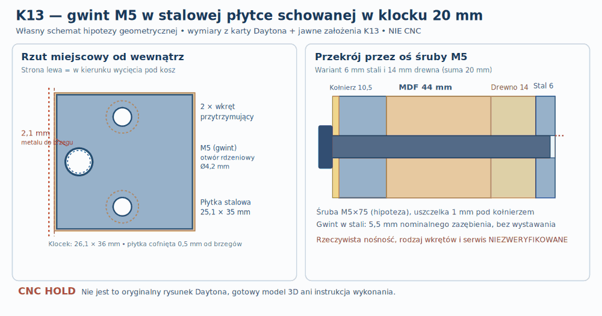

# K13 — czy można zastąpić dużą wkładkę gwintowaną płytką M5 schowaną w klocku 20 mm?

**4 listopada 2026 · Badanie konstrukcyjne po K10–K12 · niezweryfikowana koncepcja nośnika, a nie gotowy projekt technologiczny. CNC HOLD.**

## Z czego wynika decyzja?

K11 wykazało geometrię, której nie naprawi sama zmiana gatunku drewna: gdy oś śruby RSS390HF-4 leży na promieniu **184 mm**, a krawędź modelowego klocka K01 na **178,9 mm**, zewnętrzna wkładka RAMPA M5 Ø10 pozostawia **0,1 mm** nominalnego materiału, a M6 Ø12 wychodzi poza drewno o **0,9 mm**. Nie wolno tego mylić ze znacznie mniejszym **otworem przelotowym Ø5,5 mm pod śrubę M5 w MDF44** — ten pozostawia **3,35 mm** MDF między otworem a wycięciem Ø355,8. Dokumentacja: [K11](K11_realne_wkladki_pasy_drewna_i_materialy_scian.md) i [oryginalny rysunek Dayton RSS390HF-4](https://www.daytonaudio.com/images/resources/295-468-dayton-audio-rss390hf-4-specifications-46176.pdf).

Żeby nie powtarzać badań „jakie mocowania bywają”, rozpatrzono *konkretną zmianę drogi sił*: zamiast gwintu **zewnętrznego** Ø10 wkręcanego w drewno, rozmieścić **gwint wewnętrzny M5 w stalowej płytce**, przytwierdzonej od tyłu do drewnianego klocka. Płytka musi zostać **wpuszczona i pozostać w obrysie dotychczasowego klocka 20 mm**. To nowe rozwiązanie autorskie, **nie zidentyfikowana część producenta RSS390HF-4 ani faktycznie zamontowany podzespół**.

[Wersja wektorowa SVG](../wyniki/k13_plytka_M5_w_klocku20_NIE_CNC.svg) (te same wymiary, schemat, nie CAD).

*Źródła wymiarów: [Dayton](https://www.daytonaudio.com/images/resources/295-468-dayton-audio-rss390hf-4-specifications-46176.pdf) (kołnierz, rozstaw i wycięcie), [ISO 273 / metryczny otwór przelotowy i wiertło pod gwint](https://engineeredbydesign.co.uk/Pages/Eng_Data/Threadform_table.php), [ISO 4762 / wymiary łba](https://roymech.org/Useful_Tables/Screws/cap_screws). Rysunek opracowany na potrzeby badań FSzP; nie jest obrazem fabrycznego mocowania ani dokumentacją CNC.*

## 1. Jawnie zdefiniowany materiał **każdego** elementu tego wariantu

| Element | Materiał-kandydat i parametry | Co sprawdzono / czego nie sprawdzono |
|---|---|---|
| **Front z otworem** | 2 × MDF22 klejone do 44 mm; płyta bazowa P30E | Przykładowy przelot **Ø5,5 mm pod M5**, nie Ø6,5 mm kosza; pas do wycięcia **3,35 mm**. Brak prób wykruszenia MDF, tolerancji i rozkładu docisku |
| **Klocek 20 mm** | Klejonka bukowa lub odpowiednia klejonka zidentyfikowana gatunkowo; do **obliczeń masy** arbitralne **700 kg/m³**, nie właściwość egzemplarza | Model geometryczny K01; po frezowaniu kieszeni 6 mm pozostaje 14 mm drewna do frontu. Nie znamy orientacji włókien, złączy klejonki ani wyrywania |
| **Płytka gwintowana** | **S235JR**, grubość badana 4/5/6/7/8 mm; **7850 kg/m³** jako założenie masowe. [Karta hutnicza ThyssenKrupp](https://www.thyssenkrupp-materials-processing-europe.com/en/c-steel/hot-strip/s235jr-s355k2/s235jr) deklaruje **min. 235 MPa granicy plastyczności** w typowym zakresie grubości | Przesiew wymiarów. **235 MPa nie jest dopuszczalnym naprężeniem gwintu, jego nośnością w połączeniu ani zgodą na nacinanie gwintu w tej płytce** |
| **Śruba kosza** | Hipotetyczna **M5 ISO 4762**, łeb Ø8,5 mm; przykład długości pod łbem 75 mm | Otwór w kołnierzu Daytona Ø6,5 mm **nie wyznacza** otworu MDF. Długość75 i rodzaj łba nie są zamówieniem ani potwierdzeniem tolerancji/gwintu |
| **Dwa zabezpieczenia płytki** | Wkręty do drewna o nominalnym trzpieniu Ø3 mm, łbie Ø6 mm i długości pod łbem 16 mm — **wyłącznie hipoteza geometryczna** | Po odjęciu płytki6 pozostaje nominalnie **10 mm wkrętu w drewnie** i **4 mm do klejonego frontu**. Brak produktu, odpowiedniego pilota, odporności na wyrwanie, poluzowanie i uszkodzenie kieszeni |
| **Klej między klockiem a MDF** | Dotychczas kandydaci z P19A: epoksyd EA9466 oraz PVAc KLEIBERIT 303.0, **niezamienne bez kwalifikacji** | Zachowano nominalną powierzchnię styku klocka, ale **nie przeniesiono** nośności z wcześniejszych hipotez na połączenie ze stalową płytką |
| **Uszczelka kołnierza** | Pianka elastomerowa z karty kompresji; w rachunku **0,5/1/2 mm grubości po ściśnięciu** | Brak wybranej uszczelki i rzeczywistej zależności siła–ściśnięcie; bez niej nie można ustalić ostatecznej długości śruby ani momentu |

Wariant traktujemy w [paszporcie E22 z K10](../dane/k10_rejestr_materialow_czesci_obudowy.json) jako **alternatywę złożoną z płytki i dwóch elementów zabezpieczających**, nie jako nowy niezidentyfikowany materiał. W przypadku jego wyboru obie składowe muszą mieć własne karty oraz odbiór.

## 2. Czy stal ma miejsce w modelowym klocku?

Klocek z K01 ma w rzucie lokalnym **26,1 × 36 mm**; płytkę cofnięto **o 0,5 mm z każdej krawędzi**, więc jej obrys to **25,1 × 35 mm**. Zachowano *nieruchomą* oś M5 na promieniu **184 mm**.

| Pozycja / otwór | Nominalny najmniejszy pas do odpowiedniej krawędzi |
|---|---:|
| Przelot **Ø5,5 mm we froncie MDF** do wycięcia Ø355,8 | **3,35 mm MDF** |
| Średnica **zewnętrzna RAMPA M5 Ø10** w oryginalnym klocku | **0,1 mm drewna** — wariant niekwalifikowany K11 |
| **Gwint wewnętrzny M5 Ø5** w płytce stalowej do jej wewnętrznej krawędzi | **2,1 mm stali** |
| Otwór rdzeniowy **Ø4,2 mm do gwintowania M5** w płytce do wewnętrznej krawędzi | **2,5 mm stali** |
| Łeb M5 ISO 4762 Ø8,5 na koszu, promieniowo do wycięcia | **1,85 mm** |
| Otwór Ø3,4 przytrzymującego wkrętu do bocznej krawędzi płytki | **3,8 mm stali** |
| Modelowy łeb Ø6 tego wkrętu do bocznej krawędzi płytki | **2,5 mm** |
| Zewnętrzna krawędź płytki przy osi śruby **180°** do lewej ściany modelowej | **4,5 mm** |

Dwa otwory zabezpieczające płytkę mają umowne środki **8 mm promieniowo na zewnątrz od osi M5 i 12 mm stycznie w obie strony**. Otwory nie przecinają nominalnie gwintu centralnego. Wszystkie te liczby są **lokalną geometrią bez tolerancji**, nie obliczeniem rozkładu sił ani dostępu rzeczywistej frezarki/wkrętaka. Szczególnie prześwit **4,5 mm przy lewej ścianie** uniemożliwia zakładanie, że zespół można swobodnie serwisować od tyłu w gotowej skrzyni.

## 3. Co daje grubość płytki i ile naprawdę waży osiem sztuk?

Obliczono pięć grubości płytki w tej samej kieszeni. Całość — stal, drewno i zagłębione łby — **musi pozostać w 20 mm**. Obwiednia zewnętrzna jest tylko *warunkiem*, bo realnych łbów i tolerancji nie ma.

| Płytka [mm] | Drewno przed płytką [mm] | Przyrost masy 8 zespołów [kg] względem samych klocków |
|---:|---:|---:|
| 4 | 16 | +0,201 |
| 5 | 15 | +0,251 |
| **6** | **14** | **+0,302** |
| 7 | 13 | +0,352 |
| 8 | 12 | +0,402 |

Dla przykładowych **6 mm** objętość *ośmiu stalowych płytek* wynosi **0,042168 l**, masa stali bez odejmowania otworów **0,3310 kg**, wyparta masa drewna **0,0295 kg** i **przyrost 0,3015 kg**. Pierwotny materiał ośmiu klocków to **0,150336 l**, a masa przy umownej gęstości700 kg/m³ **0,1052 kg**. Suma klocków z płytkami w przybliżeniu **0,4067 kg**. Nie obejmuje to śrub, osłon, kleju ani rzeczywistych gniazd łbów.

Podmiana drewna stalą **wewnątrz** tego samego klocka nie zmienia jego wyporności jako zewnętrznej bryły, dopóki nic nie wystaje, ale zmienia masę, sztywność i obciążenia spoin. Wymaga ponownego bilansu po finalizacji wszystkich podzespołów, nie wolno poprawiać „na oko” wartości 100/120/150 l.

## 4. Długość śruby przy różnych uszczelkach

Przetestowano **45 kombinacji**: 5 grubości płytki × 3 wysokości ściśniętej uszczelki **0,5/1/2 mm** × 3 długości śruby pod łbem **70/75/80 mm**. Założono **brak dodatkowej podkładki pod łbem** i idealny pełny gwint bez fazowania/niepełnych zwojów. Kryterium **≥5 mm zazębienia (1×M5)** jest wyłącznie progiem porównawczym, **nie normatywną nośnością gwintu**.

Dla płytki **6 mm**, śruby **75 mm** i uszczelki:

| Ściśnięta uszczelka | Idealizowane zazębienie M5 | Wyjście poza klocek20 |
|---|---:|---:|
| 0,5 mm | 6,0 mm | 0 |
| **1,0 mm** | **5,5 mm** | **0** |
| 2,0 mm | 4,5 mm | 0 |

W konkretnym scenariuszu **1 mm**: od spodu łba do początku stali jest **10,5 (kołnierz) + 1 (uszczelka) + 44 (MDF) + 14 (drewno) = 69,5 mm**. Śruba **M5×75** ma wówczas **5,5 mm** nominalnego zazębienia w stalowej płytce grubości6 mm. Zostałoby **0,5 mm** nieobjętej gwintem głębokości płytki, ale **0 mm** wystawania z tyłu. Nie jest to jeszcze dobór śruby: rzeczywiste pasowanie, uszczelka, faza gwintu, DIN prowadzenie gwintu i podkładka nie są ustalone.

Tylko **9 z 45 kombinacji** spełnia umowny screen ≥1×M5 i brak tylnego wystawania. Pozostałe nie są automatycznie nienadające się do montażu, ponieważ screen nie jest normą bezpieczeństwa. Dla konkretnej uszczelki2 mm i płytki6 mm **75 mm śruba nie osiąga umownego kryterium pełnego 5 mm**; zmiana grubości uszczelki nie może być w projekcie pomijana.

## 5. Z jakiej drogi sił naprawdę korzystałby taki węzeł?

Zamiast źle podpartej, dużej wkładki w klocku z tylko 0,1 mm drewna uzyskujemy konstrukcyjnie inną drogę:

**kołnierz Dayton → śruba M5 → gwint w stalowej płytce → docisk płytki do drewnianego ramienia kieszeni → klocek bukowy → klej → MDF44 → reszta obudowy.** Dwa małe wkręty mają przede wszystkim **zabezpieczać płytkę przed obracaniem i wypadaniem**, a nie automatycznie przenosić całą siłę osiową śruby. Ich własne obciążenie może zależeć od kierunku oddziaływania, odkształceń i strat kontaktu. To wymaga analizy 3D kontaktu.

Jest to **hipoteza o przebiegu sił**, NIE już policzona nośność. Z P40A wzięto jedynie referencyjne maksymalne **151 N na jedną śrubę** dla modelu 15 kg/5g/ramię120 mm. W idealnym, nierzeczywistym przypadku pełnego kontaktu płytki z drewnem po odjęciu otworu M5 i dwóch otworów Ø3,4 mm, powierzchnia kontaktu wynosi **840,71 mm²**, a średnie naprężenie od samego **151 N** wyniosłoby zaledwie **0,180 MPa**. **Nie jest to naprężenie maksymalne, dopuszczalne ani dowód wytrzymałości**: kontakt nie musi być równomierny; lokalne ugięcie płytki może doprowadzić do koncentracji nacisków i pęknięcia przy wewnętrznej krawędzi. Gdyby **całe** 151 N rozdzieliło się po równo na dwa małe wkręty (skrajne założenie, a nie realna droga sił), każdy przenosiłby **75,5 N**. W realnym złączu siły mogą być nierówne, zmieniać zwrot, wytwarzać moment odrywający i powodować pełzanie/rozwarstwienie. **Sam E stali i deklarowane Re=235 MPa nie rozwiązują problemu wyrwania małych wkrętów z 14 mm drewna.**

Ważne ryzyko: jeżeli gwint M5 w płytce zostanie zerwany, sam głośnik można odkręcić od frontu, ale **płytki zamocowanej od tyłu klocka niekoniecznie da się wymienić w zamkniętej skrzyni**. Konstrukcja wymaga zdefiniowania bezpiecznej, serwisowalnej retencji, tak aby żadna stalowa część nie wypadła i nie zaczęła grzechotać. To może prowadzić do odrzucenia tego wariantu mimo korzystnej geometrii.

## 6. Czy zachowany został serwis wkładów 100/120/150 l?

Jeśli stalowa płytka i łby dwóch przytrzymujących wkrętów **są całkowicie schowane** w dotychczasowym klocku20 i nic nie odstaje, to **zewnętrzna obwiednia przeszkody w K02 pozostaje nominalnie taka sama** jak w przypadku pustego klocka. K02 **potrafił przeprowadzić 20/20 wkładów** przy takiej idealnej bryle. To jednak NIE jest nowa weryfikacja tras 20 modułów z rzeczywistym osprzętem — nie sprawdzono zmian kształtu drewna po wybraniu kieszeni, wystawania łbów ani montażu samych płytek.

Przy osi **180°** obrys płytki jest tylko **4,5 mm od wewnętrznej ściany**, więc docelowy montaż wymaga zaplanowania **przed zamknięciem skrzyni**, a nie zakładania późniejszego swobodnego manewrowania metalem i wkrętakami. Dla osi 0° należy powtórzyć konkretną ścieżkę **wkładu ID16**. Do tego czasu regulację 100/120/150 l na gotowej skrzyni traktujemy jako **niewykazaną**.

## 7. Decyzja i tylko następne, rozstrzygające kroki

**Decyzja K13:** stalowa płytka S235JR z gwintem M5 *schowana w klocku20* stanowi **dodatnią geometrycznie alternatywę** względem wkładki RAMPA M5 Ø10 z K11; w scenariuszu **płytka6 / uszczelka1 / M5×75** obliczenia dają 2,1 mm pasa stali, zazębienie5,5 mm i brak wystawania w obszar wkładów. **To nie jest zwycięskie ani bezpieczne mocowanie — wymaga najpierw rzeczywistej walidacji mocowania płytki do drewna.** Nie zastępuje to wariantów Francisa, T-nut ani hurricane nut w zakresie serwisowalności i zmęczenia.

Dalsze priorytety (w tej kolejności): wybrać faktyczny wkręt przytrzymujący z kartą, zwymiarować fazowanie gwintu M5, podkładki i grubość ściśniętej uszczelki; przygotować **3 porównywalne próbki** dla płytki w klocku, **3** dla bezpośredniej wkładki, **3** dla captive T-nut/hurricane (wszystkie w symulowanym froncie MDF44 i z rzeczywistą spoiną); sprawdzić wyrywanie, obrót, odspajanie i cykle ściągania głośnika; dopiero na właściwym złączu zaktualizować 3D geometrię i **przeliczyć K02/K07 w obu orientacjach**. Warunek finalny: każda ze zmiennych musi mieć tolerancję i źródło. **CNC HOLD**.

[Odtwarzalny skrypt K13](../skrypty/k13_plytka_stalowa_w_klocku20.py) · [Wersjonowane założenia](../dane/k13_plytka_m5_w_klocku20_zalozenia.json) · [Wyniki 45 wariantów](../wyniki/k13_przesiew_plytki_w_klocku20.json) · [Regresja CI](../.github/workflows/k13-captive-steel-plate.yml) · [Paszport K10](../dane/k10_rejestr_materialow_czesci_obudowy.json).
