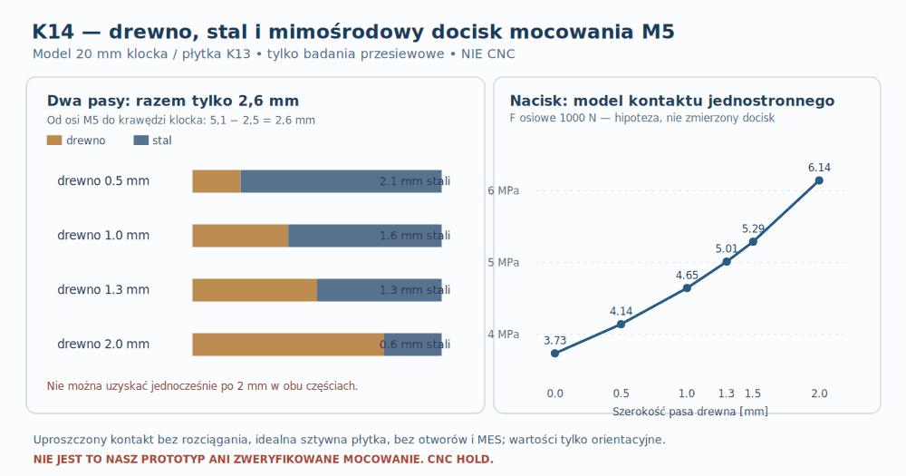

# K14 — obciążenia, mimośrodowy docisk i tolerancje płytki M5 w klocku20

**4 listopada 2026 · Następny etap po K13 · rachunki graniczne i analiza czułości, NIE kwalifikacja do wykonania · CNC HOLD.**

## Co dokładnie weryfikujemy, zamiast powtarzać wybór mocowania?

[K13](K13_plytka_stalowa_M5_w_klocku20.md) wykazał **dodatni** nominalny pas stali **2,1 mm** dla płytki z gwintem M5 schowanej w klocku, lecz nie wyznaczył nośności przy dociśnięciu kołnierza RSS390HF-4. Wcześniejsze [P40A](101_P40A_reakcje_8_mocowan.md) przeliczyło reakcje idealnych ośmiu punktów, a [P19A](030_P19A_obliczenia_spoin_i_material_kleju.md) spoiny MDF. **Żadna z tych symulacji nie jest rzeczywistym modelem kontaktu płytki z drewnem ani testem wyrwania.** K14 odpowiada teraz na trzy pytania: czy lokalna geometria w ogóle daje potrzebny materiał, jaki jest skutek mimośrodowego docisku oraz czy nominalna śruba ma zapas na nieznane jeszcze tolerancje.

[Oryginał SVG](../wyniki/k14_pasy_i_docisk_NIE_CNC.svg) · [Dane K14](../dane/k14_scieranie_styku_tolerancje_i_docisk.json) · [Skrypt](../skrypty/k14_docisk_plytki_tolerancje.py) · [Wyniki JSON](../wyniki/k14_docisk_tolerancje_64.json).

**Zasada źródeł:** rysunek Daytona i nominalne M5 są danymi wejściowymi; geometria klocka i płytki to *nasz uproszczony model* K13; progi „2 mm” i „zazębienie ≥5 mm” są hipotezami porównawczymi. Nie są danymi dopuszczalnymi materiału, normą CNC ani wynikiem prób fizycznych.

## 1. Czy przed płytką zostaje dostatecznie dużo drewna?

Zachowano środek śruby na promieniu **184 mm**, początek klocka na **178,9 mm** i promień nominalnego gwintu **M5 = 2,5 mm**. Do podziału na **drewno przy wewnętrznej krawędzi kieszeni** i **stal między gwintem a początkiem płytki** pozostaje w tym modelu:

\[
w_{\rm drewno}+w_{\rm stal}=184-178{,}9-2{,}5=\mathbf{2{,}6\ mm}.
\]

Nawet przesunięcie wewnętrznej krawędzi klocka do krawędzi wycięcia kołnierza **177,9 mm** pozostawiłoby łącznie tylko **3,6 mm**. Dlatego **nie da się jednocześnie osiągnąć choćby hipotetycznych 2 mm dla obu pasów**. To ograniczenie geometryczne niezależne od stali S235JR, odmiany klejonki czy zastosowanego kleju.

| Pas drewna przed kieszenią [mm] | Pas stali od zewnętrznego gwintu M5 do krawędzi [mm] | Komentarz |
|---:|---:|---|
| 0,0 | 2,6 | brak drewnianego pasa, konieczna zupełnie inna droga obciążenia |
| **0,5 (K13)** | **2,1** | bardzo cienki pas drewna, zero potwierdzonej nośności |
| 1,0 | 1,6 | zysk drewna kosztem stali |
| 1,3 | 1,3 | geometrycznie równy podział; oba nadal poniżej 2 mm |
| 1,5 | 1,1 | możliwe osłabienie stali przy gwincie |
| 2,0 | 0,6 | skrajnie cienki pas metalu |

Próg 2 mm służy wyłącznie porównaniu. **Nie wynika z katalogowej minimalnej odległości od krawędzi dla gwintu w stali ani z obliczonej wytrzymałości klocka**, więc jego niespełnienie nie jest dowodem złamania normy. Stanowi natomiast sygnał, że **wymiary muszą zostać dobrane przez rzeczywistą analizę wytrzymałości oraz testy**, a nie poprawione retorycznie.

## 2. Poprawne rozróżnienie sił: 151,11 N to nie siła osiowa

W [P40A](101_P40A_reakcje_8_mocowan.md) przykładowe obciążenie **15 kg, 5 g, r=184 mm, ramię=120 mm** w modelu idealnych ośmiu śrub dawało dla najbardziej obciążonej śruby:

- składową **osiową/normalną** około **119,92 N**,
- składową **poprzeczną** około **91,94 N**,
- ich **wypadkową** \(\sqrt{119{,}92^2+91{,}94^2}\approx151{,}11\ \mathrm N\).

To **nie są** zmierzone siły w K13. Wcześniejsze użycie 151 N jako osiowego docisku całej płytki było jedynie sondą referencyjną. W K14 do analizy ściskania używamy jawnie składowej 119,92 N (jako odrębnego scenariusza z P40), ale w prawdziwym mocowaniu znacznie większy wpływ może mieć **wstępny docisk od dokręcenia śruby**. Składowa ścinająca i obciążenie kołnierza wymagają własnego modelu kontaktu i tarcia.

## 3. Model kontaktu niepełnej powierzchni — co naprawdę policzono?

Przyjęto sztywną prostokątną płytkę **25,1 × 35 mm**, obciążaną normalną siłą przy osi M5 przesuniętej ku jej wewnętrznej krawędzi. W pierwszym modelu *bez rozciągania kontaktu*, gdy mimośród przekracza jedną szóstą szerokości, powierzchnia dociskana ogranicza się do trójkątnego rozkładu na pasku o szerokości:

\[
c=3\, (r_{\rm śruby}-r_{\rm krawędzi\ płytki}),\qquad
p_{\max}=\frac{2F}{c\,b},\quad b=35\ \mathrm{mm}.
\]

Rachunek ignoruje centralny otwór, dwa otwory zabezpieczające, rzeczywistą podatność, 3D naprężenia, pełzanie drewna i tarcie. **To przesiew z mechaniki kontaktu, NIE wynik MES ani dopuszczalny nacisk S235JR/drewna.**

Przy umownej osiowej sile **1000 N** (dlaczego taką siłę rozważamy — poniżej) szczytowy *wskaźnik modelu* wynosi:

| Pas drewna [mm] | Pas stali [mm] | Nominalny wskaźnik \(\ p_{\max}\) [MPa] |
|---:|---:|---:|
| 0 | 2,6 | 3,73 |
| **0,5** | **2,1** | **4,14** |
| 1,0 | 1,6 | 4,65 |
| 1,3 | 1,3 | 5,01 |
| 1,5 | 1,1 | 5,29 |
| 2,0 | 0,6 | 6,14 |

Wartości rosną przy odsuwaniu krawędzi płytki w kierunku osi M5. **Nie da się z nich wywieść bezpieczeństwa ani zniszczenia**; kluczowe są nieznana charakterystyka drewna prostopadle do włókien, rzeczywiste ugięcie i szerokość podparcia stalowej płytki, koncentracja przy kieszeni, nośność gwintu, dwie retencje i klej MDF. Niezależny model kontaktowy i test próbek nadal obowiązują.

## 4. Dlaczego sam moment dokręcania może zdominować obciążenia?

W [NASA-STD-5020B, dodatek A.2, równanie 24, str. 46](https://standards.nasa.gov/sites/default/files/standards/NASA/B/0/2021-08-06-nasa-std-5020b_final.pdf) podano nominalną zależność między momentem a napięciem wstępnym śruby:

\[
F_{\rm wstępne}\approx \frac{T}{K\,d}
\]

Przy **M5 (d=0,005 m)**, **umownym** współczynniku \(K=0,15/0,20/0,25\) i **przykładowym, niezalecanym** momencie 1 N·m wychodzą odpowiednio **1333 / 1000 / 800 N**. Ta rozpiętość pokazuje znaczenie tarcia i procesu montażu. K14 przeliczył **12 kombinacji** \(T=0,5/1/2/3\) N·m × \(K=0,15/0,20/0,25\); ich wynikowych docisków **400–4000 N nie wolno interpretować jako zalecanej siły ani momentu instalacyjnego**.

**NASA nie ustanawia wymagań dla naszego subwoofera.** Przywołano tylko równanie służące pokazaniu problemu. Nie znamy \(K\) dla rzeczywistej śruby i gwintu, momentu wynikającego z częściowego tarcia, tolerancji spoin, osiadania uszczelki ani utraty docisku w czasie. **Zabronione jest publikowanie z tych liczb „momentu dokręcania Dayton RSS390HF-4”.** Trzeba sprawdzić rzeczywistą siłę wstępną i wytrzymałość złącza.

## 5. 64 narożniki umownych tolerancji: M5×75 nie jest rozwiązaniem odpornym

W K13 rozwiązanie **płytka6 / uszczelka1 / M5×75** miało **idealizowane 5,5 mm zazębienia gwintu**, bez wystawania z tyłu. K14 zaburzył *niezależnie*, w sposób stresowy, sześć wymiarów:

| Wymiar | Nominalnie [mm] | Badany zakres [mm], **bez źródła tolerancji producenta** |
|---|---:|---:|
| Długość śruby pod łbem | 75 | ±0,5 |
| Kołnierz Daytona | 10,5 | ±0,2 |
| Grubość uszczelki po ściśnięciu | 1 | ±0,5 |
| Front MDF | 44 | ±0,5 |
| Klocek drewniany | 20 | ±0,3 |
| Płytka stalowa | 6 | ±0,2 |

Dla \(\ 2^6=64\) kombinacji końców przedziałów jedynie **24/64** spełniają *oba* umowne kryteria K13: **co najmniej 5 mm idealnego zazębienia** i **brak wystawania śruby**. W najgorszych skrajnych konfiguracjach idealizowane zazębienie spada do **3,3 mm**, a maksymalne wystawanie osiąga **1,5 mm**.

**Nie są to rzeczywiste tolerancje normowe ani partii**. Wynik obala jednak twierdzenie, że tylko liczba „M5×75” bez tolerancji, faz gwintu i docisku uszczelki wystarczy do specyfikacji produkcji. To również **nie jest dowód, że śruba 75 mm z produkcji na pewno nie zadziała**. W prawdziwym projekcie tolerancje należy zebrać z kart, ustalić limit długości gwintowanej części, fazy i ewentualny brak podkładki.

## 6. Dodatkowe ograniczenia cienkiej kieszeni i rejestracji otworów

Syntetyczny rozjazd położeń krawędzi kieszeni i drewna o **±0,1 / ±0,25 / ±0,5 mm** pokazuje, że nominalny drewniany pas **0,5 mm** może się w modelu zmniejszyć do **0,3 / 0 / −0,5 mm**, odpowiednio. To nie są specyfikowane błędy wykonawcze.

W koszu Daytona fabrycznie jest **Ø6,5 mm**. To inna część niż **Ø5,5 mm** w MDF pod hipotetyczną śrubę M5, co daje radialny luz trzpienia **0,25 mm**, a nie dowolną możliwość przesuwania osi. Przy niezależnym błędzie rejestracji środka o ±0,2 mm w X i Z przesunięcie wypadkowe wynosi **0,283 mm** i przekracza tę umowną rezerwę. Należy przeliczyć wspólnie położenie klocka, tulei/gwintu, frontu, kosza i tolerancje otworu.

## 7. Decyzja: czego teraz NIE optymalizować?

**K14 NIE dopuszcza płytki K13 do wykonania.** Należy skorygować samą geometrię przenoszenia siły, ponieważ nominalnie duży gwint stali przylega do cienkiego pasa drewna, a osiowy docisk od wstępnego napięcia śruby może dominować nad normalną reakcją P40. Kontynuacja polegająca jedynie na dalszym zwiększaniu E kleju, klasy śruby lub grubości płytki **nie zamknie badania**.

Rekomendowane dalsze zadania są wąskie: **(1)** rozważyć alternatywną drogę podparcia płytki przy tej samej pozycji otworu i 20 mm przestrzeni — obwiedniowy metalowy zacisk, podporę po bokach zamiast 0,5-mm przedniej ścianki albo płytkę opartą na pełniejszej drewnianej części; **(2)** policzyć kontakt jednostronny i trwałość miejsc zakotwienia oraz spoinę MDF w modelu przestrzennym; **(3)** dobrać realną uszczelkę, śrubę i proces kontrolowania siły docisku z kart technicznych; **(4)** powtórzyć w K02/K07 20 rzeczywistych tras modułów i dostęp narzędzia, w tym pod ścianą przy osi 180°; **(5)** zweryfikować próbki w obciążeniu i cyklach.

**Główne kryterium wyboru:** najmniej ryzykowne, *wykonalne i serwisowalne* połączenie, nie największe E ani lokalnie dodatni pas stali. Nie ma wyników zbudowanego prototypu, pełnego CAD, kontaktowego MES ani fizycznych prób. **CNC HOLD.**

[Źródłowe scenariusze](../dane/k14_scieranie_styku_tolerancje_i_docisk.json) · [Odtwarzalny Python](../skrypty/k14_docisk_plytki_tolerancje.py) · [64 kombinacje w JSON](../wyniki/k14_docisk_tolerancje_64.json) · [K13](K13_plytka_stalowa_M5_w_klocku20.md).
