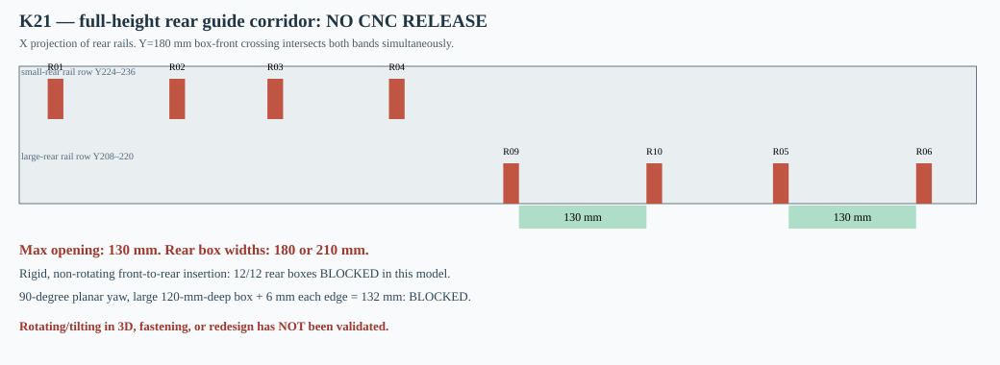

# K21 — rigorous service-throat obstruction proof for the 12 rear volume inserts

**Date: 4 November 2026 · Status: CNC HOLD.** This is a necessary-condition geometry test derived directly from K15 module destinations and K17 continuous full-height support spines. The inability to pass through a *fixed rear support barrier* is a new decision-relevant defect. It does **not** certify a full dynamic 3D path, the actual physical insert assembly, or any CNC machine operation.

## Solid premises and proof

The cabinet's available X interior spans **[22,998] mm**, vertical interior Z **[22,478] mm**. The eight permanent back-row K17 rails all extend across that entire Z interval, with X coordinates:

| Rail | X span [mm] | Y span [mm] |
|---|---|---|
| G17_COLUMN_01 | 51–67 | 224–236 |
| G17_COLUMN_02 | 175–191 | 224–236 |
| G17_COLUMN_03 | 275–291 | 224–236 |
| G17_COLUMN_04 | 399–415 | 224–236 |
| G17_COLUMN_09 | 515.5–531.5 | 208–220 |
| G17_COLUMN_10 | 661.5–677.5 | 208–220 |
| G17_COLUMN_05 | 790.5–806.5 | 208–220 |
| G17_COLUMN_06 | 936.5–952.5 | 208–220 |

Rear-small rails occupy Y224–236 and rear-large rails Y208–220. For a rear insert whose Y depth is 100 mm or 120 mm, consider its **front-facing Y coordinate equal to 180 mm**. A 100-mm box then covers Y180–280; a 120-mm box Y180–300. Both overlap **all eight** rear rails simultaneously. Every target rear module has its front Y coordinate at **227 or 247 mm**, so continuous insertion from the loudspeaker opening at the front of the cabinet necessarily passes the configuration Y=180, irrespective of intermediate X or Z movements, as long as orientation stays fixed and X/Y/Z are continuous translations.

At this crossing all full-height rail X intervals are forbidden. Their free gaps, in mm, are:

- X 22–51: 29 mm
- X 67–175: 108 mm
- X 191–275: 84 mm
- X 291–399: 108 mm
- X 415–515.5: 100.5 mm
- X 531.5–661.5: 130 mm
- X 677.5–790.5: 113 mm
- X 806.5–936.5: 130 mm
- X 952.5–998: 45.5 mm

**Maximum free contiguous X span = 130 mm.** Every rear box is 180 or 210 mm wide in the axis-aligned original pose. Thus **no such rigid, nonrotating box can cross**, even assuming zero extra clearance, an unobstructed front opening and removing every other obstacle. This is a necessary-condition impossibility proof for the current pure-translation envelope, not merely one failed path-planner heuristic. **4 small rear + 8 large rear = 12 of 12** unrotated rear inserts are blocked.

A planar rotation (yaw) can reduce projected X width, but for a rectangular box of X width w and Y depth d the X span is `w|cos θ| + d|sin θ|`, which has minimum `min(w,d)` for θ in 0–90°. Thus a 210×120mm rear-large box can narrow to **120 mm** at ~90° yaw; with a *hypothetical 6mm service clearance per side*, it requires **132 mm**, still greater than the **130 mm** available. Therefore the **eight rear-large modules** cannot cross via *pure planar yaw and translation* with that specific 6mm margin either. The four 180×100mm small rear modules may fit a 130mm horizontal gap when yawed by 90° (100+12=112), but passage still requires verifying depth, corners, braces and tools.

**Important limitation:** full spatial pitch/roll may reduce an X projection beyond the planar-Yaw minimum by presenting another box dimension (notably the 100mm Z height). Such a route requires a complete 3D swept-volume planner with a realistic rigid shape and assembly sequence, which has NOT been implemented. No universal claim that all 3D mounting is impossible has been made. K17 lower shelves, keeper fasteners, actual basket shape and wire clearances would only add constraints.

## Why the prior K02/K07 success is not evidence here

K02/K07 checked older module insertion with K01 pads and P30E bracing, **before all 12 full-height K17 guide spines were added**. K17 and K20 report only static *installed-position* AABB nonintersection. A zero solid clash at the destination does not imply a connected collision-free route from outside to inside. Existing K18 guide DXFs therefore remain **CNC HOLD**, as reinforced by K20's absent physical keeper joint and eight edge-opening pockets.

## Targeted redesign screen, NOT an approved rail removal

A purely hypothetical removal of one back rail yields these widest unblocked X gaps:

| Candidate temporarily removed | Maximum open X span [mm] | Support-bearing modules affected |
|---|---:|---|
| G17_COLUMN_05 | 259 | 4, 5, 6, 7 |
| G17_COLUMN_10 | 259 | 12, 13, 14, 15 |
| G17_COLUMN_09 | 246.5 | 12, 13, 14, 15 |

These candidate 246–259mm gaps are merely **a first topological check**; they do not prove a route with K15 braces, driver opening, tools or other attachments. Moreover removing one rail removes one of two geometric support paths for the affected modules. Reintroducing a 456-mm full-height rail after insertion through a nominal Ø355.8-mm opening may itself be impossible without a proven tilted assembly route. **Do not remove or cut any rail on the strength of this table.**

## Immediate engineering response (next K22 design)

1. Choose a fundamentally serviceable support architecture: shorter detachable rails / externally accessible mechanically retained shelf carriers / alternative bracing that leaves a **continuous service throat** wide enough for the bounding box and assembly hand/tool envelope. Avoid imposing an unsupported one-rail-per-module condition.
2. For each candidate, define all real fasteners, panel joints and keeper contacts, and run 3D sequential (translation + rotation) swept-solid geometry for the actual **20-module sequence** and its reverse, and for vertical/horizontal/transport orientations.
3. Reinstate measured or documented mass and elastic/bearing strength, tolerance stack, corner radii, full-depth basket shape and wiring, then repeat the 100/120/150 L union-volume calculation and acoustic verification. None can be declared before realistic components exist.

**Decision: reject K17/K18/K20 as a proven installable rail layout. Keep the existing research DXF explicitly blocked.** The independent [K21 generator](../skrypty/k21_gardziel_montazowa.js) recreates the [machine-readable study](../wyniki/k21_przesmyk_montazowy.json) and this SVG. The numeric barrier proof is reproducible, and its domain is explicitly limited.
