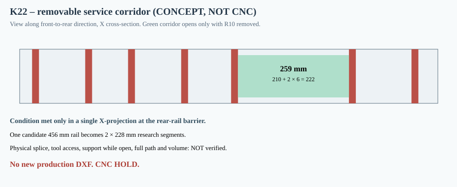

# K22 — sectional rear rail as a research candidate to reopen the blocked service throat

**4 November 2026. Computational geometry only; CNC HOLD.** This is a response to the [K21 proof](K21_przesmyk_i_weryfikacja_montazu_wkladow.md), not a new manufacturing release.

## Why this candidate

K17's eight permanent rear spine X projections leave a 130 mm widest gap, preventing even *purely translational* passage of twelve rear boxes. A targeted topology screen temporarily omits **G17_COLUMN_10**, whose X coordinates are [661.5, 677.5] mm. This produces an X corridor **[531.5, 790.5] = 259.0 mm**, while leaving the other seven rear rows in their current positions.

| Box family | Width [mm] | Hypothetical side clearance [mm] | Width demanded [mm] | Available X opening [mm] | Allowed box-left-X range [mm] |
|---|---:|---:|---:|---:|---|
| Small rear, 4 boxes | 180 | 6 each side | 192 | 259 | 537.5–604.5 |
| Large rear, 8 boxes | 210 | 6 each side | 222 | 259 | 537.5–574.5 |

This demonstrates only that the **necessary X cross-section** is no longer blocked. It does NOT show how the boxes arrive at the passage, avoid the existing K15 braces and K17 lower lips, rotate, reach their target locations or are held while the missing rail is being restored.

## Can the removed full-height spine be brought in afterward?

Its nominal XZ presentation is 16×456 mm. The opening Ø355.8mm has radius 177.9mm. For a centered upright rectangle with a **hypothetical 6mm margin** added to each face, the farthest corner lies at `hypot(16/2+6,456/2+6) = 234.418mm`, exceeding 177.9mm. Therefore the *upright full-length spine cannot pass directly through the opening* without 3D rotation/reorientation.

Splitting that rail into two 16×12×228mm nominal pieces would give an upright XZ rectangle corner radius of `hypot(16/2+6,228/2+6) = 120.814mm`, fitting the aperture's projection. This does **not** prove the route inside the cabinet or that either segment can be attached after modules are in place.

The generated K22 geometry independently identifies **G17_15_shelf_2 occupying Z=250–254 mm exactly at the proposed split plane Z=250 mm**. This is a direct coincidence with an existing load-support feature, not a free zone for a connector. Any split at that height must relocate the structural joint or **redesign the shelf and its force-transfer detail**, including hardware and the resulting interference envelopes. Do not manufacture two 228mm rail halves on the assumption that this plane is already usable.

The splice would lie at global Z=250mm, with **zero modeled lap/fasteners**. K17's existing lower and upper contact features and the neighboring box stack must be revisited: this rail currently supplies one of the two nominal support paths for **modules 12, 13, 14, 15**. A butt splice alone is **not mechanically sound** and does not restore certified stiffness or retention. A scarf, overlap, metal sister plate, keyed mechanical connector or rail-carrier change will only be selectable after access/clearances, material tests and stress analysis.

## Conditional release criteria

This screen is useful because it identifies **one possible topology**, not because the actual module mount is now proven. The immediate task is a real 3D swept-volume assembly study with a physically dimensioned positive-lock segment splice, module temporary support and complete fasteners; check every module and both segment paths under the cabinet's 500mm depth envelope. Then test rail splice and shell-anchor coupons (bending, tear-out, preload, fatigue, creep, humidity, transport), recompute fixed and removable geometric displacements and modal behavior, and finally regenerate all production DXFs.

**Decision: no K18 DXF may be machined; the K22 gap and two-piece presentation are only feasibility conditions.** See [K22 raw machine-readable screening](../wyniki/k22_dzielona_szyna_przesmyk.json) and [reproducible program](../skrypty/k22_analiza_szyny_segmentowej.js).
