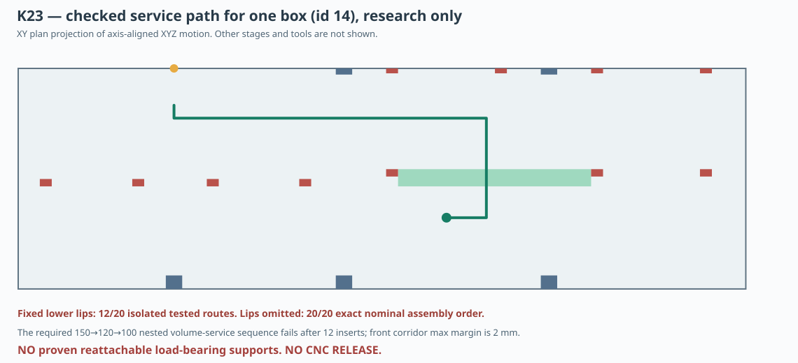

# K23 — swept AABB module entry and reversibility: physical regulation remains open

**4 November 2026. Research model, CNC HOLD; no new machining output.**

## Method, checked geometry and limitations

Read K15's actual 138 nominal solids and all K17 spines and lips, then remove only the proposed single segmented rail `G17_COLUMN_10` as in [K22](K22_dzielona_prowadnica_i_przejscie_montazowe.md). Obstacles: 16 reference cabinet panels/braces (the two front panel solids are replaced by a numerical centered Ø355.8 hole), the remaining 11 full-height rails, a nominal rear 50mm damping mat, plus 36 original lower tongues when explicitly selected. The upper K20 detachable keepers are absent during insertion. Each module begins outside the removed speaker opening. All 20 modules are represented as precisely dimensioned rigid axis-aligned K15 boxes. All movement waypoints follow X, Y or Z axes only, with **continuous full swept AABB union collision checks** for each segment and all previously installed boxes.

This is more rigorous than checking final placements but less general than 6DOF geometry. Zero-thickness tangency between ideal surfaces is permitted. No tolerance, chamfer, real Dayton basket, module fastener, human/tool envelope or cabinet deformation is included.

## Computed reference outcomes

| Test | Result |
|---|---:|
| Isolated module, 36 integral lower lips intact | **12/20** proposed paths clear |
| Isolated module, lower lips hypothetically absent | **20/20** proposed paths clear |
| One full nominal sequence with lower lips absent | **20/20** success |
| Same path order reversed, lower lips absent | **20/20** success |
| K07-like nested states: 150→120→100L, lower lips absent | **12/20** then fails |
| Four small-rear removals from all-20 installed state, same reverse route | **0/4** clear |

The passing 20-box construction is in order:

`0 → 2 → 1 → 3 → 4 → 12 → 6 → 14 → 7 → 15 → 5 → 13 → 8 → 16 → 10 → 18 → 11 → 19 → 9 → 17`

**This order is NOT an operational adjustable-volume mechanism.** With desired K15 states (150L: box4; 120L: boxes4–15; 100L: all20), a route attempted in nested order beginning with boxes4–15 fails when placing small rear box0 after twelve existing boxes: it intersects boxes12 and14. Attempted reverse-path removals of all four small rear boxes from the full100 state likewise intersect retained rear large boxes. These are *candidate-path counterexamples*, not universal proofs that every possible 6DOF motion fails.

## Why temporary omission of lower lips is not a solved design

With existing K17 lower lips, 8 isolated module paths hit protruding fixed lips, specifically the low/high rear-large and front-large families; their first colliding feature IDs are in the JSON audit. The successful all-20 sequence only becomes possible when the 36 surviving lower tongues are **deleted from the obstacle list during travel**, despite those tongues being physically integral to K18 rail contours. A CNC worker cannot produce the current monolithic K18 lip profile and also remove/reinstall those lips during service. Detachable lower supports therefore need a complete new, mechanically qualified joint and screw access *after the relevant box is placed*.

## A second independent geometry blocker: 2 mm nominal front transport window

A 210×150×100 mm **front-large** insert moving laterally from the speaker opening to right-hand X destinations must pass an intermediate X overlapping both the K15 B1 front web [X448,470] and a rear-large fixed rail [X515.5,531.5]. Their blocking Y intervals are [44,54] and [208,220]. Thus the front module's 150mm Y depth must fit into **[54,208] = 154mm**, allowing a maximum symmetric nominal **2mm transport clearance**. An independent lateral swept test passes nominal expansions 0/1/2mm, but fails at 3mm. This is only the lateral leg and does not imply a complete route with positive tolerance: at the final front placement the module touches the front support face.

## Engineering decision and next discriminating studies

1. **Replace integral low lips** with a small set of mechanically accessible, removable load-bearing shelf/carrier interfaces, not an unsupported 4mm tab. Validate stress, bearing, shear, pullout, preload and vibration with real materials and coupons.
2. **Find a truly reversible state-switching route** for 100↔120↔150 L, with other boxes retained, after all physical shelves and keeper screws have been added. Use 6DOF swept solid + actual insertion tool reach.
3. **Relieve the front 2mm passage** or redesign the installation sequence, e.g. mechanically detachable guides or front web support outside the active service throat; do not silently accept zero- or 2mm fit as a production tolerance.
4. Finalize full-height split rail splice and check tool access; K22's original split at Z250 clashes with an existing supporting lip Z250–254. Prove rail segment insertion after all boxes.
5. Recompute total occupied volume and electroacoustic case for each truly attainable configuration. All present numbers remain hypothetical pending physical measurement.

[K23 reproducible Node generator](../skrypty/k23_swept_montaz_i_zmiana_litrazu.js) · [JSON complete trial paths](../wyniki/k23_swept_montaz_wkladow.json) · [regression workflow](../.github/workflows/k23-swept-insert-assembly.yml)

**Final decision: current K18 DXF remains under CNC HOLD.**
