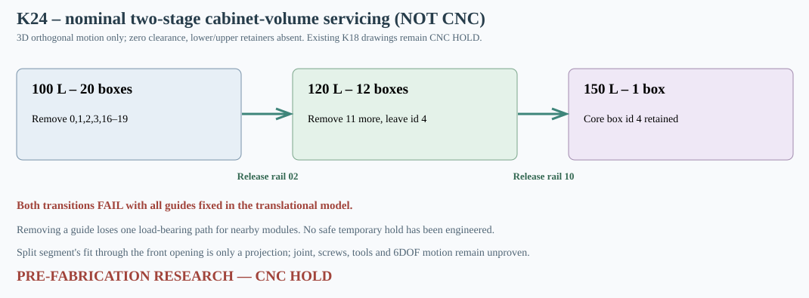

# K24 — Two-phase service corridors and detachable-guide feasibility for 100/120/150 L

**4 November 2026 — engineering research only. CNC HOLD.** The purpose of this study is to resolve the actual regulator service topology rather than merely showing that all 20 insert modules can be fitted once. This is an extension of [K23](K23_analiza_ruchu_wkladow_i_regulacji.md), not a validated mechanical mounting system.

## Algorithm and strict domain

A 3D **axis-aligned configuration-space graph** is built by expanding every nominal K15 cabinet obstacle, K17 continuous spine and already installed sealed box by the current module's half dimensions (Minkowski sum). The finite orthogonal cell grid includes the obstacle critical planes and midpoints. Breadth-first search finds connected translations between the nominal centered speaker cutout entry and the box target. Each returned simplified route is independently checked by **continuous full swept AABB** along every X/Y/Z line segment. The proposed speed/ordering result is therefore broader than the single manually chosen K23 route.

**Deliberate idealizations:** only XYZ translations, zero minimum gap, exact tangent contact allowed; the two full front panels are replaced by a centered nominal Ø355.8 aperture and the driver is absent. All K17 lower lips, K20 upper keepers, screws, seals and service tools are **omitted**. The removed full-height guide cannot actually be removed and replaced until a mechanically sound segmented connection is designed. The graph gives a route in an ideal mathematical cabinet, not an approved manufacturing or maintenance procedure. No physical accessibility, pitch/yaw/roll, thermal and dimensional tolerances or actual speaker basket checked.

## Stage A — nominal 100 → 120 L

K15 says the required state change removes box IDs **0, 1, 2, 3, 16, 17, 18, 19**, retaining the 12 large boxes 4–15. The K24 graph tested all **16 subsets of four small-rear fixed guide columns**. The results were:

- With none removed, or with **G17_COLUMN_01 alone** removed, none of small-rear 0–3 could reach the front opening while the 12 large boxes stayed installed.
- Removing **any one of G17_COLUMN_02, 03 or 04** admitted all four small-rear box individual paths with the 12 large boxes still present, in the zero-clearance no-lip computational cabinet.
- Selection **G17_COLUMN_02** is a *provisional* research option because its X location is relatively near the cutout and its hypothetical straight split at Z250 coincides with **no existing K17 lip**, unlike the large-rear rail10.

With guide02 absent, a stepwise shortest-reachability greedy search from the **full 100L configuration** finds a continuous collision-free removal order of **0 → 1 → 2 → 3 → 16 → 17 → 18 → 19** (8/8 modules), each checked against the remaining installed 19…12 boxes. With all rails fixed, the control can remove **4** modules before stalling; this does not prove general 6DOF impossibility.

## Stage B — nominal 120 → 150 L

K15's 150L state retains **only box 4**. With G17_COLUMN_02 restored to its nominal state and **G17_COLUMN_10 temporarily omitted**, the full computational route search returns the removal order **8 → 9 → 10 → 11 → 12 → 13 → 5 → 7 → 6 → 14 → 15** (11/11 modules), leaving box4. With all rails fixed, the control removes only **4** modules before stalling.

Both stages are reversible **as mathematical unfastened routes** by running the saved paths in reverse module order with the same rails temporarily absent. This is *not* proof of tool access, safe guide disconnection, positive module retention or operational volume setting while the cabinet is powered.

| Condition | Modules removed before search stalls | Required | Classification |
|---|---:|---:|---|
| 100→120L, no released guide | 4 | 8 | Blocked in studied graph |
| 100→120L, guide02 released | **8** | 8 | Translation graph passes, unfastened model |
| 120→150L, no released guide | 4 | 11 | Blocked in studied graph |
| 120→150L, guide10 released | **11** | 11 | Translation graph passes, unfastened model |

**One-millimetre uniform interference/clearance perturbation:** The companion sensitivity runs are included in the [raw K24 results](../wyniki/k24_drogi_serwisowe_i_podpory.json) (A completed: false; B completed: false). They MUST NOT be conflated with approved CNC tolerances; some front module locations touch fixed rail solids by design at nominal zero gap.

## Mechanical load demand and near-box access: unresolved safety blockers

Removing **G17_COLUMN_02** removes one nominal supporting spine for small boxes **0 and 1**. Removing **G17_COLUMN_10** removes one nominal supporting spine for rear-large boxes **12–15**. None of these boxes may be left suspended or unsecured during service. K15 panel-volume mass calculations under **assumed density 730kg/m³ and a hypothetical 5g inertial event** give:

| Temporarily missing support | One-box shell mass kg | Load per original pair side N | Demand on only remaining side N | Conservative far-tip moment N·mm | Idealized beam stress MPa |
|---|---:|---:|---:|---:|---:|
| G17_COLUMN_02, box0 | 0.469 | 11.508 | **23.017** | **529.391** | 12.408 |
| G17_COLUMN_10, box12 | 0.602 | 14.774 | **29.548** | **561.414** | 13.158 |

These hypothetical 5g one-support demands are **not** material strength verification, are not mandatory design loads and do not determine allowable MDF/steel failure criteria. They serve as an engineering warning to design a real independent temporary grip/load path before any guide can be removed.

At the rail-to-box interface the nominal available Y gaps are **11mm (small rear), 7mm (large rear), and 0mm (front large)**. Between the back of front-large boxes (Y202) and the front of rear-large rails (Y208) there is **6mm**. For an *arbitrarily chosen* small straight tool with 10mm shaft diameter and 1mm free passage on each side (12mm overall), none of these gaps provides the required corridor. This is a screening assumption, not a chosen production fastener or verified human tool envelope. Sideways/angled tool access and tool-free locks remain to be designed and validated.

## Splitting the chosen guides is NOT a solved structural joint

G17_COLUMN_02 is nominally 456mm high. A split at global Z250 yields two 228mm pieces. No K17 lip coincides with this cut plane, and each upright 16×228mm segment with a hypothetical 6mm margin has a corner radius 120.814mm under nominal cutout radius177.9mm. It therefore **fits the frontal opening in projection**, but the complete three-dimensional insertion, screw/clip attachment, pull-out, buckling, bending, fretting, fatigue and release route were not simulated. In contrast, G17_COLUMN_10 currently has a lower shelf intersecting nominal split Z250 and needs a different splice geometry.

The rear-small guide02 can therefore be prioritized for a physically testable prototype joint (perhaps a metal bridge or keyed coupler), but **no bolt diameter, hole placement, CNC contour or preload is approved**. An alternative is to redesign the fixture so boxes attach to independent cabinet-brace or shell supports while all service corridors remain free.

## Practical next engineering release gates

1. Define a captive, **positively locked two-part rail02 joint** and a different physically load-bearing rail10 splice that avoids the occupied Z250 shelf plane. Include actual attachment to MDF22 top/bottom, axial tool approach and required installation/removal with modules already in place.
2. Define removable *lower load-bearing ledges* and *upper anti-inversion/anti-rattle keepers*, with reattachment access inside the now-demonstrated route geometry; add their fasteners/anchors as real finite 3D solids.
3. Repeat the full 100↔120↔150 cycles **with all actual fixture solids present except at clearly documented service instants**, including temporary safe support for modules0/1 and12–15.
4. Validate clearance/tolerance stacks, cutter radii, material coupons and fatigue/impact, with measured stock and specified loads. K23's front-side transport pinch is at most 2mm nominal per side for the 150mm-deep front box.
5. Recalculate net sealed-box displacement, real air volume and electroacoustic results at 100/120/150 L; only then replace research DXF with production CNC drawings and a safe fabrication release.

All saved CSV/DXF designs K18 are **CNC HOLD**. [K24 generator](../skrypty/k24_dwuetapowe_trasy_serwisowe.js), [machine-readable stepwise routes and all 16 masks](../wyniki/k24_drogi_serwisowe_i_podpory.json), [regression workflow](../.github/workflows/k24-service-sequence-search.yml).

