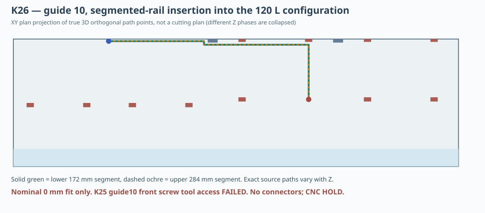

# K26 — actual 3D translational swept paths for the two serviceable segmented guides

**2026-11-04 — CNC HOLD.** The K25 splice height / tool audit used only stationary plate contact zones and frontal aperture projections. K26 now checks **continuous motion of both rail segments**, including the occupancy of the previously inserted half, in each operating volume state.

## Exact scope

The [reproducible Node study](../skrypty/k26_trasy_dzielonych_prowadnic.js) reads K15 cabinet solids and 20 K15 module boxes, 12 K17 full-height rails and K25 split proposals. It removes the *selected* guide from the obstacle list, adds back every other K17 solid spine, 16 reference cabinet internal/side/rear panel/brace solids and rear 50mm mat; installs modules according to nominal 100L (20), 120L (12), 150L (1). **Lower integrated lips, upper keepers, real connector plates and fasteners are intentionally absent**, because they have not been engineered as movable components. The front double MDF panel is represented by the nominal centered Ø355.8 reference cutout at its passage; the actual Dayton basket is removed.

Each rigid guide part is represented as a real-sized **16×12×segment-height mm upright cuboid** and searched in 3D using orthogonal XYZ critical-plane cell decomposition/BFS. The movement does not rotate the segment. Every returned shortened path's axis-aligned segments are independently checked with their **complete continuous swept AABB volumes** against all remaining obstacles. In each order, the first already installed segment is included as a rigid obstacle to the second. This is a mathematical **zero-clearance** positioning test, not physical installation, hand/tool access or CAM.

## Reproducible results

| Guide / split Z | Cabinet state | Rail halves [mm] | Install both halves, lower-first? | Install both, upper-first? |
|---|---|---|---|---|
| G17_COLUMN_02, Z250 | full100 | 228 + 228 | PASS geometry | PASS geometry |
| G17_COLUMN_02, Z250 | core120 | 228 + 228 | PASS geometry | PASS geometry |
| G17_COLUMN_10, Z194 | core120 | 172 + 284 | PASS geometry | PASS geometry |
| G17_COLUMN_10, Z194 | single150 | 172 + 284 | PASS geometry | PASS geometry |
| G17_COLUMN_10, Z194 | full100 | 172 + 284 | BLOCKED | BLOCKED |
| G17_COLUMN_10, Z300 | core120 | 278 + 178 | PASS geometry | PASS geometry |
| G17_COLUMN_10, Z300 | single150 | 278 + 178 | PASS geometry | PASS geometry |

**Guide02**: in the full 100L assembly and in 120L, both 228mm nominal segments can pass from the nominal speaker entry through the cabinet to the X175–191/Y224–236 guide location, and be removed in the reverse order. A typical lower-rail centre route is `[231,50,250] → [183,50,250] → [183,50,136] → [183,230,136]`; the upper-rail reaches Z364 instead.

**Guide10**: when 120L contains just the large boxes, or when 150L retains only box4, both halves of the Z194 split (172mm +284mm) can pass one after the other via the X≈440 crossover staging corridor. The lower representative centre route is `[231,50,250] → [440,50,250] → [440,50,130] → [440,60,130] → [669.5,60,130] → [669.5,60,108] → [669.5,214,108]`. Both rails are demonstrably **BLOCKED** in the full 100L state for this fixed-orientation translation-only model. The alternative Z300 split (278+178mm) likewise passes both orders for 120L/150L, but it is not mechanically qualified either. The guide10 *straight face-mounted screw tool* remains blocked per K25; passing rail bodies do not solve fastening.

The results support precisely the **staged idealized chronology**: guide02 temporarily removed for 100↔120, then restored; guide10 temporarily removed for 120↔150, then restored. The latter cannot be brought through the current full 100L populated case. This justifies keeping the two changeover operations distinct in future mechanical studies.

## Clearance experiment: 0 mm succeeds but uniform +1 mm does not

The raw data include independent 0, 1 and 2mm expansion tests. In the +1mm test the guide's **nominal seated end** (Z22 for the lower piece, Z478 for the upper) is by construction flush with the cabinet's Z22..478 inner boundary, so the target cannot support a uniform 1mm clearance to the shell. Both halves also touch at the split. Hence a failed 1mm *uniform margin* cannot be interpreted as a measured 0mm real passage clearance. **Different tolerances must be assigned to slide clearance and to intentional seated/locked joints**, and those joints need full dimensional stacks, chamfers and machining radii. Do not claim this model proves a feasible milling allowance.

## Interaction with K25 connection and tool access

K25 found a hypothetical frontal Ø14mm Y-axis tool path to rail02's Z250 plate zone, but **NO** such path to rail10's Z194 plate zone (only 4mm and 5mm Y gaps to nearby boxes; centred tool normal at X669.5 lies outside the driver's nominal opening). K26 moves the unfastened 16×12 rail parts; it neither includes a load-transferring splice nor solves tool access, fastener torque, locking direction, support under load, vibration, humidity or fatigue. An alternative remotely released connector, captive pin, accessible service hatch or different load-bearing carrier is still needed.

At no stage has a safe temporary second support been designed for boxes0–1 (guide02) or12–15 (guide10) during detachment. The K25 5g + hypothetical 0.2kg per box one-sided loading is a **demand screen**, not an allowable MDF design value.

## Engineering outcome and K27 recommendation

**Important progress:** guide02 and guide10 **do not have to be geometrically rejected solely because their 228mm / 172+284mm rail parts might be impossible to fit through the front opening after the boxes have been positioned.** Under K26's strict zero-clearance fastener-free geometry, both service conditions admit an ordered 3D translational route. This does **not** mean the real assembly is buildable.

Next K27 should compare (1) guide02 positively retained split joint with tools that can reach from the driver hole; (2) guide10 remote-action captive mechanism or large access cassette instead of a conventional face bolt; (3) safe independent load support during operation. Model their true 3D parts and insertion/removal paths, then test failure/creep/pullout of real MDF and fastener coupons. Recompute volume after hardware. No final DXF shall be produced until all these risks are resolved.

**Existing K18/K20 research DXFs: CNC HOLD.** [Machine-readable K26 route data](../wyniki/k26_przejscia_dzielonych_prowadnic.json) · [generator](../skrypty/k26_trasy_dzielonych_prowadnic.js).
