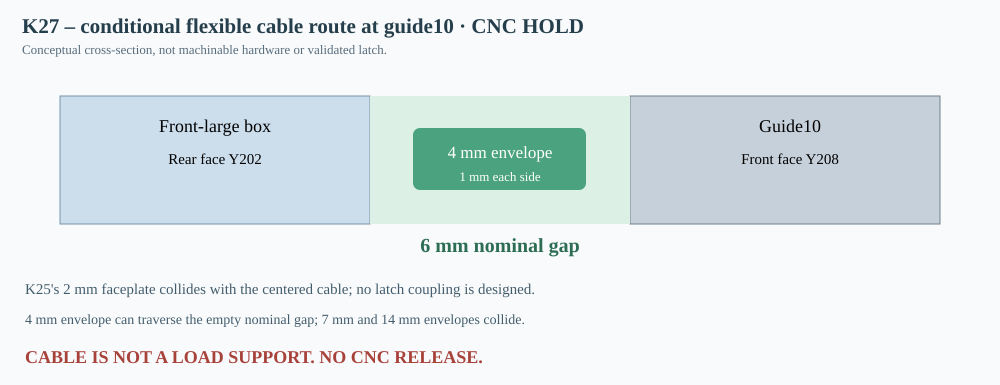

# K27 — remote cable corridor to guide10; conventional faceplate incompatibility

**4 November 2026. CNC HOLD.** Following K25's proof that a nominal 14 mm screwdriver envelope cannot approach guide10's Z194 splice through the driver opening, and K26's unfastened guide-half insertion proof, this study tests one alternative actuation corridor. It does NOT approve a load-bearing latch or any CNC file.

## Modeled access route

Source model: K15 cabinet and all installed boxes in states 100L/120L/150L, all 12 K17 guide columns and 80 original integral lip solids, and the 50mm rear damping-mat envelope. The two front MDF sheets are represented by the nominal centered Ø355.8mm speaker opening with the driver removed. An assumed flexible line begins at X231/Y44/Z194, proceeds to X231/Y190/Z194, follows a sampled quarter-circle of radius 15mm ending at X246/Y205/Z194, and travels laterally to X669.5/Y205/Z194. The endpoint is still 3mm IN FRONT of guide10's Y208 face.

All 34 motion segments are checked using continuously swept square AABB envelopes. A 32-chord sample of the quarter bend has a maximum R15 chord sagitta of 0.0045177mm. The physical cable bend radius, duct guides, friction, torque and end coupling remain unknown. The result refers to a flexible-cable routing envelope, NOT a rigid screwdriver capable of turning around a corner.

## Finite-envelope comparison (core 120L)

| Outer square envelope (mm) | K15+K17 collision audit | Remaining nominal width in 6mm Y throat (mm) |
|---|---|---|
| 4 | clear | 2 |
| 5 | clear | 1 |
| 6 | clear | 0 |
| 7 | collision | -1 |
| 14 | collision | -8 |

With width 4mm, a hypothetical Ø2mm cable with 1mm free clearance on each side crosses the empty slit at nominal Y205. In this region, a front-large box ends at Y202 and rear-large rails begin at Y208, leaving 6mm. Outer width 6mm produces mathematical tangency and **zero** extra allowance. At 7/14mm the trial line collides. The same unplated 4mm nominal envelope was checked in all three installed-module states.

**Negative finding:** K25's theoretical 2mm front-face plate at X661.5–677.5/Y206–208/Z169–219 intersects the centered 4mm cable envelope at Y203–207 in a positive 1mm Y overlap. Even after shifting the centreline, a 2mm plate plus a 4mm envelope consumes the entire 6mm slot. The original face-bolted plate plus thin remote cable is therefore not a robust mechanically compatible assembly.

## Tolerance screen, not a specification

A nominal width 6mm with outer width 4mm leaves 1mm per side. If each opposing surface intrudes 0.5mm, the remaining per-side free room is 0.5mm. If each intrudes 1mm, the nominal fit becomes tangential. No MDF thickness, moisture, bondline, metal plate or cable datasheet was measured; this sensitivity is only a screening hypothesis. Physical cable connectors need room, radiused bends, strain-relief and fixed anchoring that are not modeled.

## Structural safety (distinct from the control cable)

Using K25's intentionally hypothetical density 730kg/m³, ancillary mass 0.2kg per box and 5g acceleration, the four rear-large boxes impose a combined inertial load demand of 157.43245N. The remotely pulled cable must NEVER be counted as structural support. Positive independent restraints must hold modules12–15 while rail10 is unlatched. No MDF bearing, fatigue, screw pullout, lock retention force, cable strength, assembly vibration or creep results exist.

## Next discriminating K28 research

Model a flush nonprotruding positive latch with captive fail-safe connector AND independently load-rated temporary module supports, or compare a gasketed access cassette. Include real actuation force and stroke, lock state verification, cable sheath, full couplings and hand/tool 3D access. Repeat the complete K24/K26 state switching sequence with actual finite parts, clearance stacks and material coupons. Recompute internal displacement and acoustics before machining.

**Decision: empty-corridor existence VERIFIED in the stated nominal geometry; K25 faceplate+cable combination REJECTED in its centered geometry. Actual positive latch NOT ENGINEERED. All K18 DXF remain CNC HOLD.**

[Reproducible K27 generator](../skrypty/k27_zdalne_odblokowanie_prowadnicy10.js) · [Numeric results](../wyniki/k27_zdalne_sterowanie_przekroje.json)
