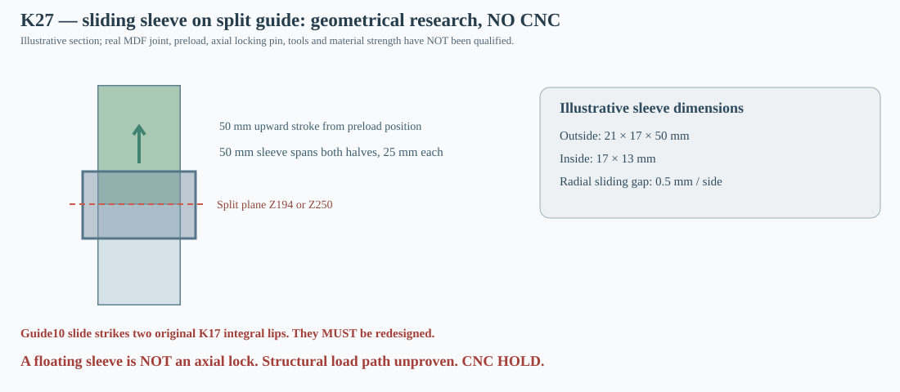

# K27 — 3D service motion of a preloaded sleeve and full guide segments (structural LOCK NOT proven)

**4 November 2026 — CNC HOLD.** K25 showed that a straight front-normal service tool cannot reach the guide10 splice, while K26 proved guide halves alone can pass through the current cabinet in the appropriate volume states. K27 now adds **a physically dimensioned trial bridging sleeve envelope** to the moving lower rail. It is deliberately tested as a *negative control for lack of a positive axial lock*. No fabrication drawing, material grade or hardware specification is approved.

## Geometric hypothesis

Consider a continuous sleeve slid over 16×12mm nominal laminated MDF8 rail sections. **Illustrative, not manufactured:** wall thickness 2mm, 0.5mm sliding gap per radial side, inside 17×13mm, outside 21×17mm, length 50mm. Four separate 50mm-high wall cuboids are used for collision checks, leaving the central void for the rail. Material displacement **6,800 mm³ = 0.0068 L per sleeve** (0.0136 L for both), not a complete air-volume calculation.

The sleeve is *preloaded on the lower rail half*, its 50mm length initially entirely below the junction. Once the two 16×12mm guide segments are seated end-to-end, the sleeve is translated upward **50mm**, ending with 25mm over each half. The **full lower rail is conservatively enlarged to its sleeve's outer 21×17mm cross-section over the entire segment height** for the first entry route; this AABB overestimates the real combined rail/sleeve volume and makes the motion feasibility check stricter for those paths. The upper half then enters with the enlarged lower assembly counted as a permanent obstacle.

## Independent swept-motion tests

The [reproducible K27 generator](../skrypty/k27_tuleja_przesuwna_i_trasy.js) reads K15, K17, K25 and K26. It builds orthogonal 3D critical-plane BFS routes from the centered nominal speaker Ø355.8 entry and independently checks every continuously swept AABB segment against the 16 fixed K15 inner cabinet solids, other K17 rails, installed volume boxes, and the rear 50mm mat. Then it checks the four **actual hollow ring walls** as they slide 50mm in Z with both guide halves already present.

| Guide / state | Split [mm] | Enlarged lower-with-sleeve followed by upper | Sliding sleeve with old integral lips omitted | Sliding sleeve with original K17 tongues |
|---|---:|---|---|---|
| G17_COLUMN_02, full100 | 250 | PASS nominal | No scene clashes | No tongue clash |
| G17_COLUMN_02, core120 | 250 | PASS nominal | No scene clashes | No tongue clash |
| G17_COLUMN_10, core120 | 194 | PASS nominal | No scene clashes | **BLOCKED: G17_12_retainer_2, G17_14_shelf_2** |
| G17_COLUMN_10, single150 | 194 | PASS nominal | No scene clashes | **BLOCKED: G17_12_retainer_2, G17_14_shelf_2** |
| G17_COLUMN_10, full100 | 194 | BLOCKED | No scene clashes | **BLOCKED: G17_12_retainer_2, G17_14_shelf_2** |
| G17_COLUMN_10, core120 | 300 | PASS nominal | No scene clashes | **BLOCKED: G17_14_retainer_2, G17_15_shelf_2** |

**Critical new finding:** guide10 Z194 has no sleeve-slide collision with the other cabinet solids or the 120L/150L modules **only while its old integrated lips are absent**. If the existing K17 guide10 tongues stay attached, the moving rear wall strikes **G17_12_retainer_2** and **G17_14_shelf_2**. The alternative Z300 hits **G17_14_retainer_2** and **G17_15_shelf_2**. A one-piece sleeve is **not compatible with the old K18 lipbed rail profiles**; a genuinely removable load-bearing bracket architecture is required. Guide02 Z250 happens to avoid these tongue clashes over the test slide window.

The guide10 Z194 preloaded lower half and plain upper half fit in the **120L core and 150L single** mathematical cabinet, but they fail in the fully populated **100L** state. This confirms the staged service chronology. Again, no tool, actual hand, real fastener, rotation, MDF moisture/dimensional tolerance or finished driver basket is included; the allowed exact face tangency is not manufacturing clearance.

## Engineering rejection of a bare sliding sleeve as a joint

**A collar that can slide freely has no positive axial lock.** The modeled 0.5mm radial gap does not create a known clamp preload, and the butt-jointed MDF halves have no tongues, threaded inserts, end stops, pins or feature resisting separation along Z. Hence K27 **must not** be interpreted as a validated load-carrying rail splice. Contact of a floating metal ring can limit relative lateral motion once it bears but cannot guarantee secure axial retention or bending stiffness, especially under reversal, humidity, creep and vibration.

K25 direct Ø14mm hypothetical Y-axis tool access was geometrically possible for guide02, **but the straight tool to guide10 at X669.5 is outside the front hole**. A captured sleeve would need a *real remote accessible axial actuator plus a mechanically positive end stop*; these are not invented here. The K25 +5g/0.2kg single-remaining-support load cases remain an unqualified demand screen, not safety design allowables. There is also no qualified load-bearing backup while rails02 or10 are removed.

## Decision and K28 experiment to resolve the real blocker

**Keep the pre-sleeved part-loading topology as a useful geometric lead, reject the bare sleeve as a finished connector, keep all K18 DXFs in CNC HOLD.**

Next compare physically specified alternatives that have real positive lock from the opening: a captive spring-loaded cross-pin with reachable actuation (and pullout geometry), a remote cable-actuated bayonet capture tested for pull-off and rattle, or a reconfigured externally accessible service hatch/cassette with a sealed load-rated lid. Model the exact locking hardware/cable/hand envelope and show the guide10 lock can be **engaged and disengaged while the 120L modules remain installed**. Test physical MDF / metal coupon strength (shear, bending, pullout, torsion, fatigue, creep, moisture) and quantify final hardware displacement and tolerances before any CNC release.

[Detailed K27 JSON and path waypoints](../wyniki/k27_tuleja_przesuwna_i_trasy.json) · [Node generator](../skrypty/k27_tuleja_przesuwna_i_trasy.js) · [GitHub regression](../.github/workflows/k27-sleeve-connector-geometry.yml).
