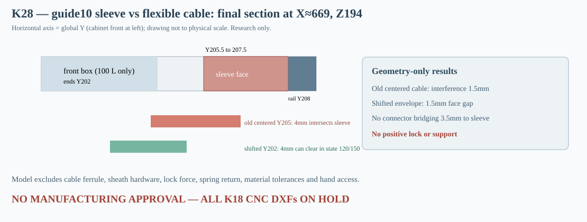

# K28 — integrated sleeve/cable interference: a shifted route helps only in the correct service states

**4 November 2026 — CNC HOLD.** Two independently performed K27 investigations suggested (i) a sliding through-sleeve around the sectional guide10 and (ii) an actuation cable along a narrow Y205 route. K28 tests the **combination**, including interference with the sleeve while it translates over the joint. Nominal geometric access is not a positive load-bearing lock.

## Reproducible source geometry

[K27 sleeve](K27_tuleja_przesuwna_i_brak_blokady_osiowej.md): 21×17×50mm outside, 2mm walls, 0.5mm hypothetical radial gap around guide10, split global Z194. Its **front wall** occupies X659–680, Y205.5–207.5, Z169–219. [K27 cable](K27_linka_zdalnego_odblokowania_i_kolizja_plytki.md): 32-segment approximation of a nominal R15 quarter bend from the front Ø355.8 bore to a lateral X669.5 termination at Z194. Each of 34 motion segments is swept as a complete square AABB envelope.

K28 reconstructs the same route while varying lateral **Y termination height** and square outer envelope width, checking K15 cabinet, all currently installed K15 modules, K17 rails/reference lips, rear 50mm mat and the four sleeve walls. It also checks the actual sleeve wall swept prisms from the fully preloaded position (Z119–169) to its bridge position (Z169–219).

## Critical cross-study contradictions and resolutions

With the **original cable endpoint Y205** and **4mm square envelope**, the final lateral segment covers Y203–207, overlapping the sleeve front wall's Y205.5–207.5 by **1.5 mm**. It is therefore INVALID to combine the independently passing K27 results unchanged. Moreover the original K25 2mm front plate X661.5–677.5/Y206–208/Z169–219 occupies **1,200 mm³** of the identical material space as that closed sleeve front wall: faceplate plus sleeve cannot physically coexist even before considering the cable.

**A state-dependent workaround emerges from the model:** guide10 should only be operated in the **120L and 150L** states, where the 100L-only *front* boxes16–19 are not installed. There an amended cable route to **Y202**, using the same 32-chord assumed R15 bend and a 4mm outer square corridor, clears all nominal solids including the full sleeve, and does **not** collide with the sleeve moving upward by 50mm. It ends **3.5 mm in front of the sleeve face** (envelope's far Y face 1.5mm short), so **it is not mechanically coupled** to the sleeve; a real load-rated connector, latch and actuator are still completely absent.

| Scenario | Outer envelope | Lateral line Y | Result |
|---|---:|---:|---|
| All20 100L, original cable+sleeve | 4mm | 205 | BLOCKED by sleeve |
| All20 100L, forward cable+sleeve | 4mm | 202 | BLOCKED by front100-only box18 |
| Core120L, original cable+sleeve | 4mm | 205 | BLOCKED by sleeve |
| Core120L, forward cable+sleeve | 4mm | 202 | **No nominal collision** |
| Single150L, forward cable+sleeve | 4mm | 202 | **No nominal collision** |
| Core120L, shifted larger flex envelope | 14mm | 198 | No nominal collision, **NOT a rigid screwdriver route** |
| Core120L, tight shifted route | 3mm | 203.75 | No nominal collision but only **0.25mm** separation to sleeve front face |

The latter 3mm Y203.75 envelope ends at Y205.25, only 0.25mm shy of Y205.5. No manufacturing safety factor or realistic tolerance can be concluded from that. A wider bent envelope at Y198 is not a proof that a rigid screwdriver can turn the 90° R15 corner. Even with a cable body geometrically clear, **the last several millimetres of actuator coupling and the load-bearing sleeve lock do not exist** in the current model.

## Preload-and-slide order is not optional

The 4mm square Y205 cable also intersects the **100mm axial swept walls** of the collar during its Z119→219 motion envelope: it cannot simply be connected first and avoid the tube's movement. By comparison the shifted **Y202** envelope clears those same four moving wall volumes (in nominal 120L/150L scene). This establishes a **spatial compatibility condition** for future connector design, not a complete service order with fasteners.

K27 independently found that the **original K17/K18 guide10 integral tongues** physically intersect this sleeve's Z stroke. They must be replaced by independently attachable qualified supports. Removing guide10 eliminates one of two nominal support columns under boxes12–15 and cannot be attempted without a positive temporary load path. K25's screening total of **157.43 N at hypothetical 5g plus 0.2kg each** is load demand, not safe capacity.

## Next K29 design decision

1. Develop an actual **positive axial retention** feature in the sleeve and a finite remote actuation termination in the **Y202 service-state corridor**, specifying a connector that does not intrude into the validated 4mm envelope or cause the sleeve to be inaccessible during switching.
2. Model both latch states with all screws/springs/sheaths, actual cable bend radius, stroke, tool grip and pull-apart force. Include physical tolerance intervals and avoid treating ideal tangent contacts as buildable fits.
3. Provide a load-rated temporary two-point support for boxes12–15 **before guide10 is unlocked**. The remote cable must never be a load-bearing support.
4. Revalidate K24/K26 full 100↔120↔150 sequencing after the added fixtures change access, then cabinet air displacement, stiffness, sealing and tests of metal/MDF pullout, creep, fatigue and vibration.

**Decision:** K28 resolves a conflict between two attractive K27 concepts at the level of route geometry. It does NOT produce a lock, safe servicing, physically verified tolerances or a production CNC file. **CNC HOLD.** [Regenerate program](../skrypty/k28_integracja_tulei_i_sterowania.js) · [All cases](../wyniki/k28_integracja_tulei_linki.json) · [CI](../.github/workflows/k28-sleeve-cable-integration.yml).
