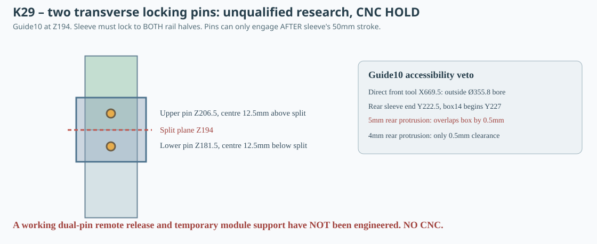

# K29 — finite two-cross-pin retention screen, inaccessible guide10 and unqualified load path

**5 November 2026 — CNC HOLD.** K27 showed that an unpinned sliding sleeve is **not** a positive rail lock; K28 found a geometrically clear nominal Y202 remote cable route in states 120/150 that still terminates 1.5mm before the sleeve wall. K29 tests a genuinely different necessary mechanical feature: **two positive transverse locks, one through each rail half and the surrounding sleeve**, inserted after the full 50mm sleeve stroke. This is a dimensional failure-mode test, not an approved screw, spring or latch product.

## Reference coordinates and candidate interfaces

Guide02 is X175..191/Y224..236, split at global Z250; guide10 is X661.5..677.5/Y208..220, split at global Z194. Both use K27's not-approved 21×17×50mm outer sleeve with a nominal 17×13mm through bore. Two proposed smooth pin axes cross **Y** through the 2mm front sleeve wall, the 12mm-deep MDF rail and the 2mm rear wall. Pins are centred 12.5mm below/above the split, with 25mm sleeve overlap on each half:

| Guide | Lower pin X/Z [mm] | Upper pin X/Z [mm] | Front outer sleeve Y | Rear outer sleeve Y |
|---|---|---|---:|---:|
| 02 | 183 / 237.5 | 183 / 262.5 | 221.5 | 238.5 |
| 10 | 669.5 / 181.5 | 669.5 / 206.5 | 205.5 | 222.5 |

**Both pins must be positively secured against withdrawal and be removable on command.** Placing either pin in the lower/upper rail before sliding the sleeve upward causes an intentional positive interference with the **swept front/rear sleeve wall**. Therefore the correct logical sequence is: position both rail halves → move sleeve +50mm Z → engage both pins → mechanically verify both are engaged. To reverse: safely unload boxes → retract both pins → move sleeve −50mm → separate and withdraw rail segments. Neither pin insertion nor positive retention is actually engineered.

## Direct access and finite head/clearance tests

K29 recomputes conservative 3D AABBs for a trial Ø3mm shank traversing the outer 17mm sleeve depth, for 5mm-square pin-end heads projecting 4mm or 5mm past the rear sleeve face, for an equivalent forward head, and for a hypothetical **Ø14mm straight tool** approaching along Y from the nominal speaker opening. This checks all K15 braces, the mat, other rails and all modules installed in each state.

| Check | Guide02 at 100/120 | Guide10 at 120 | Guide10 at 150 |
|---|---|---|---|
| Straight Ø14mm Y-axis reference tool | **Both axes clear in nominal scene and front-hole projection** | **Neither axis accessible**: X669.5 too far outside driver opening | Neither accessible |
| Rear head 5mm projection | No nominal collision | **Collides with module14** (Y227 forward face) | No module14 present |
| Rear head 4mm projection | No nominal collision | No penetration; only **0.5mm nominal Y gap** to module14 | No module14 present |
| Front head 4mm projection | Clear in nominal scene | Clear in this state | Clear in this state |

Additional counterexample: guide10's 4mm front head **collides with module18 in 100L**; no guide10 servicing is authorized in that state anyway. Not every possible remotely guided pin is ruled out—only this specified direct tool/head configuration. A zero-volume-tangency success does not imply an allowable manufacturing tolerance.

## Orientation-sensitive edge-distance experiment, not a structural standard

With trial pin Ø3mm and hypothetical **Ø3.3mm** MDF hole (or Ø4mm with Ø4.5mm hole), scan the pin axis and two geometric rules **chosen only as conservative screens:** minimum in-plane transverse centre-to-edge ≥2 hole diameters and centre-to-free axial end ≥3 diameters. For axis-Y through a 16mm X width, transverse centre-to-edge is 8mm; for axis-X through the 12mm Y depth, it is 6mm. Axial distance from pin centre to nearest rail-half free end is 12.5mm.

| Trial hole [mm] | Pin axis | In-plane edge-distance ratio | End-distance ratio | Passes these illustrative tests? |
|---|---|---:|---:|---|
| 3.3 | Y | 2.424242 | 3.787879 | Yes, only this screen |
| 3.3 | X | 1.818182 | 3.787879 | No |
| 4.5 | Y | 1.777778 | 2.777778 | No |
| 4.5 | X | 1.333333 | 2.777778 | No |

This does **not** certify MDF bearing, fastener shear, splitting, steel sleeve fatigue or screw tolerance. It suggests investigating slender, through-Y retaining pins for guide02 instead of blindly drilling a wider cross hole in 12mm MDF, but **guide10 remains inaccessible with a straight front-normal tool**.

## Hypothetical five-g load transfer and missing allowables

K25 supplied deliberately assumed +0.2kg hardware per box, MDF density730kg/m³ and 5g for screening, not a legal or actual transport specification. To avoid assuming an equal share across joints, K29 asks what happens if the **entire four-box guide10 5g sensitivity load** is conservatively imposed on one three-millimetre pin.

| Guide group | Combined hypothetical 5g load N | Ø3 double-shear indicator MPa | Two 2mm sleeve walls bearing MPa | 12mm MDF depth bearing MPa |
|---|---:|---:|---:|---:|
| G17_COLUMN_02 | 65.653982 | 4.644069 | 5.471165 | 1.823722 |
| G17_COLUMN_10 | 157.432388 | 11.136063 | 13.119366 | 4.373122 |

These are not safety factors or rated working loads. The actual direction and partition of force across braces, shelf pairs, rail anchors and splice are undetermined. Pullout, creep, impact, joint backlash and MDF coupon strengths are absent.

## Why the K28 remote cable is not yet the missing positive lock

The revised 4mm-square cable envelope at Y202 spans Y200..204 and stops **1.5mm in front of the K27 sleeve face Y205.5**. It cannot simply be declared coupled. With the two pin centres at Z181.5 and Z206.5, a **single control** would have to physically retract **two distinct positive locks**, hold them clear throughout a **50mm axial sleeve displacement**, then guarantee both re-engage in the final locked state. No fork, cam, Bowden sheath termination, spring force, wear, compression or connector-space is modeled. The actuation cable is not a structural support.

The installed rear-large box14 begins Y227. A hypothetical 5mm head projecting behind the sleeve rear Y222.5 extends to Y227.5 and collides by **0.5mm**, whereas 4mm extends to Y226.5 and leaves only 0.5mm gap; this leaves no robust production datum, and positive retention has not been checked.

## Decision / K30 recommendation

**Retain guide02 as a research-only candidate for a physically testable positive two-pin system. Do not retrofit ordinary front-to-back removable cross-pins to guide10 without a demonstrated remotely retracted pair of locks and actual tool clearance.**

Prioritize a comparison between a compact **captive auto-engaging dual detent** with a mechanically demonstrable combined release stroke and an independently supported, gasketed **service hatch / guide cassette**. Both alternatives must have finite CAD solids, positive retention before service, no fall/drop path for boxes12–15 during detachment, a reachable tool/grip envelope, tolerance stacks, load-rated MDF attachments and measured coupons. Repeat the complete K24/K26 service motion with those solids and all three air-volume states before declaring the cabinet ready for CNC.

**All K18 DXFs remain CNC HOLD.** [Generator](../skrypty/k29_dwa_trzpienie_rygla.js) · [Machine-readable results](../wyniki/k29_rygle_poprzeczne_dostep.json) · [CI](../.github/workflows/k29-positive-pin-research.yml).
