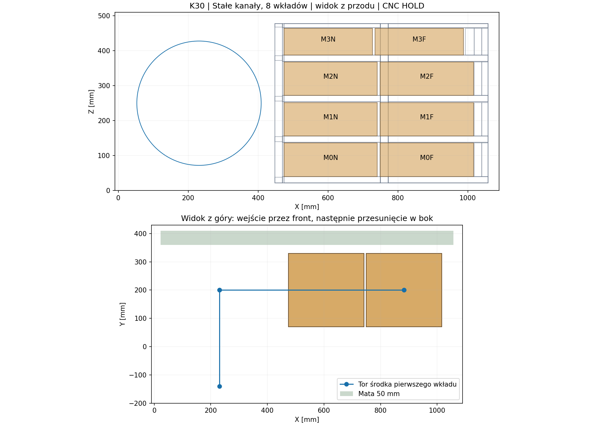

# K30 — stałe kanały i blokady dostępne przez otwór głośnika

**5 listopada 2026. Wariant konstrukcyjny K30-R1. CNC HOLD — nie frezować.**

Polecenie: poprawić podparcie wkładów i przygotować precyzyjne części CNC. Użytkownik wykluczył klapę serwisową: dostęp wyłącznie przez otwór głośnika. Przedstawiony poniżej projekt usuwa konkretną wadę montażową K17–K29, ale nie jest zamkniętą dokumentacją wykonawczą. Nie zastępuje automatycznie dotychczasowej konfiguracji P30E.

## Decyzja konstrukcyjna

Zamiast dwudziestu skrzynek, dzielonych prowadnic i zdalnych rygli badamy **osiem skrzynek w czterech stałych kanałach**. Każdy kanał mieści dwie skrzynki ustawione wzdłuż X. Wkład wchodzi przez otwór głośnika w lewej części obudowy, zostaje podniesiony lub opuszczony do odpowiedniego poziomu i przesunięty w prawo. Najpierw trafia skrzynka dalsza, potem przekładka i skrzynka bliższa. Stałe podpory pozostają na miejscu również podczas regulacji.

Po wsunięciu skrzynek wejście kanału zamyka poprzeczka przykręcana dwiema śrubami. Przewidziano przeloty Ø6 pod modelowe M5, **wyłącznie w płaszczyznach płyt**, oraz osobne metalowe płytki gwintowane za wręgą. Śruby nie mają być wkręcane w wąską krawędź MDF. Podparcie w Z dają dolne listwy; zabezpieczenie przeciwne — listwy następnego poziomu lub górne nakładki. Boczne płaty ograniczają Y; poprzeczka i tylny ogranicznik ograniczają X. Sprężyste przekładki i docisk wymagają doboru po pomiarze, dlatego model nie dowodzi jeszcze braku stukania.

**To zmiana architektury, nie drobna korekta starych DXF.** Zachowano stały front i dostęp od głośnika. Korpus zmienia się z 1020×425×500 na **1080×432×500 mm (X×Y×Z)**. Głębokość samej skrzyni wynosi 432 mm; pozostałe 68 mm limitu 500 mm musi pomieścić wystający osprzęt, osłonę i przewody. Nie uznano tej rezerwy za sprawdzenie całego urządzenia.



[Wektor SVG](../wyniki/k30_stale_kanaly_HOLD.svg) · [model OpenSCAD](../dokumentacja/cnc/K30_STALE_KANALY_HOLD/K30_ZLOZENIE_HOLD.scad). W modelu `state=100`, `120` lub `150` wybiera obsadę; etykiety są celami objętościowymi, nie pomiarami.

## Dane wykonawcy i kontrola zdjęć

Odczytano [ofertę Allegro 17586111495](https://allegro.pl/oferta/elementy-obudowa-glosnika-mdf-na-zamowienie-subwoofer-cnc-na-wymiar-17586111495) oraz [szczegółowy kalkulator DIYkraft](https://diykraft.pl/kalkulatory-allegro-mdf-cnc/kalkulator-allegro-mdf-zabudowa-glosnika/). Parametry do projektu: MDF 8/10/12/18/22/25 mm; wymiar płaski ±0,1 mm; grubość ±0,5 mm; standardowe naroże R4/frez Ø8; brak wiercenia krawędziowego; minimalny bok formatki 50 mm. Przyjęto limity zwykłej wysyłki 1400 mm/bok, suma boków 2700 mm, 30 kg/szt. Allegro opisuje ±0,5 mm jako tolerancję głębokości, strona jako grubości — nie utożsamiać ich bez wyjaśnienia.

Obejrzano grafiki operacji, rozłożenia przykładowej kolumny, formatki, realizacje oraz planszę transportową. Pokazują przykłady obróbki i konieczność podania położeń/głębokości. **Nie dostarczają wymiarów naszego kosza, nośności MDF, kleju, momentu śrub ani zatwierdzenia naszej konstrukcji.** Obrazów sprzedawcy nie skopiowano do repozytorium i nie przedstawiono jako naszego prototypu.

## Geometria i droga sił

| Element | Wymiary nominalne / położenie [mm] | Funkcja |
|---|---|---|
| Front | 2×MDF22; otwór referencyjny Ø355,8, oś X231/Z250 | Stała przegroda przednia; mocowanie kosza nadal otwarte |
| Wręga wejściowa | X448–470; MDF22, cztery otwory R4 | Prowadzenie i mocowanie poprzeczek |
| Wręga środkowa | X750–772; MDF22, cztery otwory R4 | Skrócenie rozpiętości podpór |
| Podpory | MDF18, szerokość 50, odcinki 280 i 286 | Dwie listwy pod każdą skrzynką |
| Płaty boczne kanałów | MDF8; Y60–68 i Y332–340 | Ustalenie poprzeczne i ciągłe klejenie krawędzi podpór |
| Poziomy dna skrzynek | Z40/156/272/388 | Cztery kanały |
| Duża skrzynka | 267,1×260×96, sześć sztuk | Około 6,667 l wyporności każda |
| Mała skrzynka | 253,0×260×76, dwie sztuki | Około 4,999 l wyporności każda |
| Blokada standardowa | MDF18: 306×50; nosek MDF22: 80×50 | Dwie modelowe śruby M5 w metalowych płytkach |
| Blokada wydłużona | Poprzeczka + modelowy zamknięty profil 20×20 | Utrzymanie pojedynczego dalszego wkładu przy nastawie środkowej |

Listwy są **rozcięte na końcach wręgi środkowej**, a nie nałożone na jej materiał. Każdy odcinek styka się z wręgą i płatem bocznym. Pozostało sprawdzenie nośności klejenia, MDF, metalowych płytek i zespołu blokady. Płytki w modelu to skończone obwiednie, nie wybrany produkt ani gotowy rysunek warsztatowy złącza.

Konserwatywny wskaźnik belki podpartej tylko na końcach, bez pomocy ciągłej spoiny: dla założonych 5g, E=2700 MPa, dwóch skrzynek i podziału na dwie listwy otrzymano około **63,2 N/listwę, 1,67 MPa i 0,47 mm ugięcia** na przęśle 286 mm. To nie współczynnik bezpieczeństwa. Nieznane są dopuszczalne naprężenia, pełzanie, zmęczenie i nośność złącza. Nie przenosimy dawnych wyników MES P30E na nową skrzynię.

## Co rzeczywiście sprawdzono

[Generator](../skrypty/k30_stale_kanaly_cnc.py) sprawdza ciągłą objętość przemieszczaną na każdym prostoliniowym odcinku przez sumę Minkowskiego prostopadłościanów. Nie jest to kontrola kilku nieruchomych klatek.

- 8/8 skrzynek: wejście przez kołowy otwór, zmiana wysokości, przesunięcie do kanału i opuszczenie o 0,6 mm na podporę; kolejność dalsza → bliższa.
- 4/4 przekładek: osobne tory między skrzynkami.
- 5/5 zespołów blokad: cztery standardowe i wydłużony dla poziomu drugiego; kontrolowane są skończone bryły, nie same osie śrub.
- 8/8 podejść modelowego narzędzia 60×20×20 mm. **To założona obwiednia, nie zmierzony klucz lub dłoń.**
- Brak dodatnich przecięć stałych brył i wkładów. Przejścia obejmują matę oraz w odpowiednich torach płytki metalowe; końcowe styki nośne są dozwolone.
- Minimalny zapas promieniowy na wejściu: około **35,99 mm dla wkładów i 17,39 mm dla blokad**. Dotyczy prostokątnych obwiedni przy wskazanej orientacji, nie dowolnej manipulacji.
- Niezależny odczyt **102 DXF**: jednostka mm, obrysy zamknięte, brak zerowych krawędzi, zgodne gabaryty, otwory wewnątrz części, łuki R4 i dopuszczalne nominalne grubości. Wszystkie formatki mieszczą się w odczytanych limitach gabarytowych; masa oceniona z założonej gęstości.

Odwrócenie tych samych torów daje kontrolę demontażu w odwrotnej kolejności. Nie dowodzi ergonomii, tarcia, uchwytu ręką, montażu w pionie ani obsługi obciążonej skrzyni. **Do regulacji potrzebna jest stabilna orientacja z kanałami poziomo, odłączenie i wyjęcie głośnika oraz podtrzymanie wyjmowanego wkładu.** Bez badania retencji nie wolno uznać transportu ani docelowej drugiej orientacji za zakwalifikowane.

## Objętości

Szacunkowy bilans obejmuje nowe wręgi, kanały, ograniczniki, zamknięte wkłady i przekładki. Wyporność głośnika nadal jest założeniem **5 l**, pozostałego osprzętu **0,175 l**; metal częściowo opisują obwiednie. Pełnych 50 mm porowatej maty nie odjęto jak litej płyty. Klej, rzeczywiste podkładki, uszczelnienia, dokładna objętość włókien i mocowanie kosza wymagają aktualizacji.

| Nastawa docelowa | Obsada | Przybliżona objętość powietrza |
|---|---|---:|
| 100 l | wszystkie 8 skrzynek, 4 przekładki | 99,57 l |
| 120 l | M0N/M0F/M1F/M3N/M3F, 2 przekładki, wydłużona blokada | 119,92 l |
| 150 l | bez skrzynek i przekładek; stałe prowadzenie pozostaje | 150,33 l |

Są to wartości nominalne z założeniami, nie dokładność fizycznego litrażu. Ostateczne etykiety trzeba ustalić po kompletnym bilansie, a zmiany geometrii uwzględnić w akustyce i ugięciach obudowy.

## Dlaczego nadal nie wydano projektu do frezowania

Niezależny [audyt tolerancji](../wyniki/k30_niezalezna_kontrola.json) wykazuje konkretny błąd możliwy przy cięciu według wymiarów nominalnych. Dla dna 244 mm pomiędzy dwiema płytami „8 mm” w obrysie 260 mm:

`luz = obrys − t_lewej − t_prawej − szerokość dna`.

Skrajne dopuszczalne wymiary dają od **−1,2 do +1,2 mm**. Ujemny wynik oznacza brak możliwości złożenia. Sama deklarowana dokładność XY ±0,1 mm nie rozwiązuje rozrzutu grubości płyt. Wymiar dna należy wyznaczyć z pomierzonych grubości obu ścian, rzeczywistego obrysu i kwalifikowanej szczeliny klejowej. Dotyczy to również części korpusu i frontu laminowanego. Nie zamieniamy problemu w arbitralnie grubą spoinę.

Przy osobno **założonej** dokładności ustawienia poziomów ±0,2 mm pozostaje około 1 mm skrajnego luzu pionowego w kanale. Ten warunek wymaga przyrządu i pomiaru montażowego; nie wynika z tolerancji CNC wykonawcy.

Do wydania produkcyjnego pozostają trzy grupy prac:

1. **Pasowania i połączenia:** rzeczywista partia płyt, szczeliny klejowe, metalowe płytki z retencją, docisk i przekładki, obciążenie blokady wydłużonej, dostęp prawdziwego narzędzia.
2. **Interfejsy:** rzeczywisty kosz RSS390HF-4, jego osiem mocowań, uszczelka, terminal i pełny obrys zewnętrzny. Fronty DXF celowo nie udają kompletnego mocowania głośnika.
3. **Walidacja zmienionej konstrukcji:** wytrzymałość, sztywność, szczelność, akustyka i używanie w dwóch orientacjach. Wyniki historycznej konstrukcji nie są dowodem dla K30.

Najbliższy krok: dopracować **jedno rzeczywiste złącze poprzeczki z wręgą i model połączenia płyt z uwzględnieniem tolerancji**, zamiast wracać do zdalnych rygli prowadnicy 10. Obecny pakiet można przeglądać i mierzyć w CAD, lecz **nie wysyłać jako gotowego zlecenia frezowania**.

## Odtworzenie i pliki

```
python skrypty/k30_stale_kanaly_cnc.py
python skrypty/sprawdz_k30_cnc.py
```

Python, ezdxf, matplotlib; wersje i hashe wejść zapisuje manifest. [102 DXF i lista części](../dokumentacja/cnc/K30_STALE_KANALY_HOLD/) · [wyniki torów](../wyniki/k30_stale_kanaly_audyt.json) · [niezależna kontrola](../skrypty/sprawdz_k30_cnc.py) · [założenia](../dane/k30_zalozenia.json). Nie wykonano pomiarów ani fizycznego prototypu i niczego nie zamówiono.
