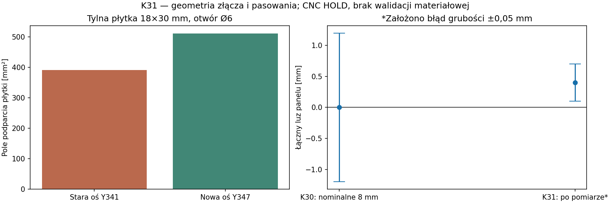

# K31 — poprawione mocowanie blokady i pasowania zależne od pomiaru MDF

**5 listopada 2026. Kontynuacja K30. CNC HOLD.** Dostęp pozostaje wyłącznie przez otwór głośnika, korpus 1080×432×500 mm. Nie zamówiono materiałów ani frezowania. Nie wykonano rzeczywistych pomiarów płyt.

## Poprawka złącza, którą można wskazać na rysunku

W K30 tylna oś śruby była na Y341. Jej modelowy koniec, wystający 5 mm za płytkę, przecina boczny płat kanału Y332–340. Sama możliwość dojścia kluczem nie wystarczała więc do dobrania dłuższej śruby.

**Przesunięto tylną oś na Y347 i poszerzono cztery poprzeczki z 306 do 312 mm.** Przednia oś Y55 pozostaje bez zmiany. Otwory są przelotami Ø6 w płaszczyźnie MDF, pod modelową śrubę M5. Nie powstaje wiercenie w krawędzi płyty.

| Parametr | K30 | K31 |
|---|---:|---:|
| Tylna oś Y [mm] | 341 | 347 |
| Poprzeczka MDF18 [mm] | 306×50 | 312×50 |
| Pas MDF między Ø6 a otworem wręgi [mm] | 2 | 8 |
| Szerokość podparcia tylnej płytki [mm] | 14 z 18 | pełne 18 |
| Pole podparcia po odjęciu Ø6 [mm²] | 391,73 | 511,73 |

Około 31% większe nominalne pole podparcia **nie oznacza 31% większej nośności**. Dla założonej całkowitej siły osiowej 500 N średni nacisk maleje z 1,28 do 0,98 MPa. To średnia, nie lokalne maksimum; nie znamy dopuszczalnego nacisku MDF, pełzania ani napięcia wstępnego śruby. Nie podano momentu dokręcania.



[SVG](../wyniki/k31_zlacze_pasowania.svg). Wszystkie wartości są obliczeniami modelu, nie wynikami próby fizycznej.

## Długość śruby i jej koniec za płytką

Przeliczono 32 skrajne kombinacje dla każdej z dwóch długości. Model obejmuje MDF18 ±0,5, MDF22 ±0,5, podkładkę 1 ±0,1, płytkę 4 ±0,2 i długość śruby ±0,25 mm. **Tolerancje podkładki, płytki i długości śruby są założeniami tego testu, nie zweryfikowaną kartą konkretnego wyrobu.**

- Długość 45 mm przechodzi przez całą grubość płytki w 16/32 przypadków; w pozostałych wejście jest za krótkie według tego kryterium.
- Długość 50 mm przechodzi w 32/32, wystając za płytkę o 3,45–6,55 mm.
- Stara tylna oś powoduje kolizję już przy nominalnych 5 mm wystawania. Nowa oś nie koliduje w modelu nominalnym oraz w odrębnej próbie z powiększoną obwiednią śruby i przeszkód.

Pełne przejście przez płytkę nie oznacza pełnej użytecznej długości gwintu: fazy, wybieg, gwintowanie, klasa śruby i metal wymagają sprawdzenia. **M5×50 jest kandydatem wymiarowym, a nie zatwierdzonym łącznikiem do zakupu.** Mocowanie samej płytki przeciw zgubieniu i obrotowi, nosek dociskowy oraz połączenie wydłużonej blokady pozostają niezakwalifikowane.

## Pasowania: rozwiązanie obliczeniowe zamiast zakładania „8 mm”

W K30 nominalna wkładka 244 mm mogła mieć interferencję 1,2 mm. K31 dodaje funkcję wymiarującą sześć płyt każdej skrzynki według sześciu zmierzonych grubości. Zewnętrzny obrys skrzynki jest zachowany.

Przykładowe zależności dla dna:

`U = L_zewnętrzne − t_XL − t_XR − 2g`

`V = B_zewnętrzne − t_YF − t_YR − 2g`

`g` oznacza nominalną szczelinę **po jednej stronie**. Przyjęte do badania 0,2 mm nie jest jeszcze zaleceniem dla wybranego kleju. Dla nominalnych t=8 mm otrzymujemy 243,6 mm zamiast 244 mm, ale **nie wolno wyciąć tego wymiaru w ciemno**: bez pomiarów nadal możliwa jest interferencja 0,8 mm.

Jeżeli rzeczywista grubość w każdym miejscu styku mieści się w ±0,05 mm względem wartości wprowadzonych po pomiarze, a oba wymiary płaskie mają ±0,1 mm, łączny luz wynosi obliczeniowo **0,1–0,7 mm**. To wynik warunkowy. Nie zakładamy, że użytkownik lub wykonawca już osiągnął taką dokładność. Przy centrowaniu obie spoiny dzielą ten luz; bez przyrządu jedna może się zamknąć, a druga przejąć całą szczelinę. Potrzebna jest kwalifikacja kleju dla rzeczywistego zakresu szczelin.

Szablon pomiaru zawiera `null`, nie fikcyjne liczby. Domyślny przebieg generuje **wyraźnie opisany podgląd**, a tryb `--require-measured` odmawia działania przed zapisem plików, jeśli brakuje wartości i rekordu pomiarowego. Nawet uzupełnione pomiary nie zwalniają całości do CNC.

## Kontrole wykonane lokalnie

- 128 skrajnych zestawów wymiarowania: 64 kombinacje sześciu grubości, dwa typy skrzynek.
- Dodatkowy niezależny test 132 przypadków: powyższe naroża, nominalny i nierównomierny zestaw grubości; kontrola zewnętrznego obrysu oraz każdej szczeliny.
- 21 kontroli ruchu: 8 podejść narzędzia, 5 wariantów blokad i 8 istniejących torów wkładów względem nowych płytek. Nie wykonywano ponownie całego badania drgań lub akustyki.
- 8 kontroli wystającej śruby z konserwatywnie powiększonymi przeszkodami o 0,7 mm na stronę. Ta próba wrażliwości nie jest pełną tolerancją złożenia.
- Odczyt 5 nowych DXF: jednostki, obrysy, położenia otworów i wymiary. Kompilacja modelu OpenSCAD dla nastawy 120.
- Brak pomiarów powoduje oczekiwaną odmowę `--require-measured`; hashe istniejących plików pozostają niezmienione.

Poszerzenie czterech poprzeczek zwiększa modelową wyporność drewna o **0,0216 l**. Nie publikujemy na tej podstawie nowych „dokładnych litraży”: osprzęt i uszczelnienia nadal mają nieustalony bilans. Zamiana wymiarów wewnętrznych paneli nie zmienia zadanego zewnętrznego obrysu zamkniętych wkładów, ale zmienia ilość MDF, kleju i gazu w samych wkładach.

## Pakiet i następny krok

[Katalog poprawek](../dokumentacja/cnc/K31_ZLACZE_I_PASOWANIA_HOLD/) zawiera pięć DXF zastępujących w wariancie K31 `PORTAL` i `STOP_0…3`, poprawiony model złożenia oraz podgląd wymiarów 48 paneli. **To nie drugi kompletny zestaw 102 części.** K30 pozostawiono bez nadpisywania. Nie należy łączyć starej wręgi z nowymi poprzeczkami ani odwrotnie.

Następne zadanie konstrukcyjne: zaprojektować **pozytywne zabezpieczenie płytki gwintowanej przeciw obrotowi i wypadnięciu**, sprawdzić obciążenie noska/poprzeczki, a potem zakwalifikować cały węzeł. Równolegle można uzupełnić rzeczywiste pomiary partii MDF i dobrać szczeliny dla konkretnego kleju. Mocowanie kosza i terminal pozostają odrębnymi brakami całej obudowy.

Odtwarzanie:

```
python skrypty/k31_zlacze_i_pasowania.py
python skrypty/sprawdz_k31.py
python skrypty/k31_zlacze_i_pasowania.py --require-measured
```

Ostatnie polecenie **ma zakończyć się odmową** przy dołączonym niewypełnionym szablonie. [Kod](../skrypty/k31_zlacze_i_pasowania.py) · [test niezależny](../skrypty/sprawdz_k31.py) · [wyniki](../wyniki/k31_zlacze_pasowania.json) · [szablon](../dane/k31_pomiary_szablon.json).
